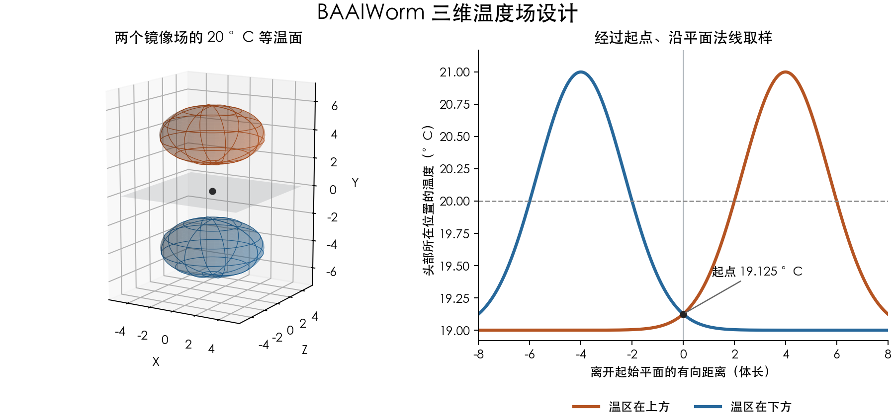

# BAAIWorm 三维温度场

场景用来检验一个行为问题：游动中的线虫能否利用头部温度变化，离开原来的摆动平面并靠近 20 °C？原论文演示了食物吸引条件下的三维游动。其 Fig. 4 的示例以前后运动和一个方向的横摆为主，另一个横向分量很小。[论文](https://www.nature.com/articles/s43588-024-00738-w)



图中的灰面是初始摆动平面，黑点是头部起点。两个椭球各对应一次独立试验。取初始静息体长为长度单位，法向坐标为 h，面内到起点投影的距离为 r，上、下两场分别取 s 为 +1、−1。给定的静态温度分布为

$$
T_s(r,h)=19+2\,2^{-[(r/4)^2+((h-4s)/2)^2]}\quad ({}^\circ\mathrm C).
\tag{1}
$$

场中心为 21 °C，远处趋近 19 °C。20 °C 位于椭球面上，距离起点最近处为两个体长。起始平面上处处低于或等于 19.125 °C，任何完全留在平面内的轨迹都会在两个场中收到相同的温度序列。温度范围、空间尺度与 20 °C 目标均为实验设计参数。这里直接规定静态空间分布，未模拟流体传热。

## 在论文身体上取样

在世界坐标中记录静息时的体长、初始头部位置和初始游动平面法线。体长用身体中心线弧长或伸直时的头尾距离，以与头部世界坐标相同的单位表示。可由同姿态、恒温下的前向游动记录估计摆动平面。图中为方便显示把法线取为 Y；任意初始朝向均可传入对应的世界法线。一对试验共用同一起点、姿态和体长，只将法线取反。整个试验期间场固定在世界中。

把本项目的 src 加入原模拟器 Python 路径。在 BAAIWorm 已创建身体之后初始化场，每次身体更新时调用下面的取样函数。返回值单位为摄氏度；需要开尔文的控制器应加 273.15。世界坐标、场中心和法线只用于环境生成和分析。温度到感觉神经电流的映射以及运动输出需要单独定义。原模型的食物输入与温度量纲不同。[上游身体接口](https://github.com/Jessie940611/BAAIWorm/blob/main/eworm/ghost_in_mesh_sim/worm_in_env.py)

```python
from thermotaxis.baaiworm_temperature import BAAIWormTemperatureField

field = BAAIWormTemperatureField(origin_world, body_length_world, normal_world)
head_c = field.head_temperature_c(interact, worm_id=0)
```

同一个场可以用 `field.temperature_c(world_head_location)` 批量读取上游导出的世界坐标轨迹，返回每一帧的头温。已有轨迹重放只验证感觉输入。重新运行身体且让感觉输入影响下一步肌肉输出，才能测量趋温行为。

## 行为实验

1. 在恒温下记录原有游动，区分身体中心偏移与头部摆动。施加方向相反的肌肉偏置，检验身体能否向摆动平面两侧转向。
2. 在上下镜像场分别从同一姿态启动，另设控制器始终读到起点温度的配对条件。保留自由游动；当头部严格留在平面内时，两个场给出的感觉信号在数学上相同。
3. 用身体中心到 20 °C 的绝对温差、中心处于 20 ± 0.1 °C 的时间占比评价是否接近目标。另报身体中心沿目标侧法线的净位移，以及头部相对中心的法向摆幅。只有头部扫过等温面时，中心的目标区停留时间仍可能为零。
4. 比较 14 神经元、重排连接及 GRU 时，共用身体、初始姿态、感觉信号、肌肉接口和评估时间，单独记录训练预算。136 细胞示例已完成法向、面内镜像温场与恒定读数对照，见[闭环游动记录与温度曲线](reports/baaiworm-136-thermal-2026-11-19.md)。

复现预览图可在项目根目录执行 `PYTHONPATH=src python analysis/plot_baaiworm_temperature.py`。
