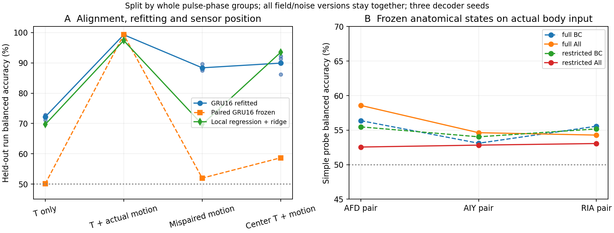
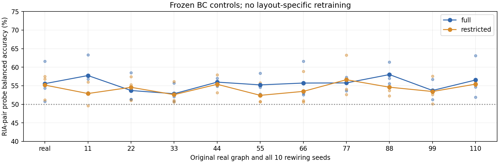

# 阶段三：实际运动参考让头部温度变得可解释

日期：2026-11-03。状态：**已完成**。接续[短期计划](../short-term-neural-physical-experiments-2026-11-03.md)、[神经通路阶段](pathway-stage1-2026-11-03.md)与[身体负载阶段](body-load-stage2-2026-11-03.md)。

## 主要结果

实际头部温度与当前运动参考配合时，可以可靠解码身体轴哪一侧更暖。相同GRU16结构、相同1024次更新，温度单独输入平均平衡准确率为72.19%，加入匹配的实际曲率与因果差分后为99.30%。这些是信息解码成绩，不是趋温导航成功率。

将已经学好的匹配解码器冻结，只破坏温度与运动历史的对应关系，成绩降到51.97%。补充使用连续0.6秒因果延迟，准确率为54.97%，运动参考RMS变化不足1%。因此本数据中有用的不只是额外输入通道或更大运动信号，而包括温度与实际自运动的时间配合。

旧8节点导航模型的冻结状态没有自动实现这项计算。阶段一在规定运动学任务上的进步，也没有自动成为实际身体输入下更好的简单可读表征；需要对接真实身体观察的功能校准。

## 数据与信息权限

复用阶段二32条有负载脉冲的20秒实际轨迹，不重新求解身体。它们没有温度控制器，故改变虚拟温场不会反过来改变轨迹。每条轨迹重新采样8个固定方向、40 K/m线性梯度，以及无噪声和3个1 mK噪声种子；场的常数温度背景独立随机，范围±0.04 K。

在0.1秒观测时钟上构造41点历史。头部曲率由前5个内部曲率样本平均得到，差分只用当前与上一观测，不输入离线Hilbert相位。运动信号以独立正常轨迹3秒后的标准差归一化。温度按原策略接口的float32 Kelvin边界量化。

目标是温度梯度在运动平面身体轴法向上的符号；接近零横向分量（低于梯度大小10%）的样本按事先规则单列。真实梯度和身体朝向只生成监督标签，不作为模型输入。该任务不包含偏好温度学习、趋温决策或实际导航训练。

只保留4秒历史完全位于负载开始之后的窗口，排除不同运行共有的扰动前历史。按完整脉冲相位组划分：训练0／2／4／6，验证1／5，测试3／7；同一轨迹的全部温场、噪声和重叠窗口留在同一组。测试有8条轨迹，属于2个未用于拟合的脉冲相位组，不将数万个窗口当独立重复。

共75,296个窗口：训练38,296、验证19,184、测试17,816。全部条件共享温度和噪声序列；中心传感对照也使用同一噪声实现。

## 4个输入条件与结果

每个条件训练3个GRU16种子，固定1024次更新、批量256、学习率0.003，使用相同批次索引。另用同一局部回归与ridge协议作可解释正对照；正则化强度只在验证组选择。

“冻结”列使用在匹配头部输入上训练好的同一个解码器，直接改变输入，不再拟合。“分别拟合”列使用各自条件的新解码器，回答可补偿性。

| 输入 | 分别拟合GRU16 | 冻结匹配GRU16后直接输入 | 局部回归＋ridge |
|---|---:|---:|---:|
| 只有头部温度 | 72.19% | 50.10% | 69.68% |
| 头部温度＋匹配实际运动 | **99.30%** | **99.30%** | **97.41%** |
| 相同温度＋错配运动历史 | 88.39% | 51.97% | 69.68% |
| 中心温度＋相同头部运动参考 | 89.93% | 58.68% | 93.50% |

匹配组GRU三个种子为99.22%、99.17%、99.52%。只计1 mK噪声时，匹配组仍约99.22%；无噪声不是高分的唯一来源。



温度单独输入并非完全没有信息；其成绩高于机会水平。错配条件重新拟合也能恢复一部分计算，不能说错配彻底销毁了信息。冻结依赖与允许补偿是两种结果，均保留。

中心传感对照只说明在**同一头部运动参考**下，头部测温更便于当前解码；没有检验中心传感器与其最合适运动参考的组合，不推广为所有情况下头部传感都更优。

## 对应关系干预是否真的控制了信号强度

主错配条件将当前已经可用的41点运动历史作随机非零循环时移，曲率与差分一起移动。所有样本仍来自当前及过去；窗口级均方和频谱幅值保持一致。实测最大均方误差6.66×10⁻¹⁶、最大频谱幅值误差7.11×10⁻¹⁵。

它是离线历史对应关系干预，不是连续生物传感器的实际错误流。为排除仅由窗口循环处理造成的解释，初步结果后另登记连续延迟检查：取正常步态周期1/4并取整到观测时钟，为0.6秒。对每个测试窗口精确定位原始身体记录，使用更早的完整曲率历史，不循环拼接，不用未来数据，也不重新训练解码器。

连续延迟的3个种子为62.72%、54.57%、47.62%，均低于其匹配输入约99%的结果。曲率及差分RMS比值分别为1.00185、0.99159。该检查支持时间配合的作用，但登记为补充实验，不伪装成原定主分析。

## 原神经模型能否直接利用实际身体信息

在同一匹配身体输入上，冻结原78个BC骨干与阶段一6个All骨干，共84个；只拟合相同规则的简单表征读出，合计318组分层／整网探针。不再更新神经骨干，不选择表现好的重排图。

| 真实图来源 | 接口 | AFD对 | AIY对 | RIA对 | 全8状态 |
|---|---|---:|---:|---:|---:|
| 原BC | full | 56.37% | 53.11% | 55.57% | 67.97% |
| 原BC | restricted | 55.48% | 54.04% | 55.18% | 61.74% |
| 阶段一All | full | 58.58% | 54.63% | 54.29% | 67.47% |
| 阶段一All | restricted | 52.56% | 52.83% | 53.06% | 55.43% |

原GRU16的冻结状态配简单读出平均84.81%，原GRU2为61.44%。状态维数不同，不能把全部差异归因于解剖布局；线性可读出准确率也不是表征总信息量的完整测量。



图中保留10张重排图全部种子。真实图RIA探针没有显示出明确超出这批重排图范围的优势。

阶段一All仍针对原规定相位接口拟合，本阶段用实际曲率／差分替换旧运动相位槽位，是明确的工程投影。因此上述结果定位到**原表征和当前身体接口不匹配**，不直接等同于真实AFD／AIY／RIA没有能力处理身体反馈。AFD本来编码温度，也不要求单个AFD状态已经代表身体哪侧更暖。

## 生物解释与下一步

Hawk等区分感觉响应与AFD→AIY传递调节；Ji等表明AIY可同时表征温度和运动状态，为感觉与运动背景结合提供依据。[Hawk et al., 2018](https://pmc.ncbi.nlm.nih.gov/articles/PMC5806692/)、[Ji et al., 2021](https://elifesciences.org/articles/68848)

本阶段具体显示：同一局部温度信号，配合当前身体运动，能支持更可靠的方向解释；对应关系延迟后，已经形成的计算会明显失配。身体因此影响神经系统“需要计算什么”和“哪些参照有用”，不仅限制最终动作速度。

这里提供的是理想曲率反馈，不是已经定位到特定细胞的生物感受器，也不是Ji论文的RIM运动指令副本。下一步应在同一实际身体输入下，对受限回路作共同预算的功能校准，再用冻结与重新拟合分开的反馈干预比较布局；不先把当前迁移失败归给神经元数量。

## 验证与复现

主设计、分组、刺激与优化预算在解码前固定。数据哈希、输入轨迹哈希和骨干哈希都保存；循环时移测试验证温度不变、窗口功率／频谱不变及相位组隔离。连续延迟在实际源窗口上逐一匹配，不由近似相位推断。所有冻结测试保持模型文件哈希不变。

项目`tests/`回归207项通过、14条既有警告；其中新增2项解码数据契约检查。阶段二的原生工作程序测试实际执行，没有把缺少程序路径的跳过当通过。

```bash
# 先恢复阶段一、二的冻结证据到默认结果路径；原BC缓存按历史归档恢复。
PYTHONPATH=src python3 analysis/run_active_sensing_stage3.py prepare --root results/active-sensing-reproduction
PYTHONPATH=src python3 analysis/run_active_sensing_stage3.py dataset --root results/active-sensing-reproduction
PYTHONPATH=src python3 analysis/run_active_sensing_stage3.py fit --root results/active-sensing-reproduction
PYTHONPATH=src python3 analysis/run_active_sensing_stage3.py neurons --root results/active-sensing-reproduction
PYTHONPATH=src python3 analysis/assay_frozen_active_sensing.py --root results/active-sensing-reproduction
PYTHONPATH=src python3 analysis/check_causal_motion_delay.py --root results/active-sensing-reproduction
PYTHONPATH=src MPLCONFIGDIR=/tmp/worm-matplotlib python3 analysis/summarize_active_sensing_stage3.py \
  --root results/active-sensing-reproduction --output results/active-sensing-reproduction-report
```

脚本默认引用阶段一、二的固定结果路径；在新机器上将归档的`evidence/`恢复到相应结果目录，并先核对归档清单。以上命令用这些冻结输入在新目录重算阶段三。如果改用重新求解的新轨迹或重新拟合的新检查点，应另行声明输入版本，不能把新旧数据混用。原生静态库跨平台重编译的哈希可能不同，不要求旧机器的编译记录在新平台逐字节重现。

[汇总JSON](assets/active-sensing-stage3-2026-11-03/summary.json)、[输入窗口、全部拟合和探针记录](assets/active-sensing-stage3-2026-11-03/reproduction.zip)、[SHA256](assets/active-sensing-stage3-2026-11-03/manifest.json)。全部4个条件、3个种子、10张重排图和未改善的神经表征都保留。
