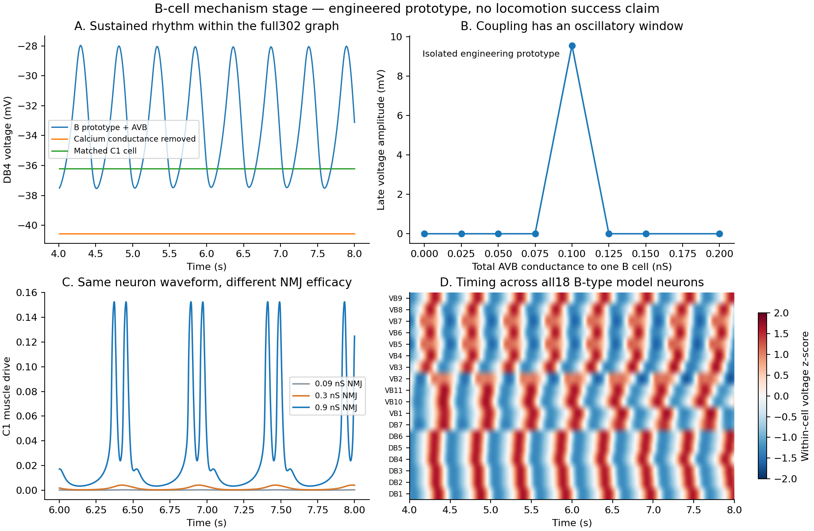

# B类节律与神经—肌肉传递：阶段收束

2026-11-07，按用户“先阶段性收束一下”的要求暂停。本轮已启动的仿真全部结束，没有追加身体扰动或反馈重放条件。

**本轮在模型内验证了B类节律的两个必要环节，并找到了神经振荡与肌肉响应之间的强非线性；尚未实现有效持续前进。**

## 验证了什么

### 1. 18个B类模型在完整302节点网络内保持节律

完整网络始终包含302个神经元、95个C1肌肉细胞、4665条化学连接和1192对电连接。只对18个DB/VB细胞的内在电流采用新的Ca/K原型；其余284个神经元保持C1动力学。没有给肌肉规定行波或给各神经元规定相位。

输入为明确的AVBL/R电位干预：0.5秒前−60 mV，之后持续−20 mV。AVB—B总电导为每个B细胞0.1 nS，按已有解剖连接分摊，双向电流守恒。B类输出的释放阈值为−30 mV，其余连接保留原0 mV；所有比较都记录这些接口改动。

| 完整网络条件 | 时长 | 后半程有持续节律的B细胞数 |
|---|---:|---:|
| B类Ca/K原型，AVB电输入 | 8秒 | 18/18 |
| 同一原型，切断AVB—B电耦合 | 4秒 | 0/18 |
| 同一原型，仅去掉再生性钙电导 | 8秒 | 0/18 |
| 匹配电容、AVB及释放接口的通用C1细胞 | 8秒 | 0/18 |

完整网络内，未接机械反馈的18个B细胞频率约1.82–1.98 Hz，中位数约1.93 Hz。结果将节律来源定位于**该原型的主动膜电流与下降电输入的组合**，而不是神经元数量、预先规定的周期电流或肌肉波形。

这里的“必要”仅针对本组模型条件。没有用这些结果推断真实B细胞的具体离子通道组成或电导值。

### 2. 电耦合并非越强越容易振荡

在冻结的单细胞原型中，分别计算固定点的线性稳定性并积分电位轨迹：

- 0 nS时，静息固定点稳定，无持续振荡。
- 0.1 nS时，固定点特征值为约2.59 ± 11.60i /秒，固定点失稳；时间积分产生约1.92 Hz、9.56 mV幅度的周期活动。
- 0.125 nS时，固定点重新稳定，持续振荡消失。

这验证了本原型中存在受电耦合控制的振荡区间；只采样了8个电导点，尚未精确确定分岔边界。它也解释了为什么“继续统一增加兴奋或耦合”不保证得到所需动态。

### 3. 相同神经波形下，神经—肌肉工作范围决定肌肉是否明显响应

单连接试验把同一个B类原型连接到原C1肌肉，保持神经波形、肌肉通道和释放阈值相同，仅改变NMJ电导。三个条件的突触前电位数组逐元素一致，后4秒的结果如下：

| NMJ电导 | 肌肉驱动范围 | 肌肉驱动标准差 |
|---|---:|---:|
| 0.09 nS | 0.0000219–0.000262 | 0.0000815 |
| 0.30 nS | 0.000276–0.00409 | 0.00130 |
| 0.90 nS | 0.00332–0.15266 | 0.04148 |

电导增大10倍，肌肉驱动的周期波动标准差增大约509倍。这里的非线性来自突触、肌肉膜动态及钙到驱动的组合；不能把它解释为EM连接计数与肌肉力之间存在同一比例关系。

0.9 nS是在三个预先声明的单连接条件中，第一个达到周期驱动峰值大于0.1的条件；随后才用于完整身体对照，没有根据身体速度挑选电导。它仍是工程工作范围假设，未拟合生理NMJ数据。

## 身体层面取得了什么，尚缺什么

增强B→肌肉连接后，完整网络确实能驱动更明显的身体形变。两个条件均使用神经产生的输出，没有外部肌肉波；统计8秒运行的后4秒：

| 条件 | 平均有符号前进速度 μm/s | 后4秒身体中心净位移 μm | 最大局部横向变化 μm |
|---|---:|---:|---:|
| 增强NMJ，反馈关闭 | −0.00858 | 0.0339 | 0.968 |
| 增强NMJ，实际形变反馈开启 | 0.0213 | 0.0850 | 2.112 |

反馈来自身体程序接受的真实两侧长度，按前方名义感受野计算有符号缩短差，再注入B细胞。其电流可从归档的身体长度逐项重算；本轮不是延迟神经电位投影反馈。增强NMJ后，反馈电流峰值约0.321 pA；开关反馈条件的B电位差最大约13.80 mV，RMS约4.98 mV，说明身体状态已经明显影响神经活动。

上述速度仍远低于既定10 μm/s持续前进门槛，净位移也远低于20 μm要求。**本轮验证了节律生成与肌肉传递，观察到神经驱动的身体形变；没有验证反馈能组织有效推进波或适应介质变化。** 所有正式条件只使用一个初始扰动种子，完整身体的新分支也尚未做时间步减半复查。

## 模型与文献的对应边界

原型采用[Xu等（2018）主文方程5](https://www.pnas.org/doi/10.1073/pnas.1717022115)的主动Ca/K结构。[2019正式更正](https://www.pnas.org/doi/10.1073/pnas.1902630116)区分了线性参考模型的4.5 pF与非线性模型的3 pF；本轮使用后者。电耦合0.1 nS也有主文参考。

补充PDF的完整参数未成功取得，因此其余电导、门控中点及时间常数均明确作为工程参数，不能称为论文的精确复现。先后保留了12个孤立细胞候选，其中9个未达到“无电输入静息、有电输入持续振荡”的标准。最终参数按孤立细胞条件中的第一个通过者冻结，再进入身体试验。

两套独立求解器对同一细胞方程的比较中，0.025 ms步长的最大电位差为0.0146 mV；减半后为0.00731 mV。这个检查验证了方程实现和单细胞数值收敛趋势，不替代完整神经—身体系统的步长复查。

[Ji等（2021）](https://elifesciences.org/articles/69905)用相位扰动而不仅是自由运动波形检验节律机制。本阶段下一项原本计划据此进行“同一身体扰动下，实时反馈与冻结反馈重放”的比较；按用户收束要求，尚未启动。

## 保存、验证与恢复位置

- 完成9次完整302网络运行、24条候选单细胞轨迹、8个电耦合稳定性条件、2次独立求解器比较及3次单连接传递试验。
- [机器可读汇总](assets/b-motor-mechanisms-2026-11-07/summary.json)的11项检查通过，覆盖轨迹哈希、节点与连接规模、时间与电位范围、电流守恒、解剖电连接及总电导、无外部肌肉波、实际形变反馈重算、独立求解器和单连接输入一致性。
- [复现归档](assets/b-motor-mechanisms-2026-11-07/reproduction.zip)保存源码、参数、原始轨迹、未通过的参数候选与分析。原C1基线及上一阶段归档保持不变。
- **当前状态：阶段暂停，无仿真继续运行。** 恢复后优先做新分支的完整身体步长复查，以及身体扰动／反馈重放对照，再决定如何研究相位协调；不先进入趋温训练。
