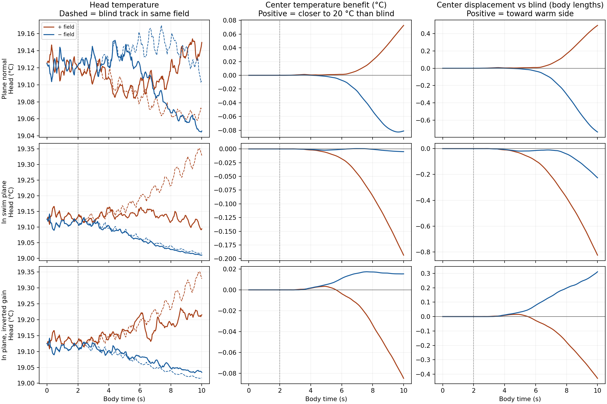
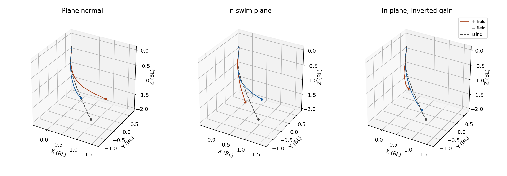

# 136 细胞 BAAIWorm 在三维镜像温场中的游动

在上游 `video_offline` 身体和神经回路上，头部温度反馈改变了运动神经元膜电位、肌肉指令和身体轨迹。三对镜像温场中，没有一对在两个热源方向上都比恒定读数对照更接近 20 °C。六次闭环游动在观察窗内均未进入目标温带。这一结果适用于本次姿态、时长和感觉接口。

## 身体离 20 °C 有多近

每个条件从同一姿态运行 10 秒，前 2 秒保留原游动输入。以 984 个身体网格顶点的平均位置作为身体中心，用当地温度到 20 °C 的绝对误差评价趋温。对照始终读到 19.125 °C，保留原游动驱动。把这条对照轨迹放入各自的温场重新计算实际温度，使每项比较使用相同的热源位置。表中前三个数值列均以正值表示改善；末列是相对对照朝暖侧多游出的体长（BL）。

| 热源方位 | 感觉电流增益 | 自身误差减少，2→10 s (°C) | 相对对照，10 s (°C) | 相对对照，8–10 s 均值 (°C) | 10 s 相对暖侧位移 (BL) |
|---|---:|---:|---:|---:|---:|
| 平面法向 + | +0.02 nA | −0.0003 | +0.0727 | +0.0461 | +0.495 |
| 平面法向 − | +0.02 nA | −0.0620 | −0.0811 | −0.0732 | −0.736 |
| 平面内 + | +0.02 nA | −0.0153 | −0.1935 | −0.1375 | −0.825 |
| 平面内 − | +0.02 nA | −0.1017 | −0.0049 | −0.0032 | −0.226 |
| 平面内 + | −0.02 nA | +0.0932 | −0.0850 | −0.0587 | −0.429 |
| 平面内 − | −0.02 nA | −0.0814 | +0.0154 | +0.0160 | +0.311 |

法向正场说明了区分两个指标的重要性。闭环身体从 2 秒到 10 秒几乎维持原温，获得的 +0.0727 °C 优势来自对照游向了更冷处。翻转热源后，闭环身体反而比对照离目标更远。面内反转增益后，正场身体自身升温了 0.0932 °C，但同方向对照升温更多。按 2 秒后 240 个身体采样时刻统计，六组的中心温带占比（20 ± 0.1 °C）和各自的对照占比都是 0%。同一姿态的逐帧样本没有作为独立重复进行显著性检验。[逐条件指标](assets/baaiworm-136-thermal/summary.json)



上图最左列虚线表示恒定读数对照的头部实际经过的温度；竖线为反馈开启时刻。下图给出相对起始身体中心的三维轨迹，三幅图共用坐标尺度，圆点为 10 秒终点。



## 热信号如何进入身体

- 温场固定在世界坐标，起始头温为 19.125 °C，暖中心位于起点外 4 个体长，起点距最近的 20 °C 等温面为 2 个体长。法向来自先前原生游动的标定，面内轴由世界 X 轴投影得到。两种方位均使用完整的三维椭球温场，身体可以自由离开初始平面。[温场公式](../baaiworm-temperature.md) · [标定数据](assets/pathway-specificity/body-summary.json)
- 传感器只接收当前头温。令感觉值为 −|20 − 头温|，用 0.3 身体秒的指数平均记录近期感觉值。相对近期平均的变化除以 0.02 °C，经过 tanh 后乘以选定的电流增益，叠加到原演示共用的 15 个输入电流钳。两次修正试验只翻转增益。目标温度和转换规则均由实验指定。原 136 细胞回路、运动解码器和身体参数沿用原版，无额外训练。[感觉接口](../../analysis/baaiworm_136/record_head.py)
- 每次均得到 301 个身体时刻（0 至 10 秒，30 Hz）。每帧先采世界坐标中的头和身体中心，再读取原游动输入、推进 60 个神经子步、记录 80 路运动输出膜电位和 96 路肌肉指令，再由原程序驱动身体。上游的神经时钟每帧推进 0.1 秒，首行位置对应身体 0 秒，首行膜电位对应神经 0.1 秒。归档的 `body_s` 与 `neural_s` 分别标记这两个时钟。
- 每帧检查了实际 15 路钳电流。六组在反馈开启前和对照的神经、肌肉记录逐值相等；以原场公式重算头温与中心温度，均与逐帧记录一致。恒定读数对照的头、中心也复现了早先独立保存的 0–5 秒原生游动样本。反馈期内，运动输出相对对照的 RMS 差为 0.96–3.45 mV，肌肉指令 RMS 差为 0.077–0.150（原模型单位）。[复算程序](../../analysis/baaiworm_136/summarize.py)
- RTX 4060 Laptop（Windows 驱动 595.97，主机 CUDA Toolkit 13.1），WSL2 Docker 的 Ubuntu 20.04 容器运行上游 b99ca5a 的 `neuronXcore`。查看器检测到一个 CUDA 设备，在 Xvfb 下报告 CUDA 图形互操作告警，并在写完数据、按 q 关闭时报告内存释放错误。所有七组均已检查完成标记、帧号、坐标、原始电流与输出数组完整性。[运行日志示例](assets/baaiworm-136-thermal/blind/viewer.txt)

## 对真实连接的解释

当前可以定位到感觉输入已经传到了身体。上游 136 细胞模型含 AIY、AIZ，但缺少 AFD 和 RIA，本次又向 15 个原有入口同步施加了同一标量。该实验能检验这种输入方式能否借助已有游动回路趋温；它对真实 AFD→AIY 通路的充分性、必要性或优势没有直接判别力。[实际加载的细胞和连接](assets/pathway-specificity/demo-circuit.json)

沿真实连接主线，下一步最值得检验的是感觉输入进了哪条通路。可在同一身体上显式加入 AFD→AIY 接口，做一份只交换受体、保持输入数与总强度的对照。先固定感觉波形观察两者的身体转向，再用不同起始朝向做闭环镜像试验，沿用上表的温差指标。这样，即使仍然没有双向趋温，也能区分输入通路没有产生定向转弯与定向转弯没有改善导航。

## 复算和重跑

在仓库根目录，安装项目依赖后用 PowerShell 复算已归档的全部结果和两张图。

```powershell
$env:PYTHONPATH='src'
python -m pytest -q tests/test_baaiworm_temperature.py
python analysis/baaiworm_136/summarize.py docs/reports/assets/baaiworm-136-thermal
```

每次运行的目录中，`design.json` 记录温场和感觉参数，`frames.csv` 包含逐帧位置、温度和电流，`network.npz` 存放运动电位及肌肉矩阵，`done.json` 给出列所对应的细胞顺序。[七组原始记录](assets/baaiworm-136-thermal)

重新生成原生游动需已按上游说明配置的 Ubuntu 容器、`build2/neuronXcore` 和本项目的温度模块。本机配置在 `worm_in_env.py` 末尾调用 `from record_head import install` 及 `install(WormInEnv, interact, "/work/record", "/work/BAAIWorm/Metaworm/data")`；运行脚本把本次记录器放在 Python 模块搜索路径首位。在已配置的 `baaiworm-focal` 容器上，下列命令将结果写入新目录。[上游版本](https://github.com/Jessie940611/BAAIWorm/tree/b99ca5a)

```powershell
python analysis/baaiworm_136/prepare.py
$lab = '/work/thermal136-' + (Get-Date -Format yyyyMMdd-HHmmss)
docker exec baaiworm-focal mkdir -p $lab
docker cp analysis/baaiworm_136/. "baaiworm-focal:${lab}/"
docker cp results/baaiworm-136/. "baaiworm-focal:${lab}/"
foreach ($case in 'blind','normal-pos','normal-neg','plane-pos','plane-neg','plane-inverted-pos','plane-inverted-neg') {
    docker exec baaiworm-focal xvfb-run -a bash "$lab/run_trial.sh" "$lab/$case"
    if ($LASTEXITCODE) { throw "Native run failed for $case" }
}
```
