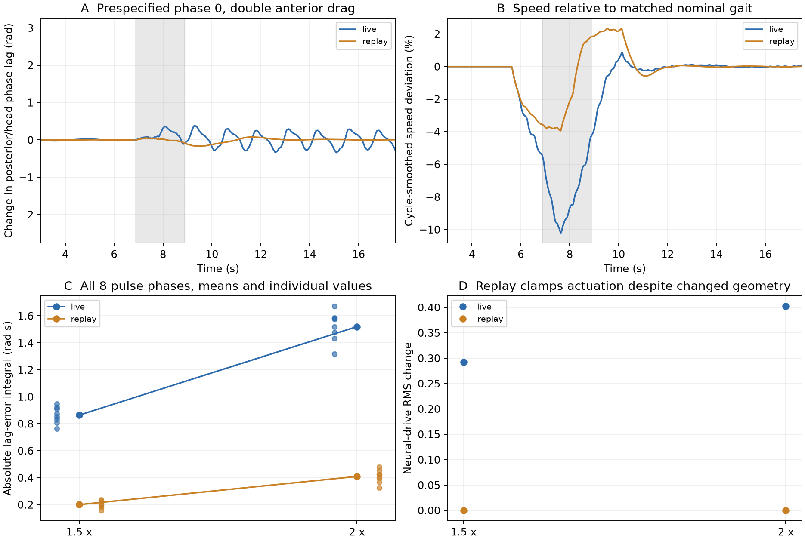
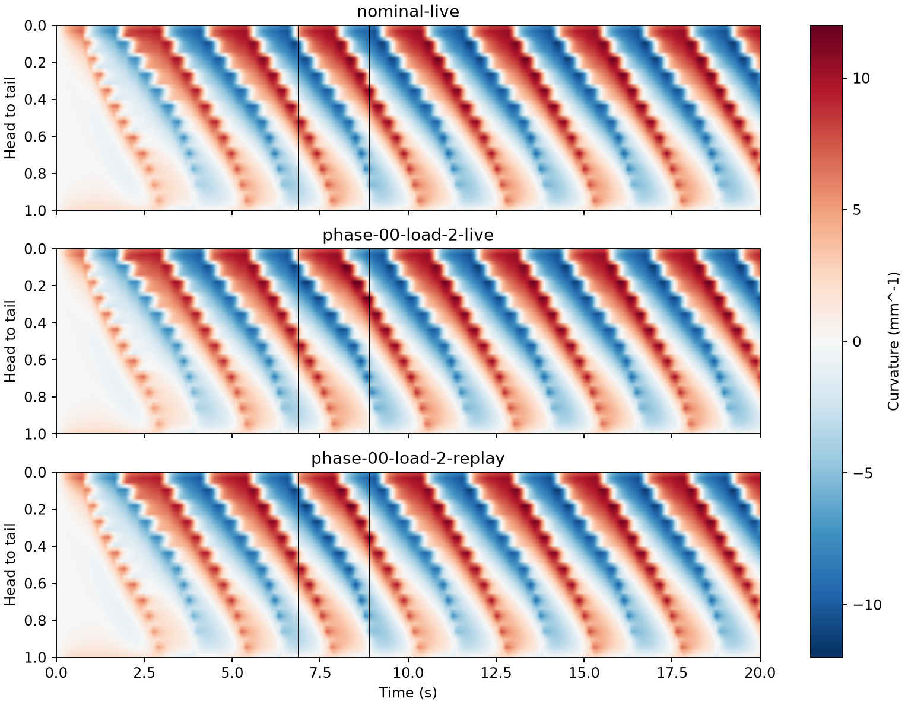
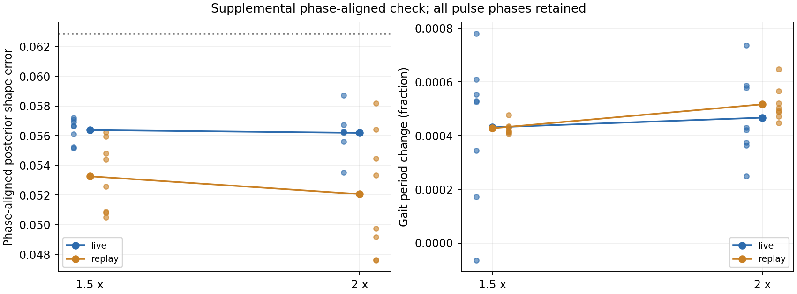

# 阶段二：局部负载、伸展反馈与步态相位

日期：2026-11-03。状态：**已完成**。接续[短期计划](../short-term-neural-physical-experiments-2026-11-03.md)与[阶段一](pathway-stage1-2026-11-03.md)。

## 主要结果

本次小幅、短时局部负载中，**没有观察到实时反馈比正常运动回放有更好的恢复表现**。实时反馈确实改变了运动神经和肌肉活动，但速度基本保持，整体步态主要发生相位重置。将相位对齐后，后期波形和周期均接近正常；不能把固定时钟上的偏差直接称为运动损伤。

这是计划中允许出现的负结果。没有增大负载或挑选相位来寻找反馈占优条件。当前实验使用Boyle简化前行运动网络，尚未将阶段一的8节点控制器接入该身体。

## 条件与因果接口

前进驱动固定0.675、头部偏置0。模型有48段、49根杆、12个简化背腹神经单元，并非完整命名运动神经元网络。前13根杆覆盖前1/4身体的12段；将其纵、横向有效阻力同时乘1、1.5或2，保持各向异性比，持续2秒后恢复。不设置姿态或世界朝向。

实时组使用当前已接受身体状态重建的侧边长度；回放组使用无负载运行在同一1 ms时刻的侧边长度。回放只替换神经伸展输入，实际身体几何、神经实际使用的长度分开记录。

无扰动实时／回放的20秒身体、神经、肌肉、伸展及长度数组逐项完全一致。负载改变后，回放组的神经与肌肉激活仍与正常参考完全相同，而身体几何改变，证明干预隔离了在线形变反馈。

基线头部曲率上穿零点测得周期2.49664秒。首次5秒后的上穿时刻为6.88646秒；以它为起点安排8个脉冲相位。设计2反馈×3负载×8相位共48条协议记录；无扰动重复复用，实际运行34条主轨迹，再加3条步长减半轨迹，共37次求解，每次20秒。求解累计耗时326.35秒，不含编译和分析。

## 原定指标

离线解析相位用于评价前后段波形关系，不进入神经或物理更新。排除最后一个基线周期，减少解析相位的边界影响。以下是8个相位的均值，不是8只生物个体。

| 负载倍率 | 反馈 | 固定时钟相位误差积分（rad·s） | 负载解除后速度平均绝对偏差 |
|---|---|---:|---:|
| 1 | 实时／回放 | 0 | 0 |
| 1.5 | 实时 | 0.86390 | 0.236% |
| 1.5 | 回放 | 0.20059 | 0.277% |
| 2 | 实时 | 1.51981 | 0.446% |
| 2 | 回放 | 0.40958 | 0.469% |



预定的“相位误差小于10°且速度误差小于10%，保持一个周期”恢复指标中，实时组两个负载均0/8达到，回放组均8/8达到。结合速度偏差很小，这提示该固定时钟指标可能混入了步态整体相位改变；没有删除或替换这一结果。



图按事先指定的相位0展示正常、实时和回放，黑线为负载开始／结束。原始逐相位数据保留，不按图像效果选择示例。

## 补充检查：相位重置还是协调受损

看到上述固定时钟结果后，另登记了`phase-alignment-design.json`。采用头部曲率上穿零点界定完整周期，将每周期线性插值为100个相位点；不优化时间扭曲，不按效果删周期。参考为正常运行3秒后完整周期的平均波形，报告负载解除后最后两个完整周期的后半身体形状误差。

| 条件 | 相位对齐的后半身体归一化波形误差 | 后期周期相对基线变化 |
|---|---:|---:|
| 无扰动正常参考 | 5.55% | +0.0376% |
| 1.5倍负载、实时 | 5.64% | +0.0431% |
| 1.5倍负载、回放 | 5.33% | +0.0428% |
| 2倍负载、实时 | 5.62% | +0.0467% |
| 2倍负载、回放 | 5.21% | +0.0517% |

参考本身具有周期间变化，所以“正常”与平均模板的误差不是0。全部条件均有足够的完整周期，没有因表现排除运行。



灰色虚线是正常运行所有参考周期相对平均模板的平均误差6.29%，与表中正常运行最后两个周期的5.55%定义不同。补充分析与原定固定时钟分析分开保存，不把事后对齐当成预先规定的阳性指标。

相位对齐结果支持后期基本步态形状与周期接近正常；本次负载下没有出现必须依靠实时反馈才能维持运动的情况。神经活动差异较大，并不自动意味着最终运动能力差异大。

## 数值验证和复现

典型相位0、2倍负载使用0.5 ms重新计算正常参考和两种反馈。相位误差积分：实时由1.67141变为1.67206，回放由0.39875变为0.39756。两组差值由1.27265变为1.27451，变化约0.15%，没有改变本例固定时钟指标的方向。最大坐标变化约4.98 μm和2.60 μm，未据此声称轨迹完全相同，也未把单例步长检查外推为全参数收敛。

37次运行中，实际侧边长度与独立几何重建的最大差为6.54×10⁻¹⁹ m；保存帧的内部求解器时间没有超出控制时刻。原生新增测试验证无扰动一致性、负载下回放保持肌肉输出、实际几何仍正确记录。项目`tests/`回归207项通过、14条既有警告，身体原生测试均实际执行。

```bash
PYTHONPATH=src python3 analysis/neuromechanics/run_load_feedback_stage2.py prepare \
  --root results/body-load-reproduction
PYTHONPATH=src python3 analysis/neuromechanics/run_load_feedback_stage2.py run \
  --root results/body-load-reproduction
PYTHONPATH=src MPLCONFIGDIR=/tmp/worm-matplotlib \
  results/neuromechanics-stage0-2026-10-27/env/bin/python \
  analysis/neuromechanics/summarize_load_stage2.py --root results/body-load-reproduction \
  --output results/body-load-reproduction-report
PYTHONPATH=src MPLCONFIGDIR=/tmp/worm-matplotlib python3 \
  analysis/neuromechanics/align_load_cycles.py --root results/body-load-reproduction \
  --output results/body-load-reproduction-report
```

须先按[身体接口报告](neuromechanics-stepper-2026-10-27.md)构建固定源版本与基础工作程序。新增源码、局部修改补丁、每次构建参数与二进制哈希均保留；生成源码中的绝对执行路径是该次构建记录，迁移后用脚本重新构建，不运行旧路径绑定的程序。

[原定指标汇总](assets/body-load-stage2-2026-11-03/summary.json)、[补充相位分析](assets/body-load-stage2-2026-11-03/phase-aligned.json)、[源码和全部原始记录](https://github.com/Zlllo/soft-worm-research-platform/releases/download/research-stage-2026-11-09/body-load-stage2-2026-11-03-reproduction.zip)、[SHA256](assets/body-load-stage2-2026-11-03/manifest.json)。原生反馈二进制为本机float64格式，轨迹同时保存为带数组格式说明的NPZ。

## 生物解释与下一步

Wen的实验支持本体感觉参与弯曲传播，Boyle模型则预设了简化耦合机制。[Wen et al., 2012](https://pmc.ncbi.nlm.nih.gov/articles/PMC3508473/)、[Boyle et al., 2012](https://www.frontiersin.org/journals/computational-neuroscience/articles/10.3389/fncom.2012.00010/full)

本次结果说明，在该有效阻力、小局部脉冲、固定前进任务中，原有驱动与身体机械响应已有较强鲁棒性，实时反馈更多地改变了节奏相位。它没有否定其它负载、身体参数或真实运动神经元中的反馈作用，也没有证明增加反馈必然提高每种行为指标。

接下来的主动测温实验复用这些实际轨迹，检验这种相位变化是否改变温度—运动参考的配合。若感觉判断依赖当前实际运动参考，身体与神经的作用就会体现在感觉信息是否可解释，而不只体现在能否维持平均速度。
