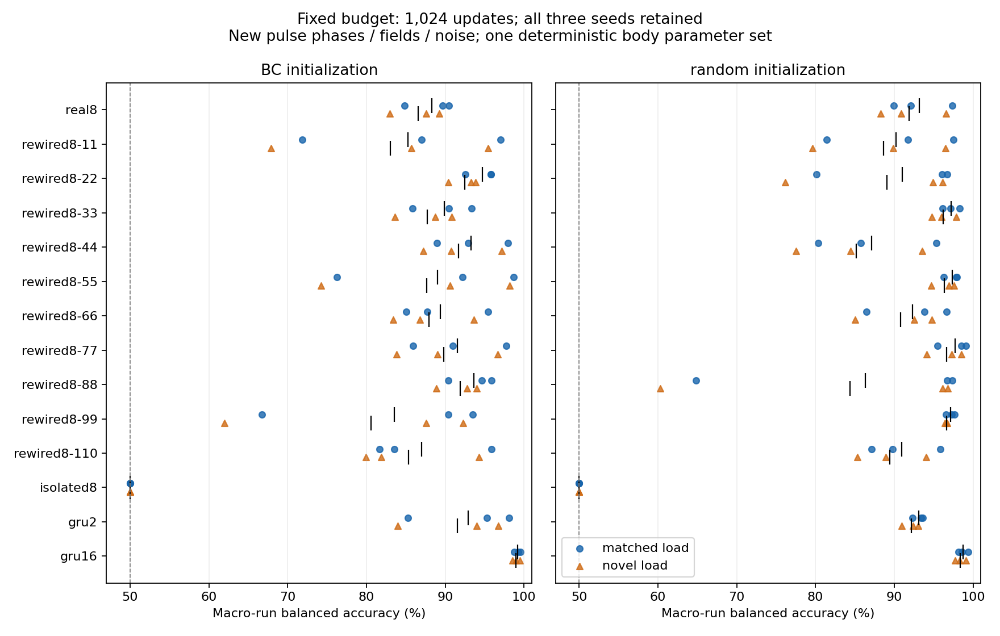

# 身体方向解码：等预算布局对照与新身体病例

登记日期：2026-11-03；完成核验：2026-11-05。状态：**84次拟合、16次新身体模拟和最终评估已完成，按用户要求阶段性暂停**。

真实8节点结构在新相位／温场上的方向解码可达到较高准确率，但没有稳定超过全部10张重排图。真实图BC起点原负载均值为88.33%，随机起点为93.15%。低分可以由功能参数状态及任务接口产生，不能只用“只有8个节点”解释；本轮结果也没有给出真实布局独有的任务优势。

## 设计和评价边界

保留真实8节点、全部10张化学重排图、隔离节点、GRU2和GRU16，各3个种子。BC沿用各自同预算的旧运动学行为克隆模型；random从随机权重开始，两类起点分别报告。每个模型以相同种子批次进行1024次更新，batch256、Adam 0.003，全部actor功能参数可训练；节点、图掩码、8节点模型的0.3秒时间常数、critic和探索参数固定。GRU更新记忆和读出，是容量参考，不是参数量匹配的细胞模型。

训练仅使用原身体数据相位0、2、4、6。旧相位3、7结果保留为诊断。最终检查点直接用于本次新病例，没有根据新病例选择种子或检查点。

新身体模拟为相位3.5／7.5 × 前部阻力倍数0.75／1.5／2／3 × 实时反馈／名义反馈回放，共16次20秒模拟。预先将1.5／2定义为主要的原负载范围组，0.75／3定义为次要的新强度组，各8次。温场方向11.25°+45°k、噪声种子0／149／159／169也是本次新取值。得到34,792个四秒历史窗口，同一身体运行的温场和噪声版本不充当独立动物。

所有病例共用一套确定性的身体参数与起始状态；“新身体病例”指新扰动相位、强度和采样条件。准确率是每条身体运行内先计算平衡准确率，再对运行及3个训练种子平均。标签是身体哪侧更暖；没有训练身体趋温策略。受限模型在AFD接收温度、AIY接收实际曲率及其因果差分、从RIA读出，属于工程输入投影。

## 全部布局结果

| 布局 | BC：原负载 | BC：新负载 | 随机：原负载 | 随机：新负载 |
|---|---:|---:|---:|---:|
| real8 | 88.33% | 86.58% | 93.15% | 91.91% |
| rewired8-11 | 85.28% | 83.00% | 90.22% | 88.67% |
| rewired8-22 | 94.71% | 92.50% | 91.00% | 89.08% |
| rewired8-33 | 89.88% | 87.72% | 97.21% | 96.20% |
| rewired8-44 | 93.24% | 91.71% | 87.14% | 85.18% |
| rewired8-55 | 89.04% | 87.67% | 97.39% | 96.38% |
| rewired8-66 | 89.41% | 87.94% | 92.30% | 90.79% |
| rewired8-77 | 91.56% | 89.84% | 97.71% | 96.64% |
| rewired8-88 | 93.63% | 91.89% | 86.31% | 84.41% |
| rewired8-99 | 83.54% | 80.59% | 97.17% | 96.61% |
| rewired8-110 | 87.02% | 85.37% | 90.92% | 89.45% |
| isolated8 | 50.00% | 50.00% | 50.00% | 50.00% |
| gru2 | 92.90% | 91.57% | 93.10% | 92.15% |
| gru16 | 99.20% | 98.99% | 98.71% | 98.38% |
| 全部10张重排图均值 | 89.73% | 87.82% | 92.74% | 91.34% |



- BC：原负载真实图减重排均值分别为-1.04、-1.62、-1.54个百分点；三种子平均-1.40个百分点。
- random：原负载真实图减重排均值分别为+1.20、-2.22、+2.26个百分点；三种子平均+0.41个百分点。

以上为同训练种子的配对描述；没有把窗口数量当成独立重复计算显著性。重排图全部保留，未筛掉低分结果。真实图与10张重排图在命名节点下的化学连接掩码均不同。所有非隔离图均保留温度／运动输入到RIA的图可达性；这种可达性不能解释不同权重下的具体分数。隔离模型实际关闭跨节点和gap通信，RIA没有温度／运动输入，始终50%符合该接口的结构预期。

## 对当前解释的影响

1. 解剖结构与功能参数要分开。真实图不加节点即可在本次任务中获得较好解码；前一步内部参数1024次更新90.17%、仅输入和读出4096次63.21%的结果，结合本轮多布局结果，更支持先检查输入配合与内部状态。两次实验起点和新病例不同，百分比不能直接作同一对照。
2. 当前任务没有稳定区分真实图与保留通路的重排图。多个布局在学习有效权重后均能完成计算；真实图的细胞身份、符号、效能及统一时间常数仍是简化实现，不能把这里的排名解释为活体网络排名。
3. 身体提供了运动与采样的时间结构。此前匹配运动参考显著改善解码、连续延迟使冻结解码下降，是时序对应的证据。本轮显示多种回路可学习利用这种信息；它没有单独分离弹性、阻力或神经反馈各自的因果贡献。原负载实时反馈恢复未获优势的负结果继续保留。

## 全部训练种子

| 起点 | 布局 | 原负载：种子7／17／27 | 新负载：种子7／17／27 |
|---|---|---|---|
| BC | real8 | 90.49%／89.70%／84.81% | 89.21%／87.57%／82.96% |
| BC | rewired8-11 | 86.97%／97.04%／71.84% | 85.68%／95.41%／67.90% |
| BC | rewired8-22 | 92.54%／95.82%／95.76% | 90.38%／93.25%／93.86% |
| BC | rewired8-33 | 90.45%／93.34%／85.84% | 88.74%／90.84%／83.58% |
| BC | rewired8-44 | 97.93%／88.92%／92.88% | 97.14%／87.25%／90.74% |
| BC | rewired8-55 | 92.16%／98.67%／76.28% | 90.59%／98.21%／74.21% |
| BC | rewired8-66 | 87.72%／95.43%／85.08% | 86.77%／93.62%／83.42% |
| BC | rewired8-77 | 97.76%／90.98%／85.93% | 96.64%／89.04%／83.85% |
| BC | rewired8-88 | 94.63%／90.36%／95.89% | 92.80%／88.86%／94.01% |
| BC | rewired8-99 | 93.49%／66.73%／90.38% | 92.25%／61.95%／87.58% |
| BC | rewired8-110 | 81.65%／95.88%／83.53% | 79.91%／94.31%／81.89% |
| BC | isolated8 | 50.00%／50.00%／50.00% | 50.00%／50.00%／50.00% |
| BC | gru2 | 95.27%／98.13%／85.30% | 93.98%／96.71%／84.00% |
| BC | gru16 | 99.28%／99.56%／98.75% | 98.94%／99.45%／98.57% |
| random | real8 | 92.12%／89.93%／97.40% | 90.89%／88.29%／96.55% |
| random | rewired8-11 | 91.78%／81.42%／97.48% | 89.85%／79.65%／96.51% |
| random | rewired8-22 | 96.08%／96.74%／80.16% | 94.93%／96.11%／76.19% |
| random | rewired8-33 | 97.17%／98.31%／96.16% | 95.96%／97.88%／94.76% |
| random | rewired8-44 | 85.76%／80.36%／95.32% | 84.46%／77.52%／93.56% |
| random | rewired8-55 | 97.89%／97.96%／96.31% | 97.56%／96.90%／94.69% |
| random | rewired8-66 | 93.81%／86.46%／96.62% | 92.57%／85.03%／94.76% |
| random | rewired8-77 | 95.49%／99.10%／98.54% | 94.11%／98.51%／97.31% |
| random | rewired8-88 | 64.83%／96.75%／97.36% | 60.29%／96.17%／96.78% |
| random | rewired8-99 | 96.56%／97.33%／97.63% | 96.43%／96.75%／96.66% |
| random | rewired8-110 | 89.83%／87.11%／95.82% | 88.96%／85.35%／94.04% |
| random | isolated8 | 50.00%／50.00%／50.00% | 50.00%／50.00%／50.00% |
| random | gru2 | 93.40%／92.29%／93.61% | 93.08%／90.97%／92.41% |
| random | gru16 | 98.16%／99.39%／98.58% | 97.71%／99.09%／98.32% |

## 核验、复现和暂停位置

已逐一核对84个模型哈希，并从各自真实起点重新比较全部参数：只有声明的参数发生改变，critic、探索参数和图缓冲区保持不变。独立读取保存预测，重算全部84个模型的四类新病例指标，均与评估记录一致。16条轨迹、生成原生源码及二进制哈希通过检查，原生求解器未越过控制时钟；登记的源码、输入和父级身体依赖哈希一致。项目tests/中**210项通过，14条已有依赖弃用警告**。

另在独立临时目录解压归档、恢复相对路径，不访问原工作区模型和数据，重新评价84个最终模型，evaluation.json与原结果逐字节一致；未重新训练。

复现归档包含本次模型、预测、轨迹、设计、日志，以及登记的训练数据和BC起点。解压后将evidence目录内容恢复到results/body-topology-calibration-2026-11-03，其余目录保留相对路径，即可重做evaluate。身体模拟重建仍需原Boyle固定提交及Sundials构建环境；原构建记录保留机器路径用于溯源，换目录应重新构建worker。归档不含原生二进制，完整原生依赖与二进制的核验在原工作区进行。

```bash
PYTHONPATH=src python3 analysis/body_topology_calibration.py evaluate
PYTHONPATH=src MPLCONFIGDIR=/tmp/worm-topology-report python3 analysis/summarize_body_topology_calibration.py
```

以上是原工作区的评价和报告命令；summarize额外核验本地原生二进制及父级构建环境，在仅恢复归档的目录中先运行evaluate即可。完整重新拟合需在恢复依赖后使用另一个root，按prepare、physical、train、evaluate顺序执行，避免覆盖本轮记录。

[完整汇总JSON](assets/body-topology-calibration-2026-11-03/summary.json) · [复现ZIP](https://github.com/Zlllo/soft-worm-research-platform/releases/download/research-stage-2026-11-09/body-topology-calibration-2026-11-03-reproduction.zip) · [逐文件SHA256](assets/body-topology-calibration-2026-11-03/manifest.json)

本阶段到此暂停。后续AFD→AIY与强度匹配通路干预仅有草稿，未执行、没有实验结果；本次没有增加节点或启动新的训练阶段。
