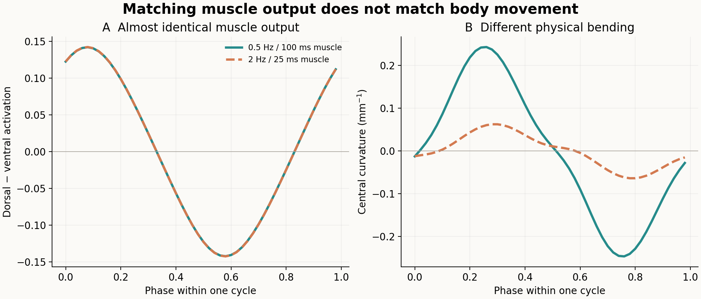
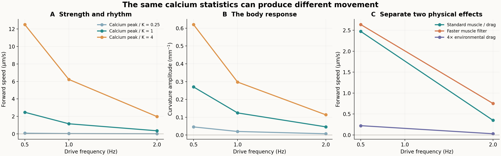
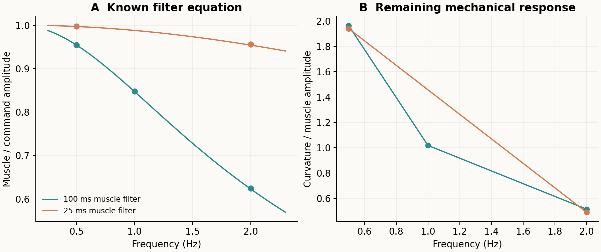
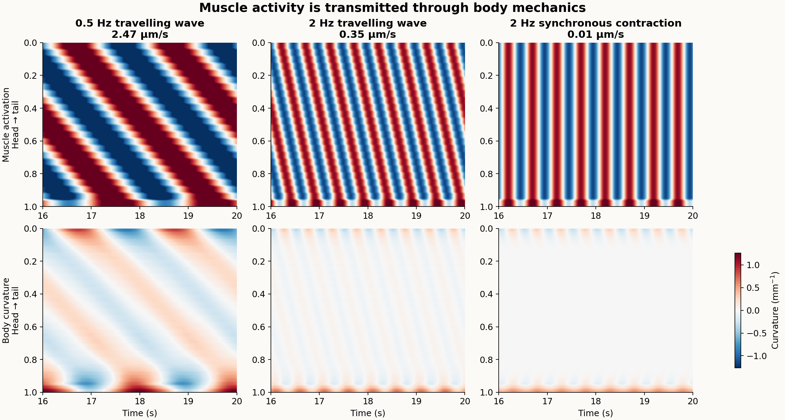

# 钙响应、肌肉节律与身体力学：短期机制结果

日期：2026-11-13。**22条固定条件已完成，4组半步长检查通过。当前模型中，钙响应强度相同，节律变化仍可使推进速度相差约7倍；把实际肌肉波形按周期匹配后，身体弯曲仍明显不同。** 对应[阶段设计](../calcium-body-transfer-2026-11-13.md)。



左图是身体中央通道的实际背腹肌肉激活差，右图是对应中央位置的曲率。两组分别为0.5 Hz／100 ms肌肉与2 Hz／25 ms肌肉，按周期相位显示。全96通道去均值波形的配对RMS差约0.161%，但中央39位置的曲率基频幅度RMS由0.2703降至0.06733 mm⁻¹。它把肌肉滤波与身体机械响应分开：即使肌肉输出波形近似匹配，更快重复也没有产生同样大的身体弯曲。本图和相位配对检查是主结果后的补充解释，不是新增仿真或预登记的单独阳性判据。

## 研究问题

同样一套身体中，钙响应较强是否就意味着推进较好？相同单肌肉钙波形的时间统计量，若节律或空间排列改变，会产生什么不同？肌肉响应时间和环境阻力分别在哪一层产生作用？

本阶段沿用95具名肌肉到48对有效通道的固定平面投影，输入明确规定的钙波，而非新神经元仿真。身体的形状、位置、速度由Boyle物理方程求解，不设定身体曲率或前进速度。这里检验从钙状态到运动的条件性传递规律，不声称完整302网络已经自主运动。

## 钙与物理方程进入算法的位置

当前模型用以下工程映射产生肌肉命令：

\[
a_i(t)=0.3\,\frac{c_i(t)}{c_i(t)+K_c},\qquad K_c=2.5\times10^{-7}\;\mathrm{mM}.
\tag{1}
\]

输入峰值为0.25、1、4倍\(K_c\)。这是模型状态尺度，不能解释为培养液钙浓度、GCaMP荧光幅度或已经校准的动物胞内钙剂量。

命令之后还有既有肌肉响应方程：

\[
\tau_m\dot m_i=a_i-m_i.
\tag{2}
\]

原实现用100 ms时间常数和显式Euler更新。本阶段独立把时间常数改为25 ms，其余方程保持不变，检验改变响应速度的作用。正弦分量的连续幅度增益为：

\[
|H(f)|=\frac{1}{\sqrt{1+(2\pi f\tau_m)^2}}.
\tag{3}
\]

所以“输入更快”并不等于“实际收缩变化更大”。已知滤波方程之后，仍由非线性的主动肌肉、被动弹性／黏性身体与方向阻力共同决定运动。以肌肉实际振幅归一化曲率响应，可以继续区分身体机械效应与前面的简单滤波。

Boyle身体在低惯性近似中求解局部受力与力矩平衡；肌肉改变主动弹性与阻尼，身体与环境的切向、法向阻力参与计算。算法中的动作由这些方程转成真实位移，并非一个动作编号直接对应一次固定移动。[Boyle、Berri与Cohen，2012](https://www.frontiersin.org/journals/computational-neuroscience/articles/10.3389/fncom.2012.00010/full)

## 与真实网络和趋温问题的联系

11月12日完整302／95肌肉模型保持神经—肌肉—身体耦合，但仍未通过完整系统数值收敛与持续推进。本阶段只读取其已有最细步长off／live快照，描述模型钙状态相对工程半饱和尺度的位置及已有驱动；不重跑神经元，也不从未收敛快照推出生理剂量结论。

早期8节点模型的低趋温分数混合了感觉编码、传递强度、动作接口与身体采样等问题。11月3日的独立身体数据解码实验中，温度单独输入为72.19%，加匹配实际运动为99.30%，冻结后错配为51.97%。这支持“运动背景帮助解释温度”的信息处理结果，不是导航成功率，也没有与本阶段串联成完整趋温闭环。[主动测温结果](active-sensing-stage3-2026-11-03.md)

真实动物中，Wen等通过机械约束、肌肉钙成像和B类神经元干预研究弯曲传播；较高环境黏度下弯曲延迟增加。这为研究运动神经、肌肉与负载共同决定节律提供了实验背景，本阶段不能替代该生物实验。[Wen等，2012](https://pmc.ncbi.nlm.nih.gov/articles/PMC3508473/)

## 条件与数值验证

18条主条件、4条预定半步长配对，各20秒，分析8—20秒。频率0.5／1／2 Hz。相同峰值比的频率／相位比较，逐肌肉核对钙与激活的一、二阶时间积分；平方积分仅用于输入匹配，不等于生物耗能。

4组预定半步长配对包括标准0.5 Hz、标准2 Hz、25 ms肌肉2 Hz、4倍阻力2 Hz。它们检验该身体实验的速度与谐波曲率指标，不替代完整302系统的逐时轨迹收敛，也不外推全部未检查参数。

所有条件、假设、运行预算和判据在主仿真前固定，协议SHA256：`2ace72400f5036cace85093189deb25726b58b7086a7a49195cf72fe05048640`。新源码、生成的身体程序、历史输入与逐条轨迹均保存SHA256。既有4项原生肌肉接口检查通过后启动。

## 结果与材料

### 1. 同一钙响应尺度下，节律提高没有提高推进

表中为8—20秒有符号平均前进速度，单位μm/s。每个格子是一条确定性仿真，不是生物重复的均值。

| 模型钙峰值／Kc | 0.5 Hz | 1 Hz | 2 Hz |
|---|---:|---:|---:|
| 0.25 | 0.07297 | 0.03259 | 0.00967 |
| 1 | 2.47161 | 1.15215 | 0.35066 |
| 4 | 12.50806 | 6.22675 | 1.97556 |

每一行中，逐肌肉的钙与激活时间积分及平方积分相同，最大相对差约1.67×10⁻¹⁴；改变的是时间节律。峰值比1时，频率从0.5升至2 Hz，速度下降约85.8%。在所测频率下增加钙幅值均提高了速度，但高钙2 Hz条件仍慢于较低钙0.5 Hz条件。结果没有出现“中等钙最佳”，也没有确定全频率范围的最优点。



图A／B分别展示推进和曲率；每种颜色对应同一钙响应尺度，行内比较保持输入强度统计量匹配。图C只比较峰值比1的物理干预；线段连接已测条件，不是连续扫描或拟合函数。

### 2. 肌肉滤波和身体力学都产生作用

以下四项均使用峰值比1的头到尾波：

| 条件 | 前进速度 μm/s | 曲率基频幅度RMS mm⁻¹ |
|---|---:|---:|
| 0.5 Hz，原100 ms肌肉／原阻力 | 2.47161 | 0.27030 |
| 2 Hz，原100 ms肌肉／原阻力 | 0.35066 | 0.04624 |
| 2 Hz，仅将肌肉时间常数改为25 ms | 0.75191 | 0.06733 |
| 2 Hz，仅将两个方向阻力同时乘4 | 0.02929 | 0.01257 |

原100 ms滤波的实测基频增益从0.5 Hz的0.95446降至2 Hz的0.62459，与Euler递推的解析增益一致。加快肌肉后，2 Hz增益升至0.95575，速度约为原来的2.14倍，但仍低于原0.5 Hz条件。将实际肌肉幅度归一化后，原模型的曲率响应仍从约1.964降至0.513 mm⁻¹／单位激活，说明不能只用前端滤波解释差异。

进一步补充检查：比较原0.5 Hz条件最后一个周期的每4个保存点与25 ms／2 Hz条件最后一个周期的全部点，共50个相位点。命令最大绝对差约3.68×10⁻¹⁵；实际肌肉去均值波形的全通道相对RMS差约0.161%，均值最大差约6.94×10⁻¹⁷。然而后者曲率幅度约为前者的24.9%，推进速度约为30.4%。在肌肉输出近似匹配后，身体机械响应的差异仍然保留。

阻力对照保持方向比40，只把两个系数同时乘4。其钙、命令、实际肌肉数组与原阻力条件逐元素相同，2 Hz速度却降低约91.6%。这直接把差异定位到该身体—环境的物理响应，而不是输入或肌肉激活变弱。这里身体形状由受力求解，并非规定形状，因此不同于旧RFT规定形变模型中“整体缩放阻力只改变耗散、不改变速度”的条件。



### 3. 空间相位仍然重要

在峰值比1、0.5 Hz下，头到尾波为2.47161 μm/s，反向波为−2.34527 μm/s，纵向同相为0.06044 μm/s。2 Hz下对应为0.35066、−0.32768与0.01109 μm/s。单块肌肉钙／激活的一、二阶时间积分匹配，空间相位改变仍显著改变运动；这些是固定相位对照，不是随机相位群体统计。



上排为实际肌肉背腹激活差，下排为身体曲率，共同颜色尺度显示同一身体中不同节律的响应差异。纵向同相虽然周期活动明显，却没有形成同等有效的推进。

### 4. 怎样理解现有完整网络的问题

读取11月12日最细步长记录，后4秒live条件的肌肉钙／Kc中位数约0.1134，95%分位约0.9821，最大约1.0858；off记录接近。它表明现有输出跨越了很宽的工作范围，不能只看峰值说“钙够大”。两批输入的单肌肉幅度、均值和空间模式未匹配，因此不把本阶段速度与该网络速度作直接性能排名。

本阶段为完整网络提供了一个具体解释候选：其约1.9 Hz的B类节律所产生的肌肉输出，需要同时满足身体的响应速度与纵向协调。新实验验证了这些因素在同一身体中的作用，但没有证明它们是旧网络失败的唯一原因；旧完整系统的数值问题仍保留。

### 5. 物理约束在算法中具体意味着什么

当前物理求解器规定“肌肉命令能产生什么运动”，同时引入响应时间、形变耦合及负载依赖。若控制器只追求更强、更快的神经或肌肉活动，并不保证得到更好的运动。可学习部分应以实际身体推进／感觉任务评价，实际肌肉状态与曲率也比单一神经活动幅值更适合诊断传递失败。

本轮没有训练新策略，没有比较学习效率，也没有把上述频率限制写成新的学习损失。它提供了今后选择控制节律、观察变量和物理状态更新方式的模型依据。生物解释、算法改进和数值验证分别保留。

### 验证与复现

- 22／22条条件完成；零输入保持静止；全部轨迹有限、无求解器时间超前。
- 8项主检查通过，包括输入重建、模型滤波解析增益、输入统计量匹配和4组半步长配对。半步长速度差最大约0.00137 μm/s，曲率幅度相对差最大约0.157%。这些结果只覆盖本阶段指定指标与4个条件。
- 另外逐元素核对两种物理干预的输入一致性；阻力干预的实际肌肉输出也完全一致。4项既有原生接口测试通过。
- 原始轨迹、协议、源码与分析锁均保留；未调整参数寻找更好图形，也没有替换完整302主模型。
- 复现包已实际解压，逐文件CRC／SHA256核验通过；仅使用解压目录的数据重算主汇总，与冻结版本逐字节一致。独立核验没有启动新仿真。

复现入口（项目根目录；新仿真必须使用新目录）：

```bash
PYTHONPATH=src python3 analysis/neuromechanics/calcium_body_transfer.py prepare --root results/calcium-transfer-rerun
PYTHONPATH=src python3 analysis/neuromechanics/calcium_body_transfer.py run --root results/calcium-transfer-rerun
PYTHONPATH=src MPLCONFIGDIR=/tmp/worm-transfer-mpl python3 analysis/neuromechanics/summarize_calcium_body_transfer.py --root results/calcium-transfer-rerun --output results/calcium-transfer-rerun-report --plots
```

`prepare`依赖固定历史身体源码、Sundials构建和两个302记录的默认路径；源版本与所需文件随归档保存。身体二进制和静态库为本机macOS arm64构建；其它平台需重新编译。归档中原始源码锁含一条历史绝对路径，独立复算显式将其映射到解压目录，保留原锁字节，避免读取原工作区。主汇总可只用归档内输入重新计算，不需要NEURON或新仿真。

在解压目录独立复算：

```bash
PYTHONPATH=src OPENBLAS_NUM_THREADS=1 python3 analysis/neuromechanics/recompute_calcium_archive.py
```

[全部指标与检查](assets/calcium-body-transfer-2026-11-13/summary.json) · [物理干预逐项核验](assets/calcium-body-transfer-2026-11-13/intervention-validation.json) · [相位匹配补充检查](assets/calcium-body-transfer-2026-11-13/phase-matching-diagnostic.json) · [运动动画](assets/calcium-body-transfer-2026-11-13/matched-input-motion.gif) · [完整复现包](https://github.com/Zlllo/soft-worm-research-platform/releases/download/research-mechanisms-2026-11-13/calcium-body-transfer-2026-11-13.zip) · [归档核验记录](assets/calcium-body-transfer-2026-11-13/archive-validation.json)
