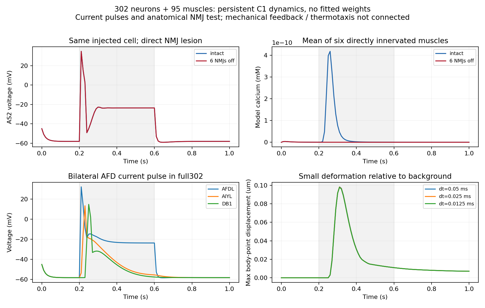

# all302：持续神经动态、肌肉电活动与身体传递

后续状态：实际温度与形变反馈已接入，见[新阶段报告](full302-closed-loop-2026-11-05.md)。以下保留本阶段前向耦合的原始记录。

日期：2026-11-05。**302神经元＋95肌肉的持续动态已实际运行，并通过肌肉驱动接口连接身体。** 本轮完成4个主要条件和3次步长复查，没有训练网络。实际温度输入、身体形变向神经元的反馈尚未接通，因此当前是神经—肌肉—身体的前向耦合，不是完整趋温闭环。

接续[完整网络身体接口阶段](../full-network-body-integration-2026-11-05.md)。当前运行规格命名为`all302-C1-unit-mask`，区分“保留302个命名神经元及解剖连线”和“302个细胞的生理参数均已重建”。real8没有参与本轮运行。

## 实际模型

| 部分 | 实际设置 |
|---|---|
| 神经与肌肉 | 302个命名神经元＋95个命名体壁肌肉，所有状态持续推进 |
| 神经元间化学连接 | 3709条非零有向条目 |
| 神经→肌肉化学连接 | 956条；合计4665条化学连接 |
| 电耦合 | 1091对神经元间、5对神经肌肉、96对肌肉间，共1192对 |
| 电耦合实现 | 每对设置两端电流机制，不把原对称矩阵重复建立成两对；14个神经gap对角条目不建立零作用自耦合 |
| 细胞动态 | 复用固定c302 C1导出的单室电导模型、离子通道、肌肉钙动态和graded synapse；神经元共用GenericNeuronCell，肌肉共用GenericMuscleCell |
| 化学符号 | 缓存中26个GABA来源采用抑制规则，其余来源显式假设兴奋；共4385条兴奋、280条抑制连接，尚未按受体解析 |
| 功能效能 | 每条存在的边使用一个C1基础电导：化学0.09 nS，电耦合0.00052 nS；不把EM数量当成功能效能，不拟合权重 |
| 神经步长 | 主条件0.05 ms；交换1 ms，保存10 ms采样 |
| 肌肉到身体 | 钙经显式饱和映射得到驱动，再通过上一阶段临时二维投影，进入原100 ms肌肉滤波及力学 |
| 背景 | 无5pA示例偏置电流、无PLM示例刺激、无旧身体内置运动回路 |

C1参数来自此前固定提交`d542a44bf2662f79e0ad23342a959a181a920877`及其已验证的NEURON导出组件。本轮直接按Cook矩阵装配这些组件，没有运行默认电子表格或`c302_Full`的示例刺激。所有初始数据、组件源码、模型装配代码与身体二进制均登记哈希。

肌肉到身体使用以下工程映射，不称为真实钙—力标定：

$$a=0.3\,\frac{\max(c,0)}{\max(c,0)+2.5\times10^{-7}\,\mathrm{mM}}.\tag{1}$$

神经和肌肉电活动先保持各自状态推进；每次给身体的命令仅使用交换时刻已完成的钙状态，不使用未来神经状态。身体实际形变已记录，但没有反向注入本轮神经网络。神经肌肉gap使用肌肉膜电位，不能与实际身体应变混为一谈。

## 四个主要条件：每个1秒

在0.2–0.6秒向指定细胞注入5pA，背景条件不注入。AFD条件同时刺激AFDL与AFDR，这是电刺激，不是温度感觉模型。干预条件只把AS2到6个体壁肌肉的化学效能置零，保留其他化学连接和所有gap。

下表均为相对同时间无注入背景的最大变化。身体量为49个点的二维坐标差范数，角度单独保存，没有把米与弧度混算。

| 条件 | 最大肌肉电位变化 | 最大模型钙增量 | 最大身体点位移 |
|---|---:|---:|---:|
| 背景 | 0 | 0 | 0 |
| AS2刺激 | 27.07 mV | 4.24×10⁻¹⁰ mM | 1.06×10⁻⁶ μm |
| AS2刺激，6条肌肉化学输出关闭 | 0.381 mV | 2.40×10⁻¹⁴ mM | 7.15×10⁻¹³ μm |
| AFD双侧刺激 | 74.96 mV | 2.40×10⁻⁷ mM | 0.0983 μm |

AS2的自身电压在关闭输出前后最大差仅4.47×10⁻⁷ mV；6个直接靶肌肉相对背景的钙响应RMS降为原来的6.48×10⁻⁵。这个对照支持当前模型中的肌肉响应依赖所连接的AS2化学输出，不能解释成源细胞没有被刺激。

AFD刺激在AIY及运动层也产生变化，说明在这一组参数下信号可以通过完整网络传播到肌肉。身体最大形变仍只有约0.1 μm，主要是刺激后的短暂局部响应；没有形成持续有效前进。AS2条件的身体位移处于极小量级，不将其计为运动能力成功。

图中灰色区域为电刺激时段。神经元曲线是模型电压；不能把通用C1模型产生的尖峰当作相应细胞的实测电生理。

## 初值、运行和步长验证

先重新装配AS2→MDL07两细胞参照，使用与原c302小例子相同的3倍突触权重、1pA／5pA刺激和3.6秒时长。电压最大差约5×10⁻⁹ V，模型钙最大差约5×10⁻¹⁴ mM，与旧文本输出的舍入精度一致。这个小参照仅检验组件装配，不作为302网络的结果。

过程中保留两项失败及修正：NEURON加载文件时不能处理当前中文绝对路径，改为在已定位目录内加载相对名称；首次组件重建漏设全局钙离子初值，造成起始钙瞬态，补齐与原导出代码相同的初值后通过参照。完整302运行均在这两项修正之后进行。

全部7次完整网络运行的302个神经电位、95个肌肉电位／钙状态及身体记录均有限，时钟对应检查通过；末态1192对gap的成对电流之和为0。项目`tests/`共**221项通过，14条已有依赖弃用警告**。

| 条件和细化 | 保存采样点上的神经电压最大差／RMS差 | 模型钙相对RMS差 | 身体点最大差 |
|---|---:|---:|---:|
| AS2：0.05→0.025 ms | 0.493／0.00598 mV | 0.412% | 5.04×10⁻⁹ μm |
| AFD：0.05→0.025 ms | 11.57／0.379 mV | 2.50% | 0.000844 μm |
| AFD：0.025→0.0125 ms | 7.09／0.196 mV | 1.27% | 0.000424 μm |

AFD较强响应的后两次细化是工程复查，在查看主要条件后登记，没有重新拟合或修改模型参数。身体响应变化较小，差值随细化下降；神经尖峰局部波形仍对步长敏感。**本阶段不宣称神经瞬时波形已收敛，也不分析亚毫秒尖峰时序**，当前导出采样本身为10 ms。

## 目前可以怎样解释

本轮解决的是模型能否实际运行到身体，以及信号在哪一层衰减。增加到302个节点后，神经与肌肉响应并没有自动形成稳定运动。相同化学掩码可以传递信号，但运动还取决于兴奋／抑制、细胞动态、肌肉钙到驱动的尺度，以及背腹空间与时间配合。

在AFD条件中，投影后的峰值指令约0.145，原100 ms滤波后的最大肌肉状态约0.0383，身体仅出现小形变。这个链条给出了后续分别校准电活动、驱动和受力的入口；不能由身体位移小直接推断网络没有信息。当前只有平面肌肉投影，仍丢失左右差异与扭转。

本轮改变了节点范围、动态和输出接口，没有做与旧real8的同条件因果比较，因此不将结果解释成“302优于／劣于8”。下一步优先完成实际温度到AFD的动态编码、形变反馈的接入，以及恒温运动工作区间；在具备基础运动后，再检验删减命令／中间回路的作用。先前的real8方向解码结果继续作为历史诊断保留。

模型层级参考[c302论文](https://pmc.ncbi.nlm.nih.gov/articles/PMC6158223/)。持续推进与刺激接口依据[NEURON仿真控制](https://www.neuronsimulator.org/en/latest/progref/simctrl/programmatic.html)和[IClamp文档](https://www.neuronsimulator.org/en/latest/progref/modelspec/programmatic/mechanisms/mech.html#iclamp)。细胞、突触与肌肉方程使用归档中的固定组件，运行假设以本报告和登记文件为准。

## 材料与复现

[完整汇总JSON](assets/full302-c1-dynamics-2026-11-05/summary.json) · [源码、动态记录与失败记录ZIP](assets/full302-c1-dynamics-2026-11-05/reproduction.zip) · [逐文件SHA256](assets/full302-c1-dynamics-2026-11-05/manifest.json)

入口：`analysis/neuromechanics/run_full302_c1.py`。在已有独立NEURON环境中，用新root依次运行`prepare`、`verify-pair`，再以独立进程运行四个`case`；`--dt-ms`控制神经步长。构建依赖和组件来源固定为本轮登记的先前C1导出及外部肌肉worker，换机器需重新编译内核和身体。归档不包含Python环境和跨机器可用的原生二进制。

当前7次完整运行包括4个主要条件、2个半步长条件和独立子目录中的1个四分之一步长AFD条件。子目录沿用同一设计与组件验证结果；其末级名称保留`AFD_pulse-halfdt`，实际步长以record中的0.0125 ms为准。不得按目录后缀猜测步长。
