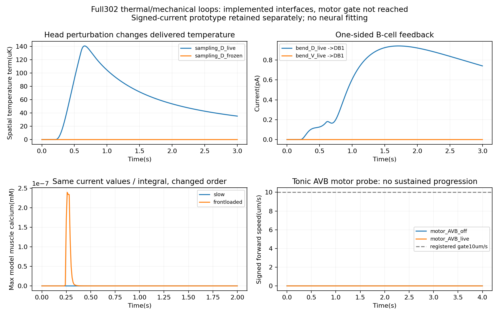

# all302：实际测温、形变反馈与运动门槛

日期：2026-11-05。**实际头部测温和局部形变反馈已接入302网络，完成因果检查；尚未获得持续有效前进，本轮没有启动趋温训练。** 接续[302持续动态与身体传递阶段](full302-c1-dynamics-2026-11-05.md)。

本轮主要结果来自修正后的17次完整302神经元／95肌肉运行：13个主条件、2次数值复查、2个实际采样验证。另保留17次带符号电流原型运行及2次离线输入时序诊断。全部使用同一C1连接与细胞参数，无神经拟合，无real8运行。

## 接入方式与生物依据

环境在每次已完成的身体状态上计算头温，网络感觉接口只收到局部温度。全局位置与梯度不直接进入神经元输入：

$$T_{\rm head}(t)=T_0+\boldsymbol g\cdot\boldsymbol x_{\rm head}(t)+\Delta T(t)+\eta(t).\tag{1}$$

固定梯度为40 K/m，主要升温检查另有0.2–1.2秒的0.05 K环境变化。温度先经0.1秒低通，再以0.05 K响应宽度映射到AFDL／AFDR的0–5 pA电流；阈值用45秒升温、840秒降温适应。后两项时间尺度取自[Hawk等2018的Fig.1J](https://pmc.ncbi.nlm.nih.gov/articles/PMC5806692/)，宽度、低通和电流增益是未拟合的工程值。阈值适应不等于培养温度偏好记忆。

局部机械反馈只进入DB1–7、VB1–11共18个B类神经元。[Wen等2012](https://pmc.ncbi.nlm.nih.gov/articles/PMC3508473/)支持B类参与相邻前部弯曲的感觉耦合，但没有直接给出本模型每个细胞的感受野与电流增益。这里用该细胞同侧神经肌肉输出的名义中心定位前方10个身体段，约200 μm，属于显式空间近似。

背／腹侧应变由实际侧边长度相对初始松弛长度计算。相反侧伸长、同侧缩短构成朝该侧弯曲的信号；均匀伸长相互抵消：

$$I_{B,s}=\operatorname{clip}_{[0,5]}\!\left[500\sum_jw_{B,j}\frac{\epsilon_{j,\mathrm{opposite}}-\epsilon_{j,s}}{2}\right]\ \mathrm{pA}.\tag{2}$$

这不是已测定的机械敏感通道模型，也不是运动指令副本。原302化学／电耦合、钙到肌肉的映射及身体力学均保持不变。神经步长0.025 ms，身体和感觉交换1 ms，导出10 ms采样；神经输入只使用交换时刻已完成的观测。

## 先修正一个接口原型错误

第一版将弯曲信号作为有正有负的电流直接注入C1细胞，部分神经电位低至约−403 mV。有限数值不等于合理工作区间，因此这些运行不用于生物解释。原始数据、代码与有效性标记全部保留。

随后在新目录重新登记：只向弯曲内侧B细胞提供非负兴奋输入，不主动向另一侧施加负电流。空间范围和增益未改变。并在每次交换时检查神经电位位于宽松的[-100,60] mV工程范围内；这不是所有细胞的实测生理边界。新分支全部运行通过此检查，保存电位范围为−67.70至30.87 mV。

## 1. 实际运动确实改变了送入AFD的信号

单独升温时，网络没有形成可观运动，空间温度项几乎为零；冻结测温位置的对照与实际测温结果完全相同。因此另行登记了一个接口检查：给前8段背侧肌肉0.2–0.6秒的0.2驱动脉冲，用物理形变带动头部，再与冻结测温位置比较。这里没有改写身体坐标，也没有把外加肌肉脉冲算作自主运动。

| 配对检验量 | 最大差异 |
|---|---:|
| 实际头部位移 | 3.52 μm |
| 实际位置测温与冻结位置测温 | 0.0001408 K，即0.1408 mK |
| AFD注入电流 | 0.01274 pA |
| 神经电位 | 0.2148 mV |

这验证了身体位置→局部温度→AFD输入→网络活动这一段反馈。它没有证明该网络能够主动产生足够的采样动作。上述运动引起的温变也小于本轮噪声检查所设的1 mK；噪声仅检查了种子7的一条序列，不作稳健性统计。

## 2. 形变反馈到达神经元，却未产生可靠运动收益

恒温下分别施加背侧／腹侧局部肌肉脉冲，比较实时反馈、关闭反馈及回放反馈。背侧实时反馈最大约2.87 pA，腹侧约2.50 pA，同侧B细胞优先收到兴奋输入。

背侧实时与关闭反馈相比，神经电位最大差27.82 mV、全记录RMS差1.55 mV；把背侧反馈错误地回放给腹侧弯曲，神经电位最大差27.00 mV。说明反馈通道没有被忽略，并能区分弯曲方向。

但实时与关闭反馈的身体点差仅1.76×10⁻⁸ μm，小于交换步长复查的4.21×10⁻⁸ μm，按未检出可靠运动效应记录。当前反馈能改变B类电位，却未充分募集肌肉输出，不能把电位变化直接当成更强推进或恢复。

还有一个可用于后续研究物理约束的现象：外加肌肉脉冲在0.6秒结束后，身体形变仍缓慢衰减，实际应变可继续提供反馈。关闭神经反馈的身体也有几乎相同的形状，因此这种持续信号主要来自当前力学模型的状态延续，不能归给神经回路的持续记忆。尚未通过改变阻力／刚度分离其具体来源。

## 3. 定位到一个输入时序与C1动态工作区间问题

实际升温经过感觉低通后，AFD电流峰值达到4.93 pA，但没有明显募集肌肉。为解释这一点，另行登记两次离线电流回放：保留所有电流值、峰值、积分和RMS，把首个非零时刻后的电流值按从大到小排列，形成前置输入。网络、肌肉及力学参数均不变，不接机械反馈。

| 项目 | 原缓慢电流 | 同值前置电流 |
|---|---:|---:|
| 峰值 | 4.9325 pA | 4.9325 pA |
| 电流积分 | 4.9030 pA·s | 4.9030 pA·s |
| 最大模型肌肉钙值 | 3.67×10⁻¹² mM | 2.40×10⁻⁷ mM |
| 最大投影驱动 | 4.41×10⁻⁶ | 0.145 |
| 相对恒温背景最大身体点差 | 约2.17×10⁻¹³ μm | 0.0981 μm |

缓慢输入主要产生逐渐去极化；前置输入产生大幅瞬态，继而募集AIY与肌肉。**在当前通用C1实现中，电流的时间结构及细胞／突触的工作区间会决定传递是否有效，不能只看输入峰值或节点数。** 该干预并未保持频谱，也不是生物上更正确的AFD编码；它用于定位模型瓶颈。最大钙值包含初始背景，不将二者之比直接称为刺激增益。



## 4. 基础运动门槛仍未通过

另对AVBL／AVBR显式持续注入5 pA，分别开启／关闭形变反馈。它是命令细胞工作区间探针，未使用隐藏节律或身体内置运动回路。运行前规定：最后2秒平均前进速度至少10 μm/s，沿该窗口初始身体轴的进展至少20 μm。

| 条件 | 最后2秒平均前进速度 | 轴向进展 | 结果 |
|---|---:|---:|---|
| AVB刺激，反馈关闭 | 3.72×10⁻⁸ μm/s | 7.45×10⁻⁸ μm | 未通过 |
| AVB刺激，反馈开启 | 3.73×10⁻⁸ μm/s | 7.45×10⁻⁸ μm | 未通过 |

模型可产生一次肌肉响应，但没有形成持续的背腹协调推进。运动门槛未通过，继续训练趋温会混合基本运动缺失和温度决策问题，本轮因此不进入趋温训练。

## 验证与下一入口

- 实时反馈在相同条件下回放，升温组和背侧弯曲组的全部保存数组均逐元素完全一致。
- 独立从保存的位置重算实际温度、重算感觉低通／适应电流、从侧边长度重算机械电流，并核对关闭与回放条件。
- 非负反馈背侧条件中，神经步长减半的电位RMS差0.000490 mV；交换间隔1→2 ms时RMS差0.00160 mV，均小于实时／关闭反馈的1.55 mV效应。没有因此宣称全部尖峰波形收敛。
- 项目`tests/`共225项通过，14条已有依赖弃用警告；原C1及身体源文件哈希保持一致。每次运行保存设计、参数、输入、神经状态、肌肉、几何及控制量。
- 在独立临时目录恢复归档，不使用原工作区数据或原生模拟器，重新计算的汇总JSON与原结果逐字节一致。

下一阶段优先校准AFD／突触的动态工作区间和持续运动的募集条件。区分短暂输入引发的神经瞬态、肌肉滤波、身体状态延续与周期性运动，不通过重新添加隐藏节律来填补缺失功能。本阶段没有将302模型的表现解释成对真实活体网络的排名。

[完整汇总JSON](assets/full302-closed-loop-2026-11-05/summary.json) · [数据与源码ZIP](https://github.com/Zlllo/soft-worm-research-platform/releases/download/research-stage-2026-11-09/full302-closed-loop-2026-11-05-reproduction.zip) · [SHA256清单](assets/full302-closed-loop-2026-11-05/manifest.json)

主数据：`results/full302-closed-loop-rectified-2026-11-05/`。实际采样补充：`results/full302-active-sampling-probe-2026-11-05/`。失败原型及离线时序诊断：`results/full302-closed-loop-2026-11-05/`。不同版本分别保存，未覆盖原型。

归档可用保存数据独立重算汇总，不需要NEURON或身体二进制：将`evidence/`恢复为主数据目录，其余文件保持相对目录，再执行：

```bash
python3 analysis/neuromechanics/summarize_full302_closed_loop.py --archive-only
```

动态重跑仍需此前固定的NEURON／C1组件及Boyle／Sundials构建环境。跨机器重建应在新目录登记原生构建哈希，原设计中的机器构建记录用于审计，不修改旧结果。
