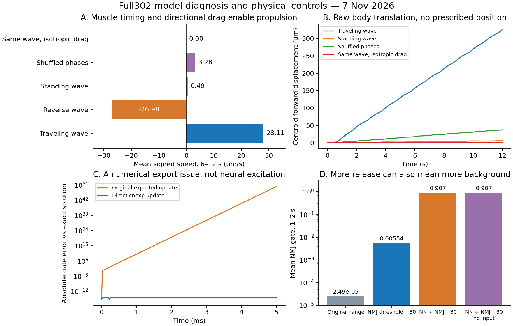
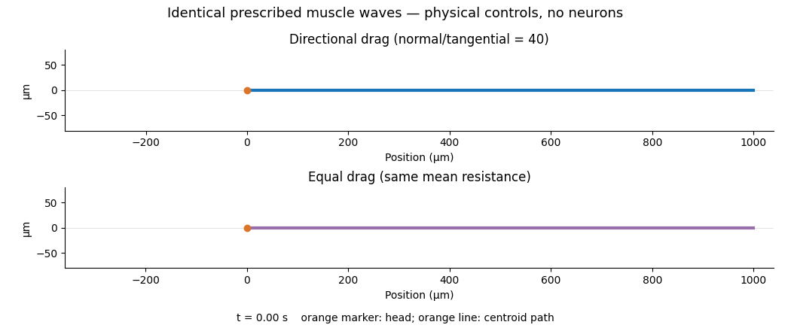

# 完整302网络的传递范围与身体推进机制

2026-11-07。本阶段完成了可见的身体运动对照，定位并修复了一个突触积分问题，也明确了“增强神经活动”与“形成有效推进”的区别。原C1基线、先前的反馈分支和全部失败条件均保留；没有新增趋温训练。

## 1. 身体可以运动，相位顺序与方向阻力有独立作用

这里直接给95块具名肌肉施加周期驱动，再经过既有平面投影、100 ms肌肉滤波和Boyle物理身体。没有设定身体位置、速度或曲率。这是**外部肌肉波的物理对照，不是神经网络产生的运动**。

每个非零条件均运行12秒，频率0.5 Hz、每体长1.5个波长，单肌肉驱动在0到0.3之间。统计后6秒。各肌肉的驱动积分均为1.8，平方积分均为0.405，误差低于1e-12；后者只是驱动幅度的控制量，不等于代谢能耗。

| 肌肉相位／身体阻力条件 | 平均有符号前进速度 μm/s | 后6秒净位移 μm |
|---|---:|---:|
| 头到尾行波，原方向阻力 | 28.114 | 168.599 |
| 尾到头行波，原方向阻力 | −26.975 | 161.763 |
| 所有纵向位置同相，原方向阻力 | 0.495 | 2.973 |
| 打乱纵向相位，原方向阻力 | 3.284 | 19.672 |
| 同一头到尾行波，各方向阻力相同 | 接近0 | 小于1e-6 |

原琼脂参数的法向／切向阻力比为40。反事实条件把两个系数都设为原来两者的平均值，保留平均阻力，仅去掉方向差异。两个条件收到的肌肉命令逐元素相同。各向同性条件仍发生形变，身体中心保持不动，因此结果不是程序停止更新。

这给出两个可直接解释的模型结果：纵向相位关系决定了这些收缩能否组织成有效推进；身体—环境的方向阻力将内部形变转成平移。相位打乱保留了单肌肉周期、幅度和驱动总量，但速度下降约88.3%。本轮只有一个打乱种子，数值是机制对照，不是随机相位群体的平均效应。

[Boyle、Berri与Cohen（2012）](https://www.frontiersin.org/journals/computational-neuroscience/articles/10.3389/fncom.2012.00010/full)提出的神经—身体模型以真实形变反馈解释介质变化下的步态调制。本轮直接肌肉波实验检验的是它的身体部分；尚未检验反馈能否在介质变化后重新组织神经节律。

## 2. 完整网络存在弱释放问题，但全体增强会抬高背景

本组始终包含302个神经元、95个C1肌肉细胞、4665条化学连接和1192对电连接，沿用原有解剖掩码、单位连接电导及身体投影。比较的是突触释放阈值的敏感性，不把−30 mV当作已经测定的细胞参数。AVBL/R或AFDL/R各注入5 pA，从0.2秒持续到试验结束。

以下条件均使用本报告第3节的独立数值修复分支，表内释放门控为1到2秒的NMJ平均值：

| 条件 | 平均NMJ释放门控 | 2秒末最大平面肌肉驱动 |
|---|---:|---:|
| 原阈值0 mV，AVB刺激 | 0.000024925 | 约2.9e-7 |
| 仅NMJ阈值−30 mV，AVB刺激 | 0.00553526 | 约4.69e-4 |
| 神经间与NMJ均−30 mV，AVB刺激 | 0.906755 | 约0.102 |
| 神经间与NMJ均−30 mV，无刺激 | 0.906743 | 同量级 |

仅改变NMJ释放范围，平均释放增大约222倍；神经间传递未同时增强，B类细胞仍接近静息状态。两类连接一起下移后，肌肉能持续受到更强驱动，但无刺激条件也几乎同样激活，说明这一全局改动主要提高了背景，不能当成改善了感觉—运动信息传递。

进一步将后两种条件延长到4秒：AVB刺激条件后2秒平均有符号速度约−0.000291 μm/s，总身体中心位移约0.000577 μm；无刺激条件分别约−0.000288 μm/s和0.000571 μm。两者都没有通过既定的持续前进门槛。仅下移NMJ阈值的AFD刺激条件同样未产生有效推进。

因此，当前结果支持“释放工作范围影响传递”的模型解释，也排除了“只要让所有节点更活跃就能走起来”这一简单修复。后续需要区分感觉输入的选择性传递、运动神经元的节律生成和纵向相位组织。

## 3. 已修复一个会干扰上述解释的积分问题

原导出文件写了`METHOD cnexp`，但把状态导数先存入中间变量`rate_s`。实际生成的C++是显式更新`s += dt*rate_s`，没有得到线性门控的指数更新。阈值下移后，某些电位区间的门控时间常数短于原步长，遂产生巨大负门控与电位发散。

单突触控制实验固定突触前电位12 mV、阈值−30 mV，门控时间常数约0.008993 ms，使用0.025 ms步长运行5 ms。原导出更新的最大门控误差约1.22e50，超出0到1范围；将状态导数直接写成`(inf-s)/tau`后，生成器正确使用指数更新，对解析解的最大误差为2.22e-16。原来的快速释放重置规则保持不变。

修复只存在于新的`kernels-direct-cnexp`目录，原神经元、肌肉离子通道、连接图及原导出文件未改动。原失稳条件与失败记录均保留；没有将发散解释成生物神经元放电增强。

完整网络另做了步长复查。0.025与0.0125 ms下，平均NMJ门控相对差约0.00125%，近零推进结论一致；但末时最大肌肉驱动差2.84%，未通过预设2%标准，因而追加0.00625 ms复查。后两种更细步长的差异降至1.43%，通过该标准。最终复查结果和未通过的初次检查分别记录在阶段汇总与`initial-validation.json`中，不能将粗步长的所有峰值视为已收敛。

## 4. 公开整合模型的运动示例还需要工作范围审计

本轮也审计并运行了[modWorm预印本](https://arxiv.org/abs/2504.18073)及[固定提交的作者代码](https://github.com/shlizee/modWorm/tree/10912b4e09c72ba3430573f0b93a48c6e86b5614)。原代码预设为279个神经元；本轮独立参考分支将其推广到302个具名神经元，使用Cook连接计数和95块肌肉的代数读出。它的神经方程、计数到电导的规则、肌肉读出和24段杆体都与原C1分支不同，结果不能直接作为两个神经模型的性能排名。

需要特别区分：代码中的反馈是延迟600 ms的神经电位，经肌肉映射与伪逆投影后返回神经电位计算；该函数没有使用传入的身体形变。这是延迟神经反馈近似，与本项目先前实际测得身体应变的反馈不同。

| 302节点参考条件 | 电位范围 mV | 身体中心净位移／体长 |
|---|---:|---:|
| 作者PLM示例波形，峰值约3000 pA，4秒 | −7.80到1577.62 | 0.19175 |
| PLM 5 pA，平衡起点、直体，10秒 | −7.50到0.068 | 0.0000443 |
| PLM 50 pA，同一起点，10秒 | −7.50到20.10 | 0.004573 |
| 无输入，同一起点，10秒 | −7.50到−0.230 | 0.0000235 |

强刺激在这个适配分支产生了可见运动，也把电位推到上千mV，因此不采用它作为生物运动成果。较弱刺激的结果保留用于工作范围比较；它们尚未形成可用于趋温的稳定前进。本轮没有声称原论文的全部结果已被复现，也未继续执行被该电位审计淘汰的强刺激分支消融。

## 5. 生物解释与下一阶段的明确方向

目前已经能把“身体不能走”和“网络没有组织出推进命令”分开：前者被物理行波对照排除；当前神经分支的问题集中在有效传递、背景激活与运动相位组织。完整解剖节点数不能替代这些动力学条件。

[Xu等（2018）](https://www.pnas.org/doi/10.1073/pnas.1717022115)提供了更具体的生物机制：AVB—B电耦合可使B类神经元进入振荡状态，本体感觉再协调波传播。结合本轮结果，下一阶段优先做**B类细胞特异的动力学与AVB—B耦合验证**，先检验是否存在可重复的节律状态，再接入实际应变反馈检验相位传播；不继续对所有神经元统一降低阈值。

验收顺序为：细胞／小回路工作范围与数值收敛→302网络内B类节律→神经产生的肌肉行波与持续前进→介质变化后的真实形变反馈适应。只有持续前进通过后，才进入AFD驱动的趋温任务。

## 数据、验证与复现

- 原始结果分开保存在`results/full302-operating-range-2026-11-07`、`results/body-phase-coordination-2026-11-07`、`results/body-isotropic-drag-2026-11-07`和`results/full302-modworm-reference-2026-11-07`。
- 完成18次C1完整网络运行、9次身体对照、4次独立模型参考和2次单突触解析检验；另保留3次C1失稳，其中首次只保留失败记录，后两次包含失稳轨迹。[机器可读汇总](assets/full302-mechanisms-2026-11-07/summary.json)包含全部条件、失败记录、时间步差异和16项最终检查。检查包括解析解、完整节点与连接规模、时间和电位范围、输入积分匹配、肌肉命令逐元素一致、身体确实形变、反事实源码仅改变两个阻力系数及上游文件哈希。
- [复现包](https://github.com/Zlllo/soft-worm-research-platform/releases/download/research-stage-2026-11-09/full302-mechanisms-2026-11-07-reproduction.zip)包含本阶段代码、输入快照、原始轨迹、独立修复分支、带许可的modWorm源文件和本机身体程序。归档内汇总不依赖NEURON或Julia，可单独重算；本机二进制适用于macOS arm64，其他平台需从源码重建。
- 本轮未修改原C1实现，也没有重新运行并宣称通过此前全部项目测试；验证针对本阶段新增实验和数值分支。没有强化学习训练、拓扑优势或生物趋温成功结论。
