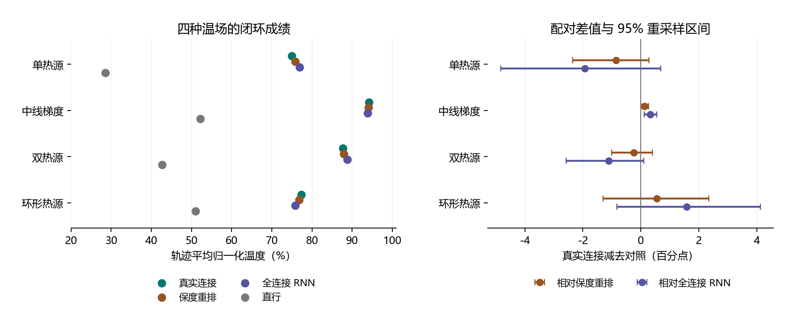
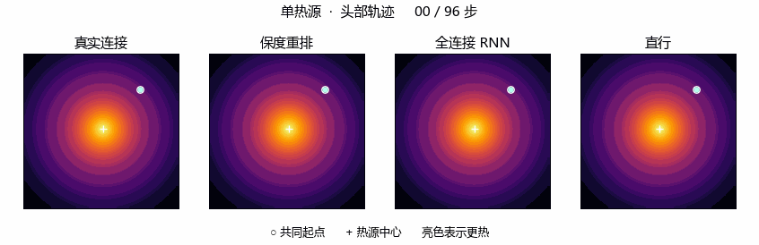

# 302 个神经元只做头部决策时，真实连接有趋温优势吗？

四个温场等权平均，真实连接得分 **83.56%**，保度重排 **83.66%**，全连接循环网络（RNN）**83.84%**。三组都能从单热源学会向热处转弯，也都能迁移到另外三张地图。本次实验没有观察到真实布线的跨温场优势。



## 不同温场的表现

分数是头部在 96 步内实际经过位置的平均温度。每张地图的最低、最高温分别记为 0% 和 100%，越高表示轨迹整体越靠近热区。同一温场内，各组共用起点、朝向和测温噪声。

| 温场 | 真实连接 | 保度重排 | 全连接 RNN | 直行参考 | 真实减重排，百分点（95% 区间） |
|---|---:|---:|---:|---:|---:|
| 单热源，新起点 | 74.94% | 75.79% | 76.87% | 28.54% | −0.85 [−2.35, +0.28] |
| 中线梯度，迁移 | 94.23% | 94.09% | 93.90% | 52.15% | +0.13 [+0.01, +0.27] |
| 双热源，迁移 | 87.67% | 87.91% | 88.78% | 42.70% | −0.24 [−1.01, +0.40] |
| 环形热源，迁移 | 77.39% | 76.84% | 75.81% | 51.04% | +0.55 [−1.30, +2.34] |
| **四场等权** | **83.56%** | **83.66%** | **83.84%** | **43.61%** | **−0.10 [−0.87, +0.51]** |

中线梯度下真实连接相对两个对照都略高，差距不到 0.4 个百分点。环形场的平均分也是这组最高，但其配对区间覆盖零。四场等权时，真实连接相对全连接 RNN 的差值为 −0.28 个百分点，区间为 [−1.57, +0.91]。

用“处在热区的时间占比”复核，热区取温度达到本图归一化量程 90% 的位置。四场平均分别为真实 50.43%、重排 50.15%、全连接 50.42%、直行 4.28%。双热源下，足够热的局部峰也能贡献得分。[各场两项指标](assets/head302-thermotaxis/summary.csv) · [全部配对区间](assets/head302-thermotaxis/differences.csv)



动画取第一个测试起点、训练种子 11 和第一张重排图（101）。亮区中心是热源，青色轨迹显示每两步的位置。固定速度下，接近热源后仍会继续前进和转弯。

## 比较怎样控制

- **结构。** 从仓库的 Cook 2019 连接组按雌雄同体神经元名单取 302 个节点。真实图保留 3,709 个有向化学连接条目与 1,091 对非自环电连接。重排分别对有向边与无向边做双边交换，保持每个具名节点的化学入度、出度、电连接度数及自环。通用对照是 302 单元全连接 tanh RNN。真实与重排各有 4,016 个可训练参数，密集对照有 91,511 个。对布线本身的判断以真实对保度重排为主。[连接组来源](../../data/connectome/README.md) · [每张图的规模和改边数](assets/head302-thermotaxis/manifest.json)
- **头部接口。** 三组都只读取头部中心与前方左右各 45°、相距中心一格的局部温差。两路温差分别接到 AFDL/R，只从 RIAL/R 读出转角。每次决策从零状态做六次神经更新，随后以固定速度 0.65 格/步前进，转角上限 0.65 弧度，碰壁镜面反射。这个接口把左右扫温简化为一对同时采样的局部探针。各组均有 302 个状态，每次选择动作时信号最多沿五条边传播。
- **权重与身体。** 化学突触的符号和强度均从头学习，电连接使用固定对称耦合。每个温度样本加入标准差为 0.08 个地图温度单位的独立噪声。运动采用统一的二维头部运动学，省去 Boyle、CCB 的身体与肌肉动力学，使三组的动作产生相同位移。
- **学习。** 每个训练种子生成单热源图上 4,096 个随机姿态，教师动作是转向热源中心的最短角，按动作上限截断。只有生成示范时使用热源坐标。三组配对使用相同示范和小批次，以均方误差、Adam（学习率 0.003）、批量 64 训练 128 次更新。统一取最后一步模型；第 0、8、32、128 步均另记 1,024 个独立姿态上的动作误差。[学习曲线数据](assets/head302-thermotaxis/learning.csv)
- **测试。** 6 个训练种子与 4 张重排图完全交叉，共 36 个训练模型。每个模型在仓库原有的四张 40 × 40 地图上各运行 64 个新起点，加上直行参考共 9,472 条轨迹。按训练种子、重排图和起点独立有放回抽样 4,000 次，组间共用同一次种子和起点抽样，四场汇总也保留配对。表中为探索性逐项百分位区间；地图固定，多个温场的区间未经多重比较校正。[逐轨迹得分](assets/head302-thermotaxis/episodes.csv)

结论适用于这套“向热处转”、固定步速、局部双探针和短时模仿学习的任务。简化模型保留真实连接的位置，化学权重与头部接口均为建模选择。设定偏好温度、需要跨动作记忆的任务或加入身体反馈，都需要单独检验。

## 复现

在仓库根目录运行以下命令。归档环境为 CPU PyTorch 2.8.0、NumPy 2.0.2、SciPy 1.13.1，绘图使用 Matplotlib 和 Pillow。SciPy 用于复现仓库环形场的高斯平滑。

```sh
python analysis/head302/compare.py --out results/head302
python analysis/head302/figures.py --out results/head302
python -m pytest -q tests/test_head302.py tests/test_connectome.py tests/test_tracking_circuit.py tests/test_navigation.py tests/test_navigation_window_policy.py
```

相同环境中从头运行两次，逐轨迹成绩、学习曲线和含温场哈希的清单逐字节一致。只重画已归档的数据时，运行 `python analysis/head302/figures.py`。
