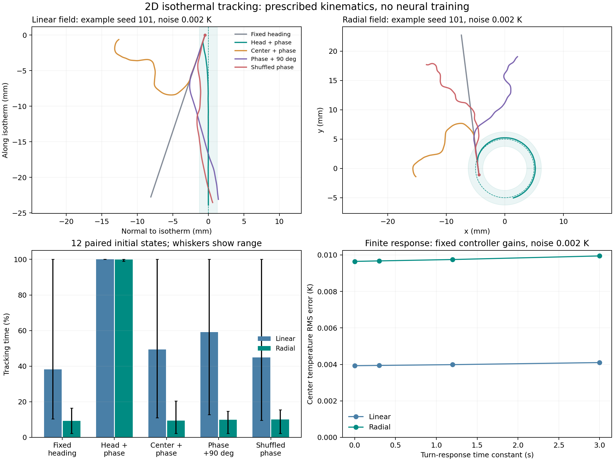

# 二维等温追踪场景与相位相关控制基准

日期：2026-10-24。场景已实现，444条验证完成，尚未训练神经控制器。它是明确规定运动的二维运动学模型，不是RFT、弹性身体、表面爬行接触或代谢能模型。



图上行为预先选定seed101、噪声0.002K的轨迹；下左为12组初态的均值与范围，不是置信区间；下右比较同一控制器在不同转向响应时间下的温度误差。

## 场景与观测权限

从舒适温度附近开始，保持0.2mm/s推进，允许有界连续转向；中心温度处于偏好±0.05K且方向距等温切向不超过25°时记为追踪。正反两个切向方向都允许。它研究维持追踪，不研究从远处寻找目标。

头部位置由中心、朝向、0.5mm前向偏置和0.15mm横向周期摆动构成，频率0.5Hz；参考长度1mm只是几何尺度，并非已求解的软体形变。转向指令上限0.3rad/s，角速度按一阶有限响应变化。中心推进速度固定，头摆预先给定，不计算机械耗散。

温度场为静态线性或径向梯度，幅值40K/m；径向偏好等温线半径5mm。环境方向、初态、温度噪声和相位干预使用四个独立随机源。控制器只收到局部含噪温度、采样时间和自身驱动相位，不收到位置、朝向、梯度或等温线方向。

这是独立的`tracking_local_temperature_and_motor_phase_v2`观测约定，明确加入运动相位。既有只允许局部温度的第0/1阶段约定没有被静默修改。

物理、传感和控制时钟分别为0.01、0.1、0.2秒。每条120秒轨迹有12000个物理步、1201次测温、601次控制更新，末端时刻不重复计入持续时间。最大横向测温振幅为0.006K；噪声扫描0、0.002、0.01K，不直接套用旧一维场景的0.05K噪声。

## 简单控制器与对照

控制器对最近两次摆动周期的测温历史作局部回归，解释温度水平、缓慢时间变化、sin相位和cos相位分量。它利用已知速度和头部几何，近似估计沿前进方向、横向的温度变化，再由温差与方向偏离请求转向。回归样本不足、矩阵不适定或条件数过大时，不生成方向估计。

这是拥有明确任务和几何先验的启发式控制器，不是神经回路复现。时间斜率只有在静态、局部近直且缓慢转向条件下才近似对应纵向梯度；弯曲、前向头偏置运动和外界温度变化都能产生偏差。当前增益是构建时固定的工作值，没有按本批结果调整。

对照包括固定朝向、头部测温+正确相位、中心测温+相位、头部测温+90°相位偏移、头部测温+打乱相位。中心传感条件取消前向头偏置修正。相位干预只改变控制器得到的相位，不改变实际头摆、采样时钟或噪声随机流。它们是冻结控制器的机制干预，不是分别重训后的模型优劣比较。

中心传感不含这个估计器依赖的横向摆头温度调制，因此它的表现不能用于否定其他中心传感控制策略；那些策略可能通过主动转向或其他运动历史获得方向信息。

## 预定批次与结果

主批为2种温度场×3种噪声×5种条件×12初态，共360条。另有72条转向响应比较和12条物理时间步比较，共444条。主批使用种子101–112，构建时seed100的10条无噪声检查不计入主批。全部条件保留，不按成功与否筛选。

噪声0.002K、响应时间0.3秒下，追踪时间占比的12初态均值：

| 条件 | 线性等温线 | 圆形等温线 |
|---|---:|---:|
| 固定朝向 | 38.25% | 9.32% |
| 头部测温、正确相位 | 100.00% | 99.89% |
| 中心测温、同一相位估计器 | 49.45% | 9.49% |
| 头部测温、90°相位偏移 | 59.20% | 9.92% |
| 头部测温、打乱相位 | 44.99% | 10.14% |

正确相位控制器的中心温差RMS，线性场约0.00394K，径向场约0.00967K。噪声升至0.01K时，追踪均值仍分别为99.97%和99.63%。这是当前几何、增益与较宽舒适带内的结果，不外推为任意噪声下的鲁棒性。

某些相位错误/中心传感条件下，加噪声反而增加了平均追踪。这可能来自噪声驱动的偶然转向改变固定朝向漂离，并不说明测温噪声通常有利；范围分散且未设计因果噪声获益实验。所有逐初态结果均保留。

## 物理约束能说明到哪一步

将转向响应时间由0增加到3秒，固定增益下，线性场追踪约100%，径向场约99.92%降至99.74%；温差RMS轻微增加。本范围内没有观察到有限响应使性能变好的证据，也没有明显失效。

参考圆形等温线绕行一圈约157秒，最大3秒响应相对这一尺度仍较短。当前约束作用于平均转向，不延迟规定的头摆本身。因此不能用这组结果解释真实肌肉、身体柔软性或全部感觉—运动延迟；后续应按相对时间尺度选择参数，并逐步使用更完整身体模型。

物理时间步0.01→0.005秒时，四个检查条件的中心温差RMS变化最大约3.81×10⁻⁷K，追踪比例不变。物理步加密未增加测温次数。

## 验证与当前研究结论

新增7项验证覆盖解析场的梯度估计与相位符号、病态回归、角速度响应、头部几何、相位干预的物理隔离、独立时钟与可复现性。完整检查169项通过；副进程独立复算10份轨迹的驻留、RMS、追踪持续时间与沿带行程，结果一致；444条记录完整、指标有限、角速度有界，训练源文件哈希不变。

当前能够说明：这个拥有几何先验的局部控制器可利用头摆同步温度调制维持等温追踪；场景可以承载感觉—运动配合的机制对照。不能说明真实神经回路学习更快、复杂回路必需，或头部感知优于所有中心感知策略。

下一步在这个场景中建立可学习的连续转向控制器，再比较感觉动态与真实/重排连接先验。比较前应处理此前零偏置/零读出的初始化对称性；将局部温度输入、驱动相位反馈和运动读出分别明确，不把所有特征都不加区分地送入AFD。

全局正弦温度扰动已经在场景接口中预留，但本批未测试。它会移动实际等温线，并可能与运动造成的温度变化混淆；特别是与头摆同频时，仅靠当前回归不能保证区分，必须另外设计检验。

## 文件与复现

- [预定设计](assets/isothermal-scene-2026-10-24/design.json)
- [全部444条结果与汇总](assets/isothermal-scene-2026-10-24/summary.json)
- [代表轨迹与测温/动作记录](assets/isothermal-scene-2026-10-24/example-traces.npz)：展示轨迹按传感时钟抽取，完整物理时钟轨迹在本地results中；评价统计使用完整物理时钟。
- [源码快照](assets/isothermal-scene-2026-10-24/reproduction_sources.zip)
- [文件校验值](assets/isothermal-scene-2026-10-24/manifest.json)

```bash
PYTHONPATH=src python3 analysis/isothermal_scene_baseline.py --output results/isothermal-scene-new
MPLCONFIGDIR=/tmp/worm-matplotlib PYTHONPATH=src python3 analysis/plot_isothermal_scene.py --root results/isothermal-scene-new --output /tmp/isothermal-scene.png
PYTHONPATH=src python3 -m pytest tests 程序/test_core.py -q
```
