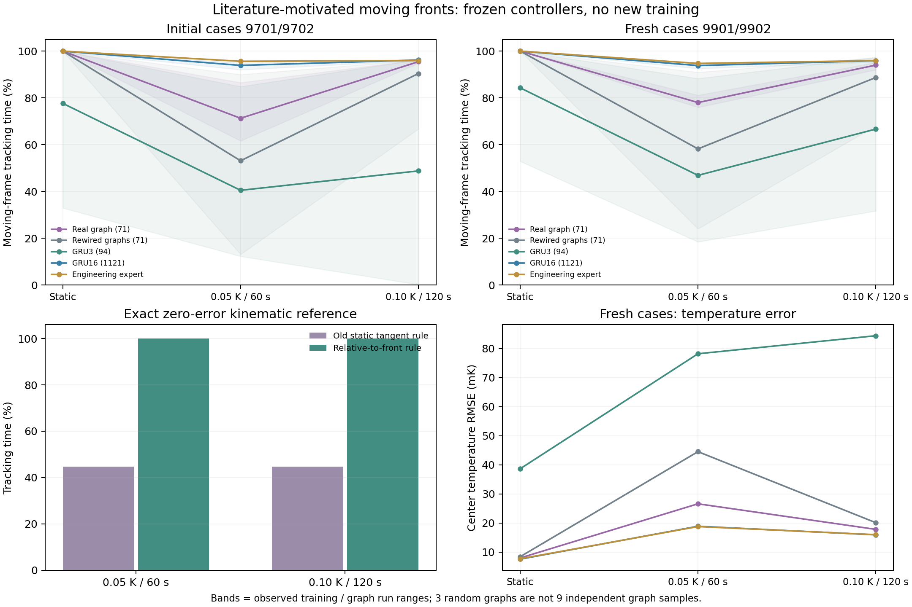

# 动态等温线：评价检验与冻结迁移

日期：2026-10-24。没有新增拟合；在静态任务上训练完成后，检验温度整体周期变化时的迁移。

## 动态评价需要改变什么

[Luo et al., JEB 2006](https://doi.org/10.1242/jeb.02590)在径向温度梯度上叠加空间均匀的正弦温度变化，报告了花状与环状轨迹。本文采用其中40 K/m梯度、0.05 K／60秒和0.1 K／120秒两组条件作为工程场景。文献行为并不证明线虫在优化这里定义的控制目标；当前也不是完整生物轨迹复现。

本任务明确要求沿瞬时目标等温线推进。全场升降温会移动等温线，正确跟踪需要法向运动。设温度波幅为A、周期为P、空间梯度为G，等温线的法向速度为

\[
v_{\mathrm{iso},n}=-\frac{\partial_t T}{|\nabla T|}
=-\frac{2\pi A}{PG}\cos\frac{2\pi t}{P}.\tag{1}
\]

用个体速度相对等温线的运动定义方向误差，法向单位向量为n、切向单位向量为t：

\[
e_{\mathrm{rel}}=\operatorname{atan2}
\left(|\mathbf v\!\cdot\!\mathbf n-v_{\mathrm{iso},n}|,
|\mathbf v\!\cdot\!\mathbf t|\right).\tag{2}
\]

追踪仍需中心温差≤0.05 K、方向误差≤25°；相对速度为零时不视为沿等温线推进。静态场中此定义还原原来的切向判据。真实前沿速度只用于离线评价，没有提供给控制器。

两组扰动的最大前沿速度都是0.1309 mm/s，低于规定前进速度0.2 mm/s。精确跟踪最多需要偏离静态切向40.88°。零温差的解析参考按旧25°规则只能获得约44.7%，按相对规则为100%；参考所需角速度分别小于0.069和0.035 rad/s，低于0.3 rad/s边界。这是线性场中的运动学参考，不代表神经策略或完整执行器的最优解。

新增四项测试验证静态退化情况及两组解析参考，原有静态任务的指标和源码保持不变。

## 对照与检查范围

冻结全节点真实图、三张度保持重排图、GRU3、GRU16，每种图／网络三个训练种子。所有检查点来自相同32条静态示范、2048次更新；动态场景没有用于拟合或检查点选择。感觉仍只有局部头部温度、运动相位和4秒历史。

初始检查使用病例9701／9702；看到真实图与单张重排的差异后，增加全部三张重排图和新病例9901／9902进行后验复检，每批都包括直线／圆形场。合计480条120秒冻结轨迹，其中168条沿用、312条新增，不能计作额外训练样本。全局温度波的初相固定为零，尚未检验不同波动初相。

## 新病例的相对等温线追踪时间

| 模型 | 静态 | 0.05 K／60秒 | 0.1 K／120秒 |
| --- | ---: | ---: | ---: |
| 真实图，71参数 | 100% | 78.02% | 94.02% |
| 重排图11，71参数 | 100% | 56.79% | 92.47% |
| 重排图22，71参数 | 100% | 46.07% | 86.80% |
| 重排图33，71参数 | 100% | 71.83% | 86.86% |
| GRU3，94参数 | 84.31% | 46.91% | 66.68% |
| GRU16，1,121参数 | 100% | 93.83% | 95.92% |
| 工程教师 | 100% | 94.75% | 95.94% |

初始病例中，真实图两组扰动为71.31%／95.47%；三张重排图分别47.89%／92.81%、48.32%／92.66%、63.25%／85.76%，平均差异方向一致。GRU16为93.90%／96.19%，仍更好。

优势不覆盖所有训练种子。例如新病例0.05 K／60秒下，重排33的训练种子7达到90.98%，高于真实图同种子的76.93%；该重排种子27只有46.94%。真实图三次训练为76.93%、75.96%、81.16%。目前可描述为所测条件下平均迁移表现及失败波动不同，不能声称每次训练都优于重排。

## 可以解释到哪一步

真实与重排共享参数数量、神经元、gap、动态、全节点接口、输入、数据和优化预算，因此差异与这一建模条件下的化学布局有关。布局影响学习出的函数及优化路径，尚未解释到具体神经元、突触或真实生物机制。

静态追踪均达100%不意味着教师拟合误差完全相同；后续需要在相同静态验证误差或更多优化检查点下比较迁移。GRU3在静态本来就较弱，不能把它全部动态损失归因于泛化。GRU16参数更多，跨模型结果同时涉及容量和运算结构。

这批不是动态任务的数据效率实验；不支持真实回路比普通记忆网络更省样本。两组扰动同时改变幅度和周期，不能单独归因其中一个因素。两批各四条病例、三个训练种子及三张重排图仍是小规模探索。全节点工程接口、统一速率动态与有限历史的限制不变。

## 对下一项任务的约束

静态任务中样本优势尚未出现；动态迁移提供了一个可继续检验的条件性现象。后续可比较学习动态任务或少量动态示范适应时的数据需求，并控制静态拟合程度、参数量与随机图种子。不能根据动态成绩选择所谓真实回路。

在训练前还需明确环境变化族和局部观测的可辨识性，见[独立检查](moving-front-identifiability-2026-10-24.md)。未知线性温漂和已知周期正弦有不同信息条件，不能混为同一个记忆问题。

## 材料

[摘要](assets/moving-front-2026-10-24/summary.json)、[全部病例结果](assets/moving-front-2026-10-24/results.json)、[设计](assets/moving-front-2026-10-24/design.json)、[检查点与源码](assets/moving-front-2026-10-24/models-and-sources.zip)和[校验清单](assets/moving-front-2026-10-24/manifest.json)均已保存。脚本为`analysis/tracking_moving_front_probe.py`及`analysis/check_moving_front_graphs.py`；离线评价在`src/thermotaxis/moving_isotherm.py`，不进入策略输入。完整测试186项通过，14条既有弃用警告。
