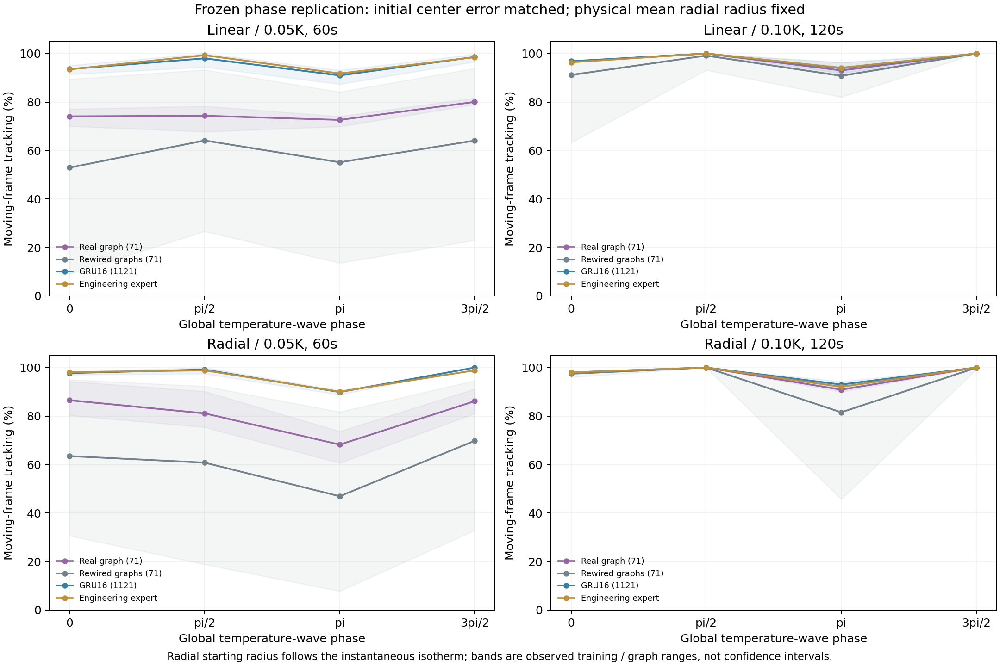

# 温度波相位与启动条件复检

日期：2026-10-24。冻结既有32条静态轨迹、2048更新的控制器，没有追加拟合。

## 需要排除的影响

[最初动态检查](moving-front-2026-10-24.md)的温度波初相固定0，此时等温线开始移动的速度最大。本批检验0、π/2、π、3π/2四个相位，使用新病例10101／10102、两个场、两组波动；真实图、三张重排图、GRU16各3训练种子，另有工程教师与盲对照，共544条120秒轨迹。

初始中心温差在相位间保持可比，径向物理平均半径固定5 mm，起点位于各相位的瞬时目标等温线附近。初始半径按平均半径减去A sin(相位)/G设置，因此径向初始曲率和头部几何效应随相位变化；没有将它们描述为完全相同初态。线性场采用等价的初始等温线坐标平移。

所有相位保持相同的初始几何切向方向及方向扰动。相对于移动前沿所需的初始方向会随相位改变，这是本批启动条件的组成部分。另报告20—120秒区间，不将该区间称为严格稳态。

## 相位与后期区间的平均结果

表中先对所有相位、场和病例平均，再对训练种子平均。重排图逐张报告，避免把9次训练解释为9张图。

| 模型 | 0.05 K／60秒：全程／20秒后 | 0.1 K／120秒：全程／20秒后 |
| --- | --- | --- |
| 真实图71参数 | 77.88%／77.39% | 97.29%／99.58% |
| 重排图11 | 59.30%／55.37% | 96.87%／99.08% |
| 重排图22 | 48.69%／43.21% | 94.40%／96.84% |
| 重排图33 | 71.00%／69.45% | 93.72%／95.69% |
| GRU16 | 95.99%／98.86% | 97.71%／99.93% |
| 工程教师 | 96.11%／98.90% | 97.58%／99.89% |

快速扰动中，真实图相对所测三张重排图的平均差异没有随相位改变而消失，去掉前20秒后仍存在。慢扰动时多数模型接近指标上限。GRU16仍表现更好；该观察没有支持真实图优于普通记忆网络或更省训练样本。

## 首次相位设计为何排除

首次设计固定瞬时初始半径、并用温度偏移维持初始温差，会随相位改变物理平均半径。在A=0.1 K、相位3π/2的径向条件中，目标会收缩到原点，使任务性质发生变化。发现后停止执行，已保存192条轨迹及设计、源码，全部排除在正式比较之外。

正式设计固定物理平均半径再移动起点；两组目标半径的全程最小值分别3.75和2.5 mm，均不坍缩。新增检查拒绝会到达原点的相位设置，验证相位0与原场景的轨迹一致、初始温度不变和离线场变换正确。原场景源码无需修改。

## 方法与解释范围

温度场的相位通过局部温度生成过程体现，神经控制器仍只接收原有SweepReading，没有获得全局相位或真实场信息。离线评价使用等价坐标／参考半径变换，计算正确的前沿速度；正式结果检查了相位间初始中心温差一致，物理平均半径保持5 mm。

平均优势不等于每个训练种子都领先。只有三张随机图、三个训练种子与每场两个病例，后续已将随机图扩展到10个预先指定种子，并单独标记7个新图。当前相位检查也未匹配各模型的精确静态验证误差，不把差异解释为已知生物神经机制。

## 材料

[设计](assets/moving-phase-2026-10-24/design.json)、[完整结果](assets/moving-phase-2026-10-24/results.json)、[摘要与初始化校验](assets/moving-phase-2026-10-24/summary.json)、[有效／排除批次索引](assets/moving-phase-2026-10-24/archive-index.json)、[源码与检查点](assets/moving-phase-2026-10-24/models-and-sources.zip)及[校验](assets/moving-phase-2026-10-24/manifest.json)均已保存。脚本为`analysis/check_moving_front_phase.py`，场生成包装在`src/thermotaxis/phased_field.py`，没有改变策略输入契约。
