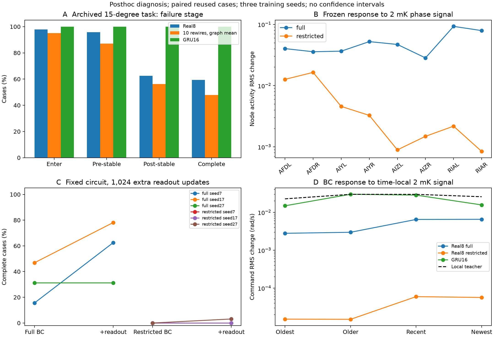

# 真实连接网络效果不突出：第一轮原因诊断

日期：2026-11-02。分支：`new-network'`。本轮研究复用既有模型，增加功能探针与小规模干预，不修改原模型实现、奖励或历史结果。

## 结论

当前已定位到两类不同的工程瓶颈：受限接口的温度信号到动作输出的响应很弱，原全节点接口则存在可通过读出层调整改善的行为。完整导航中真实图的主要剩余失败集中在线性场扰动后的恢复。现有证据不支持把低分直接归因为真实解剖连接无用，也没有证实真实布局提高RL样本效率。

本轮排除了一个具体疑点：同样的策略可见四秒温度和相位历史可以重建教师动作，因此所测完整窗口没有明显的输入缺失或标签错位。未定位到唯一生物或优化原因；四秒窗口长度、符号/细胞校准和真实布局优势仍待分别检验。



图A为原15°复查结果的阶段拆分；图B为冻结模型的工程刺激响应；图C为真实图三个训练种子的读出干预，保留全部种子；图D为教师窗口中不同时间段温度扰动的响应。均值和连线不是置信区间，节点顺序是标签顺序，不表示单一串联通路。

## 1. 做了什么

- 校验原归档SHA256，只将模型和教师缓存恢复到忽略路径`results/`，未从归档覆盖工作源码。
- 拆分原60°与修正15°结果，分别统计冷热起点、线性/径向场、进入/稳定/恢复；不混合两个任务条件。
- 覆盖78个raw模型设置：真实图、10张重排图、隔离节点、GRU2/16；每图/接口3个训练种子。检查初始化、BC和最终PPO共234个快照，其中初始化不是新增拟合。
- 以固定的80组温度背景/相位组合，施加1/2/5/10mK的水平、相位、反相、缓变、阶跃、噪声信号，共5,616个模型/刺激条件。保存逐节点响应与饱和指标。
- 在1,024个既有完整教师窗口核对动作标签；完成624个模型/时间段敏感性条件。
- 对真实图full/restricted各3种子，共6个BC检查点，固定全部内部参数，额外补训读出1,024次；用同32个既有15°病例作配对评价，共384条基线/干预轨迹。
- 对restricted真实图最终PPO模型，冻结参数，仅将观测到的温度波动放大1/3/10倍，噪声一起放大；共288条配对评价轨迹。此补充探针在第一批结果后登记，不伪装成事前主实验。

总计新增672条闭环诊断轨迹；它们不是672次独立训练，也没有新增PPO训练。各补充实验的设计先于自身结果保存。

## 2. 失败集中在哪里

下表是原15°、最终262,144次PPO交互端点，按同32病例和3个训练种子汇总，不是本次改进后的成绩。

| 真实图 full | 比例 |
|---|---:|
| 扰动前至少进入一次温带 | 97.92% |
| 扰动前完成稳定追踪 | 95.83% |
| 扰动后完成稳定追踪 | 62.50% |
| 前后两阶段均成功 | 59.38% |

分温场后：线性场完整成功27.08%，径向场91.67%。真实图线性场扰动前稳定率为100%，扰动后稳定率27.08%；因此不能概括为“网络不会进入目标”。这只是当前已查看病例的失败定位，不是所有温场的总体推断。

受限接口在原60°任务的扰动前稳定率也只有11.46%，说明它的低分早在环境扰动前已经出现，不宜把两类接口都归为恢复失败。

## 3. 输入有足够信息，但受限网络没有有效利用

将策略特征中的温度、sin/cos相位和四秒时间索引送入原局部回归规则，独立重建教师动作；不用位置、真实梯度、朝向、未来或教师隐藏状态。

- 与缓存标签的归一化MSE：`3.54e-16`。
- 最大动作差：`4.23e-8 rad/s`。

因此，所测1,024个完整窗口支持输入/标签对齐；不能外推为启动阶段所有不完整窗口均已验证。正对照来自原教师规则，不代表新的生物模型。

同一窗口样本中，始终输出零的归一化MSE为0.16666；真实图restricted在BC后的均值0.16648，full为0.15486。restricted的平均拟合误差几乎与零动作相同。结合低闭环表现，支持其教师映射未有效学成；不能仅由训练过程有限数值稳定就认定学习成功。

2mK相位相关工程刺激下，最终真实图full动作变化RMS为0.01774rad/s，restricted为0.0001441rad/s，前者约123倍。restricted的AFD有响应，但到AIY/AIZ/RIA时响应减弱。所测RIA的tanh饱和比例为零，因而不支持这批输入下“RIA普遍被压在饱和值”这个具体解释。不同接口的节点活动尺度并不代表相同生物单位。

真实图restricted并非拓扑上完全断路：真实数据中存在AFD经AIY到RIA的路径。因而应检查有效权重、输入投影、动态与训练，而非直接补一条不存在于数据中的连接。

## 4. 只调整读出能否改善

起点均为旧BC检查点，固定回路和输入参数，只训练输出层。使用原32教师episode中的24条补训，余8条仅作诊断；所有episode都曾用于原模型训练，后8条不是全新验证集。固定更新次数、全部种子保留、不选择最佳检查点。

| 接口 | 原BC完整成功 | 补训读出后 | 种子7/17/27：前→后 |
|---|---:|---:|---|
| full | 31.25% | 57.29% | 15.63→62.50；46.88→78.13；31.25→31.25 |
| restricted | 0.00% | 1.04% | 0→0；0→0；0→3.13 |

模型校验确认除了`actor`权重/偏置，其他参数和缓冲区完全未变。full的配对结果说明至少有两个种子存在可通过读出调整改善的行为，不必改变解剖布局。它不证明内部表征已充分，也不能证明读出训练优于等预算的全参数继续训练——本批没有该对照。

full的补训集MSE从0.16327略降至0.16146，另8条既有episode的MSE从0.14381略升到0.14490，行为却提高。说明教师动作MSE与闭环表现不是同一指标；不能把本次行为改善写成“验证拟合误差显著改善”。额外监督优化也必须计入预算，不能称更省RL样本的正式结论。

## 5. 只是温度波动幅度太小吗

使用restricted最终PPO模型，保持mean温度与相位不变，放大已有波动及噪声，不新增信息，也不重训。

| 波动倍率 | 完整成功均值 |
|---|---:|
| 1 | 2.08% |
| 3 | 4.17% |
| 10 | 7.29% |

单一波动增益在所测三点未恢复可靠行为。不能据此排除其他合理的感觉编码、神经增益或校准；也不能选择10倍当作生物参数或最优倍率。这里是旧60°训练模型在15°任务上的冻结配对诊断，不与原受限60°的1.04%直接相减。

## 6. 历史利用与下一步

在不同时间段加入相位相关微温变，教师和GRU16均有清楚响应；restricted真实图响应很弱，full真实图介于两者之间。由于去均值和均值通道都由整个窗口计算，早期样本也能通过均值影响全部输入，本探针不等于纯粹的神经记忆衰减测量，不能据此宣布“四秒不够”已经得到证明。

按证据优先级，下一步应：

1. 对受限通路建立可测的温度→AFD→AIY→RIA功能训练/校准，记录中间响应，而非仅继续加PPO预算。先区分输入投影、内部动态与输出表达能力；缺实测数据时明确只做工程功能约束。
2. 对full比较相同额外监督预算下的读出补训和全参数继续训练，并用策略访问轨迹标注检查分布偏移；评价重点放在线性场恢复。
3. 以上通过后才进行持续状态/更长历史的独立比较，以及有依据的符号、节点动态和运动反馈消融。
4. 任何布局收益都需新病例、新重排图和更多独立种子确认。本轮不以“找到真实图领先的设置”为目标。

## 7. 可复现性与材料

当前实例重新运行full三个原BC基线，在96条旧病例的进入时间、前/后稳定时间、完整成功及追踪比例五项逐病例字段上，与归档完全一致。

新诊断测试10项通过；完整回归235项通过（本次运行无警告摘要）。新增测试验证诊断回放与生产输出一致、温度扰动保留相位与padding、教师重建、增益恒等及失败分类，不以检查数代替科学证据。

运行目录为仓库根目录，先按旧归档说明恢复`results/`。使用本项目`.venv/bin/python`及`PYTHONPATH=src`；每个新输出目录只prepare一次：

```bash
PYTHONPATH=src .venv/bin/python analysis/diagnose_navigation_failures.py prepare
PYTHONPATH=src .venv/bin/python analysis/diagnose_navigation_failures.py failures
PYTHONPATH=src .venv/bin/python analysis/diagnose_navigation_failures.py signals
PYTHONPATH=src .venv/bin/python analysis/diagnose_navigation_failures.py rescue
PYTHONPATH=src .venv/bin/python analysis/probe_navigation_teacher.py
PYTHONPATH=src .venv/bin/python analysis/probe_navigation_temperature_gain.py
MPLCONFIGDIR=/workspace/.cache/matplotlib PYTHONPATH=src .venv/bin/python analysis/report_navigation_diagnosis.py
```

使用脚本设置的单线程CPU。源文件及原模型/教师数据哈希固定在design中。重新实验应使用新输出目录，不覆盖本轮记录；源代码或输入变化会使原设计检查失败。

[汇总JSON](assets/navigation-diagnosis-2026-11-02/summary.json)、[原始诊断与6个新读出检查点](assets/navigation-diagnosis-2026-11-02/diagnostic-records.zip)、[SHA256](assets/navigation-diagnosis-2026-11-02/manifest.json)。ZIP包含设计、全部探针行、672条新评价轨迹、源码与测试。原模型/教师大归档不重复打包。
