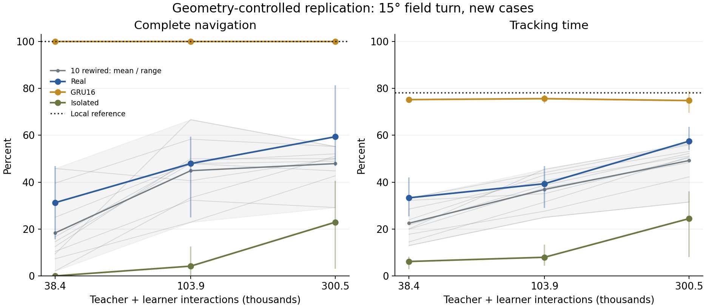

# 可达性控制后的完整导航复查

日期：2026-10-25。此为发现原任务几何问题后开展的后验物理复查，使用全新病例，不伪装成原始预登记结果。

## 为什么追加

原场绕固定原点转向60°时，沿旧等温线走得更远的个体，可能离新目标太远。即使朝目标直走，也可能没有时间进入并保持10秒追踪。因此较好的前段表现会让后段面对更难的几何条件，原完整成功率不宜单独解释为恢复能力。

最乐观的时间下界只考虑距离和速度，不计转向或感觉延迟：

$$t_{\min}=\frac{\max(0,(|T_c-T^*|-\Delta T)/G)}{v}+t_{\mathrm{stable}}.\tag{1}$$

超过剩余时间即可判定无法完成；低于剩余时间并不证明一定可控。

预定例图中，真实图种子7在病例61001的下界加稳定时长为118.5秒，剩余113.2秒。该例未按成绩挑选。另有两个独立几何测试，分别复现原60°反例和15°范围下的速度下界。

## 复查规则

保留原始105组全部结果。追加全部full／raw模型：真实图、10张重排图、隔离节点、GRU2／16，各3个训练种子，共42组RL训练。直接复用原32条示范、2048更新后的同一检查点，不重复计算示范拟合次数；PPO算法、预算和训练随机种子不变，只把场转角改为15°。径向条件不变。

新病例71001—71032在42组训练全完成后才评估。另用前16个同源病例交叉检查训练60°／15°与测试60°／15°，避免把不同病例平均值误认为几何因果效应。学习数据仍包括共同38,400次教师交互，追加65,536／262,144次学习者交互。

同一局部参考控制器，在这32个病例的60°条件完整成功59.38%，有6个原先处于舒适带的病例被速度下界排除；15°条件完整成功100.00%，排除数为0。追加实验所有原先处于舒适带的病例均未被该速度下界排除，但这仍不是所有连续控制可达性的数学证明。

## 全部模型的固定端点

| 模型 | 共同示范后成功 | +65,536次交互成功 | +262,144次交互成功 | 最终追踪比例 | 达标种子数 |
| --- | --- | --- | --- | --- | --- |
| real8 | 31.25% | 47.92% | 59.38% | 57.50% | 1/3 |
| rewired8-11 | 10.42% | 32.29% | 29.17% | 31.52% | 0/3 |
| rewired8-22 | 14.58% | 47.92% | 44.79% | 48.38% | 0/3 |
| rewired8-33 | 16.67% | 48.96% | 52.08% | 53.10% | 0/3 |
| rewired8-44 | 9.38% | 66.67% | 55.21% | 56.43% | 1/3 |
| rewired8-55 | 7.29% | 22.92% | 42.71% | 42.26% | 0/3 |
| rewired8-66 | 25.00% | 47.92% | 48.96% | 51.16% | 0/3 |
| rewired8-77 | 2.08% | 33.33% | 51.04% | 50.84% | 0/3 |
| rewired8-88 | 45.83% | 40.62% | 50.00% | 50.38% | 1/3 |
| rewired8-99 | 12.50% | 50.00% | 50.00% | 52.25% | 0/3 |
| rewired8-110 | 39.58% | 58.33% | 55.21% | 55.93% | 1/3 |
| isolated8 | 0.00% | 4.17% | 22.92% | 24.46% | 0/3 |
| gru2 | 19.79% | 23.96% | 25.00% | 25.60% | 0/3 |
| gru16 | 100.00% | 100.00% | 100.00% | 74.82% | 3/3 |

真实图最终成功均值59.38%，10张重排图图均值的平均为47.92%，其中0/10张高于真实图。结果限定在该任务、共同示范和固定优化预算，不是完整生物回路比较。

真实图的三个训练种子最终分别为{'7': 81.25, '17': 50.0, '27': 46.88}，均值领先存在明显种子波动。进入PPO前真实图已经为31.25%，重排平均18.33%；PPO阶段真实图增加28.12个百分点，重排平均增加29.58个百分点。因此当前差异主要在共同示范初始化后已存在，不能解释成已验证的额外RL样本效率优势。



竖线为3个训练种子范围，灰带为10张图均值的范围，不是置信区间。各轨迹仍只对应32个共同初态种子。

## 配对的训练／测试几何

下表仅用同16个新病例；不要与上面32病例均值直接相减。

| 模型 | 训练60°测试60° | 训练60°测试15° | 训练15°测试60° | 训练15°测试15° |
| --- | --- | --- | --- | --- |
| real8 | 39.58% | 41.67% | 45.83% | 58.33% |
| gru16 | 56.25% | 97.92% | 58.33% | 100.00% |
| isolated8 | 10.42% | 10.42% | 25.00% | 22.92% |

## 已知边界与复现

此处只复查full／raw，原接口与适应矩阵仍按60°压力条件解释。没有重新选择最佳图、最佳种子或最佳检查点；原始压力数据和失败均保留。生物功能校准、从零RL以及RFT／弹性身体仍未由本轮验证。完整回归225项通过，14条既有依赖弃用警告。

```bash
PYTHONPATH=src python3 analysis/navigation_feasibility_replication.py prepare
PYTHONPATH=src python3 analysis/navigation_feasibility_replication.py fit
PYTHONPATH=src python3 analysis/navigation_feasibility_replication.py evaluate
PYTHONPATH=src python3 analysis/navigation_feasibility_replication.py collect
PYTHONPATH=src python3 analysis/navigation_feasible_reference.py
MPLCONFIGDIR=/tmp/worm-matplotlib PYTHONPATH=src python3 analysis/report_navigation_feasible.py
```

实际运行的3个分片互不重叠，全部训练结束后才评估。归档含原始模型、新模型、源代码、设计和审计结果。

[完整材料](assets/navigation-study-2026-10-25/README.md)、[原始压力比较](navigation-study-2026-10-25.md)、[协议](../navigation-protocol-2026-10-25.md)。
