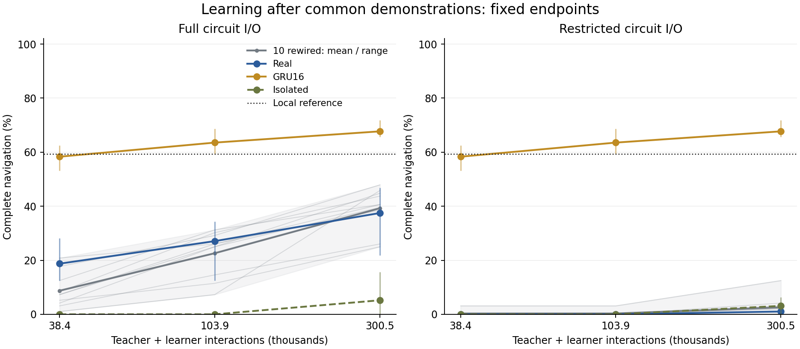
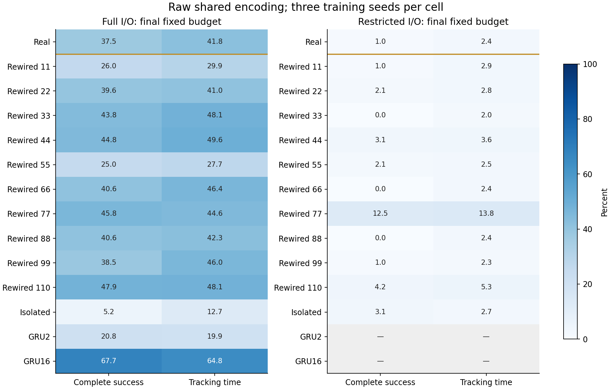
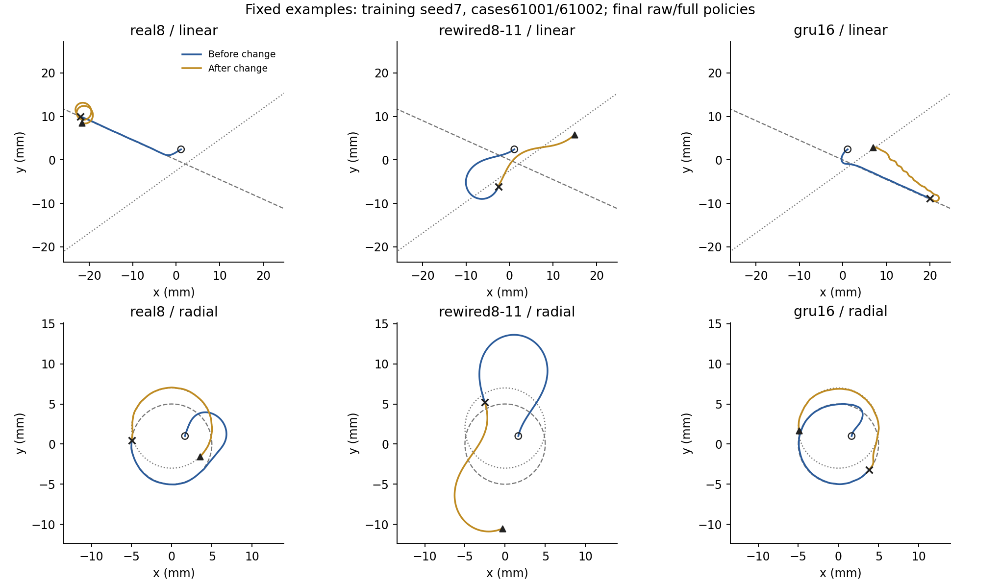
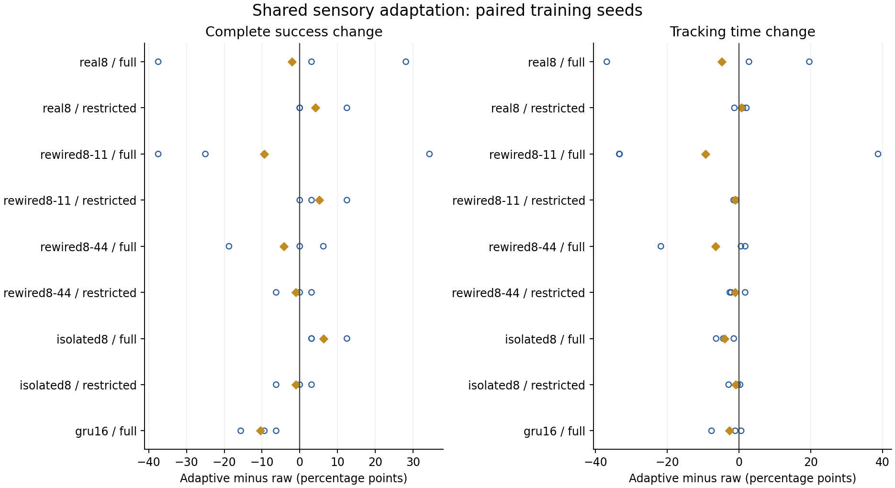
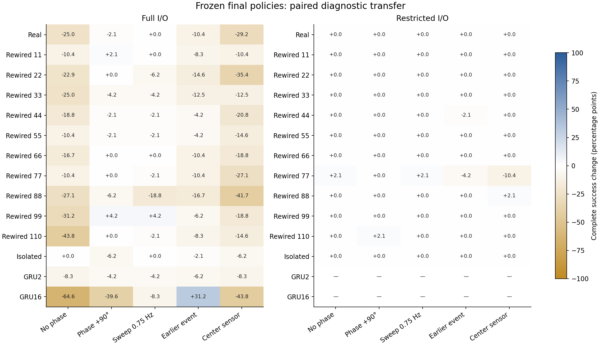
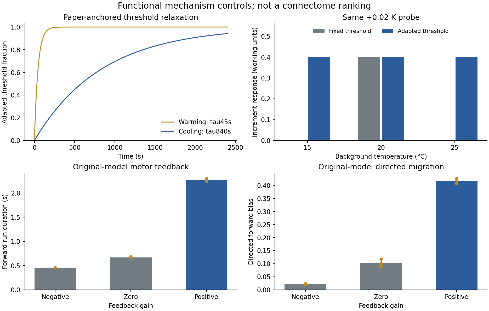

# 完整导航、接口与感觉机制：原始60°压力条件

日期：2026-10-25。

## 研究问题与完成范围

此前简单追踪任务未显示真实连接稳定领先。本轮检验：扩大到找到温区、维持追踪、受扰后恢复时，连接布局的作用是否随接口及感觉适应变化？同时用独立功能任务核验所选机制，最后比较共同示范初始化后的闭环学习。

已完成105组拟合（35种设置×3个训练种子），数值失败0组；固定端点共10,080条未见病例轨迹，另有8,400条冻结迁移／中心测温轨迹。它们反复使用32个病例种子，其中16个用于配对迁移，不是这么多独立训练或环境样本。

详细参数和预先固定规则见[执行协议](../navigation-protocol-2026-10-25.md)。原平台和旧任务未修改；新任务为规定运动学，尚未接入RFT／弹性身体。

## 1. 新任务是否合理、能否学会

初始中心温差从冷热两侧的0.06—0.15 K采样，舒适半宽0.05 K，方向完全随机。每条240秒轨迹，在120±20秒发生线性场转向／平移或径向场圆心移动。策略只用局部含噪头部温度和共同内部相位，没有位置、真实梯度或事件时刻。

首次进入、持续10秒等温追踪、扰动后重新进入与稳定追踪分别评价。场变化后仍在舒适带内的病例不计为“瞬间完成恢复”的优势；需要重入的病例另作诊断。未完成的时间保持删失。

局部参考控制器在正式32个病例上的完整成功率为59.38%、全程追踪为65.51%。参考策略是局部回归启发式，不是生物控制器或全局最优解。

开发预检中，直接更换为在线状态模型、从零A2C和短片段模仿均不稳定，相关源码、模型和失败记录保留。退回旧4秒窗口后普通GRU16可以学会新任务，正式比较据此固定共同示范初始化和PPO，开发病例42001—42016未进入正式病例集。不能把这些同时改变多个因素的预检当作算法优劣的因果比较。

**几何审计修正：** 原场绕固定原点转向60°，可能使已沿旧等温线走远的个体在剩余时间内无法完成恢复。预定真实图例61001的乐观速度下界加稳定时长为118.5秒，剩余仅113.2秒。因此本表保留为原始压力条件，不能把所有恢复失败当控制器能力不足；另以15°转向、全新病例完成[可达性控制复查](navigation-feasible-2026-10-25.md)。

## 2. 学习曲线和连接布局

每个模型先接触同一32条局部参考示范，38,400次教师控制交互，拟合2048次更新；随后新增65,536和262,144次学习者交互。总计数为38,400、103,936、300,544，但两种数据的信息类型不同，因此只讨论共同示范条件下的额外交互效率。



蓝／金竖线为三个训练种子范围，灰色范围是10张图各自三种子均值的范围，均不是置信区间。三个端点之间没有逐步成功时间记录，不能作精确样本复杂度估计。

| 设置 | 示范后完整成功 | +65,536次交互 | +262,144次交互 | 达到预定门槛的种子 |
| --- | --- | --- | --- | --- |
| 真实图 full | 18.75% | 27.08% | 37.50% | 0/3 |
| 真实图 restricted | 0.00% | 0.00% | 1.04% | 0/3 |
| GRU16 | 58.33% | 63.54% | 67.71% | 0/3 |
| 隔离节点 full | 0.00% | 0.00% | 5.21% | 0/3 |

门槛为完整成功≥75%且扰动后追踪≥50%。已经在共同示范后达到门槛不等于零数据学习；未达到不赋一个虚构的有限达标时间。

### raw编码的全部图：固定最终预算

| 模型 | full完整成功 | full追踪时间 | restricted完整成功 | restricted追踪时间 |
| --- | --- | --- | --- | --- |
| real8 | 37.50% | 41.80% | 1.04% | 2.40% |
| rewired8-11 | 26.04% | 29.94% | 1.04% | 2.93% |
| rewired8-22 | 39.58% | 40.97% | 2.08% | 2.84% |
| rewired8-33 | 43.75% | 48.11% | 0.00% | 1.99% |
| rewired8-44 | 44.79% | 49.58% | 3.12% | 3.56% |
| rewired8-55 | 25.00% | 27.72% | 2.08% | 2.46% |
| rewired8-66 | 40.62% | 46.42% | 0.00% | 2.36% |
| rewired8-77 | 45.83% | 44.60% | 12.50% | 13.81% |
| rewired8-88 | 40.62% | 42.27% | 0.00% | 2.36% |
| rewired8-99 | 38.54% | 45.98% | 1.04% | 2.26% |
| rewired8-110 | 47.92% | 48.13% | 4.17% | 5.30% |
| isolated8 | 5.21% | 12.74% | 3.12% | 2.72% |
| gru2 | 20.83% | 19.95% | — | — |
| gru16 | 67.71% | 64.81% | — | — |

在full接口内，真实图完整成功均值为37.50%，10张重排图的图均值平均为39.27%；其中8/10张图均值更高、0/10张相同。统计单元分别是图和训练种子，不能把30次重排训练解释成30张图。

在restricted接口内，真实图完整成功均值为1.04%，10张重排图的图均值平均为2.60%；其中5/10张图均值更高、2/10张相同。统计单元分别是图和训练种子，不能把30次重排训练解释成30张图。





病例61001／61002、训练种子7和三个模型均在评估前指定。虚线是变化前目标等温线，点线是变化后目标；空心圆为起点，叉号为变化时刻，三角为终点。图中保留失败，不作为总体表现证据。

full与restricted同时改变路由、可训练输入输出参数及函数空间；跨接口的分数差不单独解释为生物路由效果。真实／重排比较在同一接口内参数对应；GRU参数量不同，主要用于可学习性与通用记忆参照。所有组的共同critic结构及初值一致。

## 3. 感觉适应与主动采样

raw保留旧窗口去均值、均值和相位；adaptive开放同一温度历史驱动的阈值响应与阈值背景通道，所有模型共享。它添加了超过4秒的因果记忆，并同时改变actor和critic的辅助信息，不能把效果完全归给解剖布局或单一细胞计算。



空心点为配对训练种子的改变，金色菱形为均值。adaptive只覆盖预先指定的真实图、重排11／44、隔离节点与GRU16；没有把未测的7张图补成结果。

| 模型／接口 | adaptive−raw 完整成功（百分点） | adaptive−raw 追踪（百分点） |
| --- | --- | --- |
| real8 / full | -2.08 | -4.85 |
| real8 / restricted | +4.17 | +0.60 |
| rewired8-11 / full | -9.38 | -9.33 |
| rewired8-11 / restricted | +5.21 | -1.07 |
| rewired8-44 / full | -4.17 | -6.53 |
| rewired8-44 / restricted | -1.04 | -1.04 |
| isolated8 / full | +6.25 | -4.10 |
| isolated8 / restricted | -1.04 | -1.01 |
| gru16 / full | -10.42 | -2.73 |



各格为同16个病例上、三个训练种子平均的完整成功变化。无相位、错配相位、摆头节律、提前扰动和中心测温分别改变一个指定因素。冻结后变差说明现有策略依赖该条件，不证明另一种条件下重新学习也不可能。

补充的零横摆条件在主评估启动后、读取成绩前登记，属于诊断而非原预登记主比较；它保留头部前伸偏移，只去掉横向摆动，与中心测温一起分辨测点改变。共同近温带重放的后验信号审计也已保存，用于检查策略有没有使用微小温变，不能代替未见病例表现。

后验共同近温带重放中，真实图full对1 mK相位相关温变的平均转向RMS变化为0.01376 rad/s，restricted为0.000104 rad/s。该条件下受限接口的感觉—动作传递很弱；这不是生物回路无法工作的证据，也不能由较低的动作预测MSE替代闭环行为。详见材料中的signal-audit.json。

## 4. 细胞与运动反馈专项核验



AFD启发模块使用[Hawk et al. 2018](https://pmc.ncbi.nlm.nih.gov/articles/PMC5806692/)中升温45秒、降温840秒的阈值适应拟合时间，检验了非对称指数响应及背景变化后的微小温度增量表示。偏好温度单独固定；整流宽度和响应幅度为工作值，未拟合实测钙活动。这属于参数有来源的现象学一致性检查，不是生物模型已经验证的证据。

运动反馈移植[Ji et al. 2021 Figure7](https://elifesciences.org/articles/68848)的公开MATLAB动态方程。相同外部随机数下，Python向量计算与独立标量源方程一致；保留原始时延索引、噪声乘dt和归一化空间，不把它解释成SI线虫模型。分段统计使用原始运动状态，未复现MATLAB绘图中的平滑分段。

反馈增益-1：三个随机队列的平均前行段0.457秒，定向前行偏置0.023。每个队列256个体，不是256次独立训练。

反馈增益+0：三个随机队列的平均前行段0.672秒，定向前行偏置0.103。每个队列256个体，不是256次独立训练。

反馈增益+1：三个随机队列的平均前行段2.273秒，定向前行偏置0.417。每个队列256个体，不是256次独立训练。

额外冷却脉冲工作条件下，7秒及以上的终止比例封顶，连无脉冲反事实也较高；该条件不适合定量识别长时抗扰收益。完整脉冲与同随机流无脉冲对照保留，不仅展示有利条件。正反馈的静态定向收益只属于原论文机制模型，不能借此声称本项目真实8节点图领先。

## 5. 实现、科学证据与仍待验证的部分

- **已实现并完成本轮实验：** 舒适带外随机起点、完整导航事件、分阶段评价、路由与感觉因素、共同示范后的PPO、多图／多种子固定预算比较，以及专项与冻结干预。
- **部分实现：** 参数有来源的AFD阈值适应、独立运动反馈源模型。主8节点仍是简化速率模型，可训练连接符号与工程相位路由尚未经过功能数据校准；RIA分区动力学和RIM回路未整合进主导航网络。
- **待验证：** 更充分的细胞／突触校准、无示范从零RL的可重复学习效率、更多独立训练及环境族、完整身体反馈及真实生物实验。不能把本轮实验链完成称为整个生物研究完成。

## 验证与复现

完整回归225项通过，14条既有Matplotlib/Pyparsing弃用警告。参考控制器8个退役病例把物理步长由0.02加密到0.01秒，控制网格追踪比例最大差为0；该检查不代表所有控制器与参数都已收敛。教师数据按固定种子重生成，逐数组完全一致。实验源码、缓存及公开归档提供SHA256。

```bash
PYTHONPATH=src python3 analysis/navigation_factorial.py prepare
# 可拆为3个互不重叠的计算进程；全部fit完成后才执行evaluate
PYTHONPATH=src python3 analysis/navigation_factorial.py fit --shard 0 --shards 1
PYTHONPATH=src python3 analysis/navigation_factorial.py evaluate --shard 0 --shards 1
PYTHONPATH=src python3 analysis/navigation_factorial.py collect
PYTHONPATH=src python3 analysis/navigation_sampling_controls.py evaluate
PYTHONPATH=src python3 analysis/summarize_navigation_factorial.py
MPLCONFIGDIR=/tmp/worm-matplotlib PYTHONPATH=src python3 analysis/plot_navigation_study.py
```

初次运行需生成原教师缓存，命令及恢复路径见材料目录README。重复拟合与预检不当作独立证据，已有结果默认保留。

[完整材料与复现说明](assets/navigation-study-2026-10-25/README.md)、[机器摘要](assets/navigation-study-2026-10-25/summary.json)、[原始结果](assets/navigation-study-2026-10-25/results.json)、[校验](assets/navigation-study-2026-10-25/manifest.json)。
