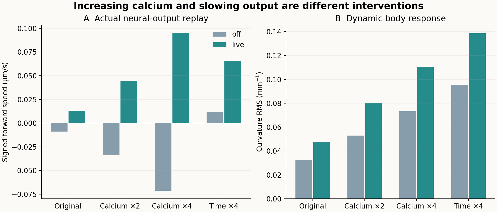
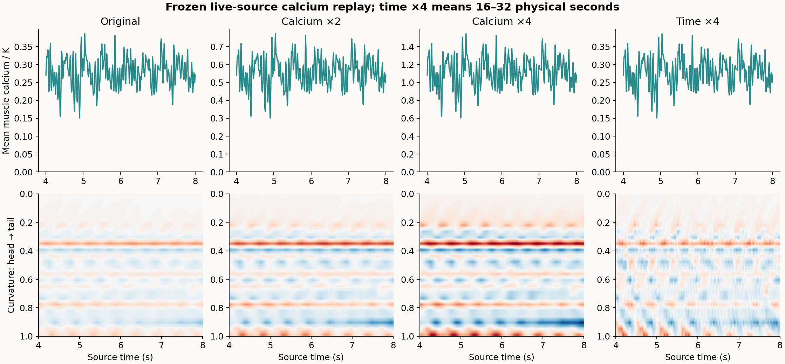

# 完整网络钙输出的开环反事实：增强幅值与放慢时间

日期：2026-11-13。分支A。**8条主条件与2条预定半步长检查完成。增大钙幅值与放慢输出都改变了身体，但都没有恢复有效持续推进；增幅在off来源中反而增强了向后运动，不能简单把低推进归为“钙不够强”。**



图中的off／live指生成冻结钙记录时原完整网络的反馈条件，不是本轮身体重放有无实时神经反馈。本轮所有条件都是开环。

## 问题与范围

11月12日完整302神经元／95肌肉模型产生了钙与肌肉驱动，却没有实现持续有效推进。本阶段不重新求解神经元，只读取该模型最细步长off／live两条冻结记录，将保存的钙状态作为身体的外部输入，比较“钙幅值变大”和“相同输出变慢”两类干预。

这是**10 ms记录经线性插值形成的开环重采样反事实**。它与旧闭环之间的任何差异，都可能混入10 ms重采样、固定历史输入及去除实时反馈等影响，不能解释成干预效果。本阶段因果比较仅限于同一重放框架内部；不声称重现原闭环，也不声称网络已被修复。

原神经—肌肉—身体快照尚未通过完整系统的数值收敛，因此这里只研究一个冻结输出的条件性身体效应，不把钙峰值解释为已校准生理剂量。[原快照验收](full302-joint-numerics-main-2026-11-12.md)

## 固定输入与时间轴

每个来源使用801个钙样本，保存间隔10 ms。原浮点时钟与规范0—8秒网格的最大差小于1e-8秒；只规范浮点时钟，不更改原样本值。先重建原95→96肌肉驱动以核对细胞顺序，再在相邻钙样本之间做分段线性插值。

令源时间为u，物理时间为t，时间倍率为s：

\[
c_i^{\mathrm{replay}}(t)=A\,c_i^{\mathrm{linear}}(t/s),\quad
a_i(t)=0.3\frac{c_i^{\mathrm{replay}}(t)}{c_i^{\mathrm{replay}}(t)+2.5\times10^{-7}\,\mathrm{mM}}.
\tag{1}
\]

每种来源的四个条件为A=1／2／4且s=1，以及A=1、s=4。前三者运行8物理秒，时间拉长条件运行32物理秒。肌肉滤波100 ms、环境阻力、身体、固定平面投影与初始姿态保持一致。没有改神经元、NMJ、细胞通道或闭环增益。

共同比较源时间4—8秒，对应物理时间4—8秒或16—32秒。报告有符号单位时间速度、净位移和路径；输入一、二阶矩均除以物理窗口长度。时间拉长会令总输入积分和总时间乘4，不能把更长时间内的位移当作同预算性能优势，也不属于等物理时长的学习比较。

相同源序列更慢播放也给身体更长的松弛时间，这是该时间变换的一部分。本实验不把它额外解释成真实神经元内在节律已经改变。

## 原定检查

- 8条主条件＋live原样和live时间×4的0.5 ms配对，共10条；不追加调参。
- 原肌肉顺序和映射的重建、源及程序SHA256、输入插值的独立实现、有限性与因果时钟。
- 时间单位归一化的钙均值／平方均值解析计算；饱和激活的一、二阶矩用32点Gauss积分并以16点核对。实际1 ms／0.5 ms交付时钟的矩形积分误差另列。
- 曲率取中央39个位置：逐位置先减去时间均值，再计算动态RMS；静态弯曲RMS单列。数值配对不做相位对齐。
- 速度绝对差≤max(0.002 μm/s，细步长绝对速度的2%)；动态曲率RMS差≤max(0.001 mm⁻¹，细步长动态RMS的3%)。这是本阶段身体指标检查，不是完整网络逐时收敛验收。

协议SHA256：`8ef90f458470129052867c60b8887132d0b63b18e33b577e96b86b6ae2116dab`。

## 结果

### 身体推进与输入变化

速度为对应后半窗口的有符号均值；负号为沿身体轴向后。净位移为该窗口中心首尾距离。每个格子是一条确定性运行，不是生物重复。

| 来源／重放条件 | 物理评价窗口 s | 前进速度 μm/s | 净位移 μm |
|---|---:|---:|---:|
| off 原样 | 4—8 | −0.009037 | 0.03608 |
| off 钙×2 | 4—8 | −0.033230 | 0.13271 |
| off 钙×4 | 4—8 | −0.071480 | 0.28557 |
| off 时间×4 | 16—32 | +0.011665 | 0.18711 |
| live 原样 | 4—8 | +0.012860 | 0.05146 |
| live 钙×2 | 4—8 | +0.044400 | 0.17762 |
| live 钙×4 | 4—8 | +0.095189 | 0.38085 |
| live 时间×4 | 16—32 | +0.065817 | 1.05350 |

两类干预均未接近此前10 μm/s且20 μm的持续推进门槛。live来源中钙×4的速度高于时间×4，因此本轮不支持“放慢总比增强更好”。off来源中，增强钙使向后速度幅度变大，而时间拉长后速度符号改变；这一差异说明输出与力学时间尺度的配合会改变运动结果，不能由单一钙幅值概括。

32秒条件的位移窗口长16秒，其他条件窗口长4秒；不能直接把其较大位移当作同时间预算优势。所有速度已按实际物理时间归一化。

### 动态弯曲与静态弯曲的分离

曲率RMS单位mm⁻¹。动态量先在每个中央位置减去时间均值，静态量为这些时间均值的空间RMS。没有把静态身体弯曲称作节律运动。

| 来源／重放条件 | 动态曲率RMS | 静态曲率RMS |
|---|---:|---:|
| off 原样 | 0.03241 | 0.16629 |
| off 钙×2 | 0.05283 | 0.27673 |
| off 钙×4 | 0.07325 | 0.38501 |
| off 时间×4 | 0.09555 | 0.17580 |
| live 原样 | 0.04768 | 0.14620 |
| live 钙×2 | 0.08016 | 0.24011 |
| live 钙×4 | 0.11059 | 0.32946 |
| live 时间×4 | 0.13863 | 0.16207 |

增强钙会同时抬高动态响应和静态弯曲。时间拉长则产生更明显的动态曲率，静态曲率变化相对小。两者都没有将当前输出组织成有效推进。这里改变的是一个给定输出的身体表达，尚未检验真正神经网络能否根据负载自行调整节律或相位。



上排是具名肌肉钙的空间平均，下排为曲率；横轴都为源时间。最后一列的源4—8秒实际对应物理16—32秒。钙空间平均仅用于显示，不作为推断相位组织或生理剂量的依据。

### 验证结果与工程修订

7项检查通过：10条运行完整、源与程序SHA不变、独立输入重建、有限且因果、激活矩积分交叉核对、两组半步长检查以及时间拉长连续输入平均矩匹配。两组细步长的速度绝对差分别约3.78×10⁻⁵、2.50×10⁻⁵ μm/s，动态曲率RMS差分别约4.65×10⁻⁵、7.12×10⁻⁵ mm⁻¹，均通过原阈值。

同来源原样与时间×4的连续单位时间输入矩一致。实际交付时钟使用左端矩形取样，最差相对积分差约0.104%，拉长后相应误差更小；未将不同网格上的离散矩伪称为逐位相等。钙幅值与时标比较没有复用不同物理时间的总积分作为同一指标。

首次独立分析器用浮点秒作为`np.interp`节点，而runner用规范索引u/0.01插值，激活最大差6.37×10⁻¹⁵，超过实现中的3×10⁻¹⁵检查容差。保留原分析器、原锁与失败记录，经主流程审核后另存v2：仍使用独立`np.interp`，仅将节点改为整数0..800、查询点改为u/0.01。容差、身体数值判据与轨迹均未改变，没有新增仿真；v2另有源码SHA及差异文件。v2同时补充了更明确的开环解释范围文本，未改变数值公式。

## 科学解释

对现有完整网络，可以把“有肌肉钙活动”与“形成有效推进”分开看。单纯增强当前钙输出虽能增加身体响应，却保留了来源相关的运动方向与较大静态弯曲；放慢输入改变了身体对同一序列的动态响应。说明幅值、时间尺度和空间组织需要分别分析。本轮没有直接改变空间相位，因而不能把残余失败唯一归给相位，也没有证明源网络失败仅由身体带宽造成。

这与[规定钙波的身体传递实验](calcium-body-transfer-2026-11-13.md)相互补充：前者说明同样的身体对特定协调波形可以推进，本阶段则检验一个真实连接模型已经产生的冻结输出怎样被身体表达。两批输入的幅值分布、均值和空间模式不同，不直接作速度性能排名。

## 保存与复算

原始目录为`results/network-output-replay-2026-11-13/`，包含协议锁、冻结钙输入、10条身体轨迹、源与程序SHA、原分析失败记录、v2修订及源码锁。新神经元运行数与训练数均为0，原完整模型与其他分支文件没有改动。

复现包已实际解压核验全部CRC与逐文件SHA256，并仅使用解压目录重新计算v2主汇总，结果逐字节一致；独立归档核验未启动新仿真。原off／live完整302源轨迹的哈希在结束时再次核对一致。

在项目根目录或复现包解压根目录执行：

```bash
PYTHONPATH=src OPENBLAS_NUM_THREADS=1 python3 analysis/neuromechanics/network_output_replay/analyze_v2.py
```

重新运行身体实验必须另用新目录，原10条记录不会被覆盖。归档中的本机身体二进制为macOS arm64构建；重算指标不需要运行该二进制，也不需要NEURON。

[完整指标](assets/network-output-replay-2026-11-13/summary.json) · [解释范围](assets/network-output-replay-2026-11-13/scope.json) · [复现包](https://github.com/Zlllo/soft-worm-research-platform/releases/download/research-mechanisms-2026-11-13/network-output-replay-2026-11-13.zip) · [归档核验](assets/network-output-replay-2026-11-13/archive-validation.json)
