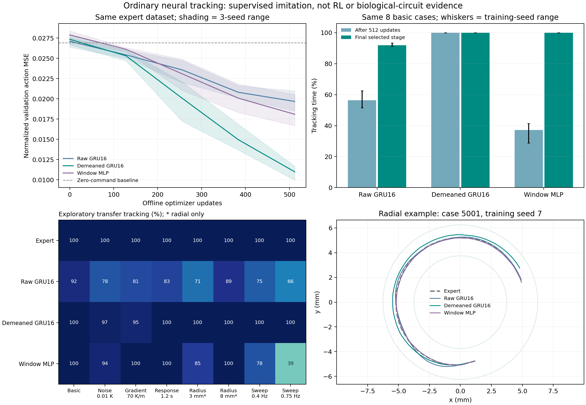

# 普通神经网络的二维等温追踪

日期：2026-10-24。性质：三个训练种子的探索性监督模仿学习；不属于强化学习或真实回路优势证据。

## 结果与研究意义

普通记忆网络已经能够学习二维局部测温追踪。保留窗口均值的去均值 GRU16 在三个训练种子的基础评估中均达到 100% 追踪时间比例；原始温度 GRU 和历史窗口 MLP 在追加访问轨迹示范和优化后也明显改善。基础任务的可学习性已有可用基准，接下来应回到真实连接与度保持重排的比较。



## 场景、信息与预算

采用[规定运动学追踪场景](isothermal-scene-2026-10-24.md)：线性或圆形温度场、持续前进、摆动头部局部测温和有限转向响应。不是 RFT 软体身体或弹性仿真，不据此报告机械能耗或代谢收益。

网络只读取过去 4 秒、41 个样本的局部温度、运动相位与样本有效标记，不读取真实位置、朝向、梯度或未来观测。监督目标是工程教师在同一时刻请求的角速度，教师读取相同传感历史。已知偏好温度为所有模型的共同任务条件。

GRU 隐藏维度为 16，参数量 1,121；MLP 读取相同窗口，参数量 15,297。每次 GRU 决策从零状态重放有效历史，训练和实际控制采用相同规则。去均值版本另行保留窗口均值，因此没有丢弃温度水平信息；它是工程预处理，不能直接解释成 AFD 生物机制。原始版本的对应额外通道为零，名义参数相同不代表有效自由度完全一致。

初始训练使用每场 64 条、合计 128 条 60 秒教师轨迹，产生 38,528 个重叠窗口标签；离线验证为每场 8 条、合计 16 条轨迹及 4,816 个标签。重叠窗口不能视为独立轨迹。Adam 学习率 0.003，batch 64，512 次更新；训练种子为 7、17、27。

训练、离线验证、追加训练触发评估、最终评估和迁移使用不同场景种子，完整划分见[预先保存的设计](assets/neural-tracking-2026-10-24/design.json)。训练初始温差与方向偏差范围大于基础维持追踪评估。基础评估从舒适等温线附近开始，不代表从任意地点寻找等温线的能力。

预先约定触发评估平均追踪比例低于 80% 时，增加三次访问轨迹示范，教师动作混合比例依次为 0.5、0.25、0。共增加 24 条轨迹、7,224 个标签与 384 次更新；不同模型追加阶段看到的轨迹不同。最终检查点按固定阶段保存，没有选择最高分检查点。

## 相同基础评估上的结果

追踪时间比例指中心温差不超过 0.05 K、运动方向与等温线切向夹角不超过 25° 同时成立的时间比例；100% 不表示温度误差为零。每个模型、每个训练种子使用相同的 8 条 120 秒基础轨迹，表中为三个训练种子的平均值。

| 模型 | 初始 512 次更新后 | 最终阶段 | 最终可用标签／更新次数 |
| --- | ---: | ---: | ---: |
| 原始温度 GRU16 | 56.33% | 91.92% | 45,752／896 |
| 保留均值的去均值 GRU16 | 100.00% | 100.00% | 38,528／512 |
| 历史窗口 MLP | 37.16% | 99.99% | 45,752／896 |

工程教师在同组基础轨迹为 100%，保持朝向的盲对照为 34.65%。初始检查点在最终同组轨迹上的比较是训练完成后的配对检查，区别于训练中的触发评估。

最终预算不同，不能把这张表解释为等预算排名。追加阶段同时增加数据和更新次数，不能把改善全部归因于访问轨迹示范。三个模型的训练种子各为三个，多个共享评估场景不能充当额外独立训练。

## 冻结模型的迁移检查

以下均不追加训练。噪声、梯度和响应时间是原设计留出的条件；半径、头摆频率及相位是事后探索，没有据此重新训练或选择模型。

| 条件 | 原始 GRU | 去均值 GRU | 历史窗口 MLP |
| --- | ---: | ---: | ---: |
| 测温噪声标准差 0.01 K | 77.57% | 97.24% | 94.13% |
| 梯度 70 K/m | 80.59% | 94.90% | 99.80% |
| 转向响应时间 1.2 s | 82.74% | 99.94% | 100.00% |
| 等温线半径 3 mm，仅圆形场 | 70.51% | 100.00% | 85.35% |
| 等温线半径 8 mm，仅圆形场 | 89.42% | 100.00% | 100.00% |
| 头摆频率 0.4 Hz | 75.42% | 100.00% | 78.03% |
| 头摆频率 0.75 Hz | 66.49% | 100.00% | 39.38% |

原频率为 0.5 Hz。通常每条件两个场、每场两个评估种子；半径条件仅统计圆形场。不同检查组使用不同场景种子，不能把条件间分数之差当成严格配对效应。图中百分数四舍五入到整数，100 不表示误差严格为零。

工程教师在对应迁移轨迹均为 100%。频率改变时，教师窗口随已知频率保持两个周期，网络仍使用固定 4 秒窗口，两者先验不同。MLP 在较快头摆下下降到约 39%，表明基础场景高分不能代替时间模式迁移检查。

同一组场景种子 6101、6102 下，去均值 GRU 使用正确相位时三个训练种子均为 100%；打乱报告给冻结网络的相位后，分别为约 55.10%、55.91%、54.55%。这支持当前模型利用相位信息，不证明所有无相位策略都不能完成任务。见[同初态相位比较](assets/neural-tracking-2026-10-24/phase-reference.json)。

## 复现与材料

已保存[完整训练汇总](assets/neural-tracking-2026-10-24/summary.json)、[事后检查结果](assets/neural-tracking-2026-10-24/diagnostics.json)、[检查设计](assets/neural-tracking-2026-10-24/diagnostics-design.json)、[全部检查点与源码快照](assets/neural-tracking-2026-10-24/models-and-sources.zip)及[SHA-256 清单](assets/neural-tracking-2026-10-24/manifest.json)。训练原始输出位于被 Git 忽略的 results 目录，公开包已包含结果 JSON 和模型文件。数据数组保存了摘要哈希，可根据固定场景和种子重新生成，未额外保存全部重叠窗口数组。

解压归档至空目录后，其中的 `results.json`、检查点和 `diagnostics/` 可作为绘图的 `--root`。重新训练使用新的输出目录，程序拒绝覆盖已有设计：

```bash
PYTHONPATH=src python3 analysis/train_tracking_network.py --output results/neural-tracking-new
PYTHONPATH=src python3 analysis/diagnose_tracking_network.py --root results/neural-tracking-new
PYTHONPATH=src MPLCONFIGDIR=/tmp/worm-matplotlib python3 analysis/plot_tracking_network.py --root results/neural-tracking-new --output results/neural-tracking-new/summary.png
```

独立相位参考脚本 `analysis/tracking_phase_check.py` 保留了原实验目录，重放时应使用原目录布局，或者在独立副本中更改目录并记录变更。它不参与拟合。

完整验证命令：`PYTHONPATH=src python3 -m pytest tests 程序/test_core.py -q`。本次检查 176 项通过，另有 14 条既有 Matplotlib／pyparsing 弃用警告。新增检查包括因果输入、有效历史打包、首步梯度、同刻教师标签、训练／执行一致性，以及纯学习器访问轨迹不受教师标签泄露影响。

## 后续比较

优先比较真实连接与度保持重排网络，并共享编码、观测、动作范围、数据和初始化规则；将拓扑、符号和时间常数分别作为因素。先按整条轨迹设置多个示范预算，保留独立训练及随机图种子，报告学习曲线与失败次数。追加示范的收益需与同等更新次数的对照比较。监督数据效率与强化学习交互效率分开报告。

有限响应、动作限制与后续身体动力学采用交叉比较，同时记录收益和迟滞等代价。当前结果没有证明真实回路优势，也没有证明物理约束提高训练效率。详见[研究主线](../research-mainline.md)和[场景设计](../scenario-design.md)。
