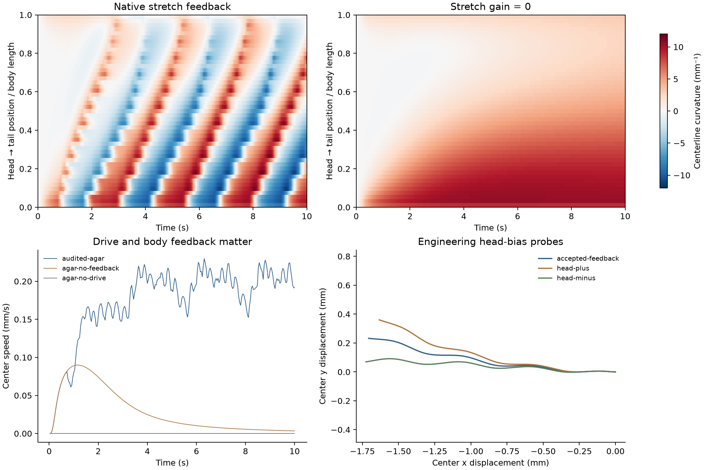

# 快速二维神经力学身体：源码复现与反馈核查

日期：2026-10-27。接续[神经肌肉与Sibernetic首次运行](neuromechanics-stage0-2026-10-27.md)，对应[研究计划](../neuromechanical-research-plan-2026-10-27.md)中的快速身体评估及初步执行校准。

后续执行更新：已完成[逐步控制、重置与实际头部测温](neuromechanics-stepper-2026-10-27.md)，并为在线控制增加逐步停止时间。下文保留本批来源验证时的数值设置与结果。

## 结果与选择

Boyle–Berri–Cohen模型已在本机完成构建，并完成11个独立条件运行。有效琼脂阻力条件下，原始10秒示例耗时1.87秒，60秒示例耗时8.15秒。它具备肌肉驱动和身体形变反馈，适合作为下一步共享运动模块的快速候选；Sibernetic继续保留为独立身体参照。

本次检验的是运动模块是否可用，以及身体反馈是否参与运动。没有接入温度场、现有8节点、扩展连接组或训练算法。

| 条件 | 模拟时长 | 运行耗时 | 预热3秒后中心平均速度 |
|---|---:|---:|---:|
| 未修改的原始琼脂示例 | 10秒 | 1.87秒 | 0.1978 mm/s |
| 增加状态记录的同条件 | 10秒 | 2.15秒 | 0.1978 mm/s |
| 同模型延长运行 | 60秒 | 8.15秒 | 0.1979 mm/s |
| 伸展反馈增益置零 | 10秒 | 1.15秒 | 0.0127 mm/s |
| AVB启发的常数驱动置零 | 10秒 | 0.73秒 | 约0 |
| 切换为水中有效阻力 | 10秒 | 88.74秒 | 0.0841 mm/s |
| 从当前身体状态重建反馈 | 10秒 | 1.99秒 | 0.1976 mm/s |

速度由保存的身体几何中心路径长度除以对应时间计算，去除前3秒启动段。它不等于朝目标的速度。每种条件为一条确定性运行，未将时间采样点当成独立重复。耗时不含编译，包含本次数据输出；不是跨硬件性能保证。

水中条件明显更慢，且原源码同时采用了更严格的求解容差，因此不能把全部耗时差异归因于介质。Sibernetic与本模型的方程和数值设置不同，两者计时用于判断研究规模是否可执行，不用于比较模型准确性。



图中上排比较身体曲率的传播，左下是速度，右下是独立的头部偏置实验。关闭反馈后出现持续弯曲而非正常传播波；这属于原简化运动模型的机制结果，不是对真实线虫回路的消融实验。

## 来源与模型范围

[论文](https://www.frontiersin.org/journals/computational-neuroscience/articles/10.3389/fncom.2012.00010/full)：Boyle, Berri & Cohen, 2012, *Gait Modulation in C. elegans: An Integrated Neuromechanical Model*。

[OpenSourceBrain源码](https://github.com/OpenSourceBrain/CelegansNeuromechanicalGaitModulation/tree/1f825daff066d56e5c26384d71648914ca169d6b)：固定提交`1f825daff066d56e5c26384d71648914ca169d6b`。仓库README说明其WormSim来自论文补充源码，并给出原补充包入口。本轮复现的是该固定仓库版本，未另外逐字节比较出版社原ZIP。

源码自带Sundials 2.3.0；在项目实验目录内编译和安装，再编译未修改的`worm.cc`。原始源码检出保持未修改，各实验使用独立源码副本、配置、补丁、可执行文件哈希和输出目录。

该模型包含48段身体、49根横向杆、12个简化神经单元（每个有背腹两个二值状态，共24个状态），以及48对背腹有效肌肉通道。背腹抑制部分包含在有效神经输出中；不能把这称为完整解剖运动神经元网络。

**这里的96个有效肌肉通道不是Sibernetic的四列各24个肌肉，也不是当前Cook数据的95个命名细胞。** 不能直接套用前一批95→96名称映射。接入完整运动神经元输出时，需要独立建立空间聚合或插值映射，并明确其工程性质。

环境通过各向异性有效阻力表达水到琼脂的变化；本批没有障碍物，也没有验证真实表面接触、毛细作用或身体自接触。模型使用权限说明保留在`worm.cc`顶部，要求研究／教学等非商业用途保留说明并引用论文；Sundials的许可独立保存。

## 检验什么、为什么、结果意味着什么

### 1. 记录接口是否改变原模型

原始输出只有身体姿态。另加有效神经驱动、肌肉状态、伸展信号和侧边长度记录，以便以后定位感觉—运动失效环节。保持动力学参数不变，将原六位有效数字CSV与高精度记录逐点比较。

最大位置差为4.995×10⁻⁹ m，杆角度差为4.998×10⁻⁶ rad，处于原输出的舍入精度范围。状态记录没有显示出超出原输出精度的轨迹改变。

### 2. 反馈是否参与运动

仅把伸展输入的增益从1改成0，其余源模型保持一致。平均中心速度降到基准的6.41%，传播波明显减弱。另把前行驱动置零，身体保持接近初始静止状态。

这证明当前源模型的运动需要其驱动和伸展反馈；不意味着新增趋温处理回路一定改善性能，也不等于本体感觉之外的反馈都已实现。

### 3. 反馈读取时间是否与当前身体一致

原程序在`IDASolve`返回后读取全局`L_SR`。但该数组由残差函数更新，可能保留求解器内部其他时刻的几何值。增加最后一次残差调用时间记录后，250个非初始保存帧都出现了残差调用时间晚于控制时间的情况，本次最大差为11.26毫秒；全控制更新间隔为1毫秒。

独立按杆位置、角度和半径重建侧边长度，与原程序缓存的最大差约1.17×10⁻⁷ m。该观察说明缓存不能直接当作当前控制时刻的本体感觉，尤其在以后研究反馈延迟时需要处理。

另设独立变体：从`IDASolve`返回的当前身体姿态重建两侧长度，再调用原伸展和神经更新。与Python独立几何重建的最大差约2.07×10⁻¹⁹ m；该例平均速度比原记录版本低约0.13%，主要运动形态仍存在。

这是反馈采样来源的修正，并未完成IDA内部历史、外部肌肉更新和多时钟交换的全部误差核查。原版本、诊断版本和修正版本均保留；修正结果不改写为原论文结果。

### 4. 身体是否存在可调的转向出口

使用当前状态反馈的变体，在前8段背腹有效肌肉驱动上分别加入相反的常数偏置±0.05。10秒内身体长轴变化为：无偏置−7.29°，正偏置−19.73°，负偏置+8.38°。

这提供了可进一步校准的转向调节方式，但属于工程肌肉输入，不是已确认的真实突触。两侧不要求严格镜像，因为原运动模型的背腹计算不完全对称；尚未建立目标转向速率到偏置的完整响应曲线。

### 5. 时长与步长检查

原生模型在60秒内持续运动，但身体长轴累计改变约−107.61°。因此“持续爬行”不能等同于“长时间直行”，后续需要独立校准漂移与转向。

另把神经／肌肉外部更新时间从1毫秒减为0.5毫秒，保留原IDA误差容差。原循环的终止与输出间隔使后一组最后保存时间为9.96秒，因此只在共同的0–9.96秒记录上比较，速度统计均从3秒开始，平均速度相差约0.17%。完整数值见汇总中的`timestep_check`。这是单条件步长诊断，不能替代所有介质和干预下的收敛检查。

## 当前状态与接入顺序

- **已实现：** 固定源版本、本地构建、原版10秒复现、60秒运行、11个条件的原始输出与计时、反馈和驱动干预、独立几何核查、初步转向输入。
- **部分实现：** 原生简化运动回路已与肌肉和身体反馈耦合；当前身体状态反馈变体可运行，连续外部控制API和控制时钟仍需校准。
- **待实现或待验证：** 动态停止／恢复、倒退能力、完整转向标定、温度采样和感觉动态、8节点与扩展回路的共享接口、95个解剖肌肉的空间映射、正式学习与迁移。

下一步优先把当前状态反馈版本封装为可以重置和逐步推进的运动模块：保存求解器与神经单元状态，返回实际头部位置和局部形变，接收共享的驱动／头部偏置输入。先验证分段运行与连续运行的一致性，再加头部测温。此处不会用新的外部正弦摆动替代身体自己产生的波形。

## 复现与材料

[汇总JSON](assets/neuromechanics-fastbody-2026-10-27/summary.json)、[源码与原始记录ZIP](assets/neuromechanics-fastbody-2026-10-27/reproduction.zip)、[SHA256清单](assets/neuromechanics-fastbody-2026-10-27/manifest.json)。源代码使用说明和Sundials许可证随归档保存。ZIP不包含编译后的程序和完整依赖安装目录。

本地完整目录：`results/neuromechanics-fastbody-2026-10-27/`。原源码版本见`configs/neuromechanics/boyle-source-lock.json`。在项目根目录运行，输出目录需为新目录：

```bash
git clone https://github.com/OpenSourceBrain/CelegansNeuromechanicalGaitModulation.git results/boyle-rerun/upstream
git -C results/boyle-rerun/upstream checkout 1f825daff066d56e5c26384d71648914ca169d6b
python3 analysis/neuromechanics/build_boyle_source.py --source results/boyle-rerun/upstream --output results/boyle-rerun/build
python3 analysis/neuromechanics/run_boyle_probe.py --source results/boyle-rerun/upstream --output results/boyle-rerun/agar --accepted-state-feedback
python3 analysis/neuromechanics/run_boyle_probe.py --source results/boyle-rerun/upstream --output results/boyle-rerun/no-feedback --feedback-gain 0
PYTHONPATH=src python3 -m pytest tests/test_boyle_output.py tests/test_neuromechanics_mapping.py tests/test_connectome.py -q
```

本轮相关检查11项通过。CSV形状与时间、刚体变换下的几何不变性、缺失肌肉映射等属于实现检查；上述运动与反馈观察来自实际运行的模型轨迹。结果汇总和画图入口为`analysis/neuromechanics/audit_boyle_probe.py`。
