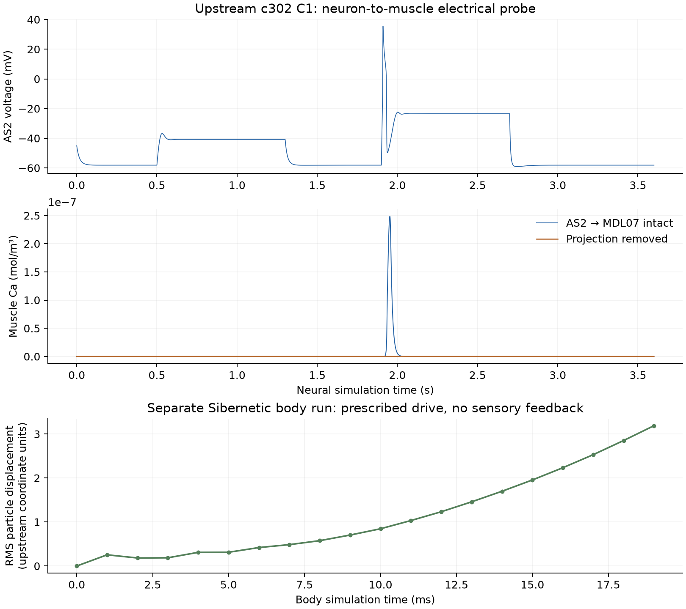

# 神经肌肉与身体模型的首次运行核查

日期：2026-10-27。对应[研究计划阶段0](../neuromechanical-research-plan-2026-10-27.md)。这次实际运行了上游神经肌肉和身体示例，并实现了肌肉名称映射；神经与身体目前仍是分开的运行，局部测温反馈尚未接入。

后续更新：快速二维身体已实际运行，见[Boyle模型及身体反馈核查](neuromechanics-fastbody-2026-10-27.md)。下文保留本批Sibernetic与c302检查的原始范围。

## 结果与研究意义

现在已有两个可以执行的来源参照：c302的神经到肌肉电活动，以及Sibernetic的规定肌肉激活到身体物理步进。这使后续能够逐层检查失败发生在感觉、回路、肌肉还是运动端。当前不能据此回答扩大回路后是否改善趋温。

| 检查 | 实际结果 | 说明 |
|---|---|---|
| 当前解剖肌肉→模拟器槽位 | 95个名称映射到96槽位，MVL24静默；顺序扰动与单肌肉输入测试通过 | 映射是索引约定，不是功能强度校准 |
| c302 C1原始突触示例 | 7个神经元、1个肌肉，3.6秒，72,001个采样点 | 完成神经与肌肉电活动仿真 |
| 移除AS2→MDL07 | AS2电压逐点不变，肌肉钙峰值从2.4889×10⁻⁷降至3.7321×10⁻¹² mol/m³ | 该模型的肌肉响应依赖这条神经肌肉连接 |
| 同模型通过NEURON运行 | 3.6秒完成；肌肉钙峰值与jNeuroML相差约0.33% | 两条执行路径可用；不是完整收敛或生物校准证明 |
| Sibernetic短程身体运行 | Apple M2 GPU；1000物理步，步长20微秒，共20毫秒；已保存粒子数据均有限 | 身体可以实际步进；未覆盖一个完整运动周期 |
| 原macOS OpenCL设置 | 20毫秒仿真耗时17.81秒 | 仅针对当前配置和此次短程运行 |
| 开启OpenCL优化 | 相同长度耗时11.88秒；保存精度下的弹性粒子位置一致 | 约1.5倍加速；未证明长时间精度和稳定性 |
| 项目相关测试 | 9项通过 | 2项新映射测试＋7项已有连接数据／策略测试 |

图中上两幅为c302及其移除连接对照，下面是独立身体运行，不能把它们看成同一次神经—身体闭环轨迹。



## 来源与运行环境

- c302：固定提交 `d542a44bf2662f79e0ad23342a959a181a920877`，版本0.12.1。[源码](https://github.com/openworm/c302/tree/d542a44bf2662f79e0ad23342a959a181a920877)
- Sibernetic：固定提交 `2b3f1eb3770cb9e3142cf38391b40a1adf27c89d`。[源码](https://github.com/openworm/sibernetic/tree/2b3f1eb3770cb9e3142cf38391b40a1adf27c89d)
- 本机macOS arm64，独立Python 3.12.14环境；NEURON 9.0.2、pyNeuroML 1.3.22、cect 0.3.5、jdk4py 25.0.2.1。全部依赖版本见[锁定文件](assets/neuromechanics-stage0-2026-10-27/requirements-lock.txt)。
- 源码检出、环境、日志和完整运行目录在本地 `results/neuromechanics-stage0-2026-10-27/`。没有安装系统Java、修改旧平台依赖或启动Docker。

c302先按上游默认`SpreadsheetDataReader`复现原始示例。它与本项目已固定的Cook修正版不是同一数据入口。原始示例成功，不等于当前Cook神经肌肉连接已经完成动态接入。

身体使用上游`worm_alone_half_resolution`配置。该名字不能理解成“没有环境粒子”：输出头信息实际包含2290个弹性粒子、388个液体粒子和31408个边界粒子。几何坐标仍按上游原始单位记录，绝对长度、头尾和身体坐标标定尚未完成。

## 发现并记录的兼容性与接口问题

### 构建与执行

Sibernetic附带的旧OpenCL C++头文件无条件引用x86 SSE指令，无法直接编译到ARM。新增的兼容补丁在ARM上使用标准C++内存屏障，力学方程未修改。另有独立性能补丁，移除macOS分支默认的`-g -cl-opt-disable`；两种构建和结果分别保存。短程一致性只针对当前配置及文本输出精度。

沙箱内无法枚举OpenCL设备，在本机受限范围外运行同一有超时的测试后，成功使用Apple M2 GPU。原失败记录保留。

jNeuroML的Java端首次找不到pip版NEURON；指定目录后又直接调用了缺少重定位环境的内部编译入口。最终采用“生成脚本→独立环境中的nrnivmodl包装入口→运行生成的Python脚本”成功完成，没有更改神经模型。构建脚本也处理了可重定位Python中遗留的`/install/lib`路径。

### 肌肉顺序不能使用辅助函数猜测

当前Sibernetic肌肉信号按MDR、MVR、MVL、MDL四个连续24槽位块排列，可由`MuscleSimulation.run`、`C302NRNSimulation.run`与界面的索引代码交叉核对。但`get_muscle_names()`返回的是四象限交错顺序，因此不将该函数用于信号数组命名。

另发现上游`C302NRNSimulation.run`存在把MVR24读取为MVR23，以及遇到缺失细胞时直接`continue`的行为。未经修复和检查，可能重复肌肉或减少返回槽位。本轮没有调用该整合桥来宣称耦合成功；新适配器通过显式名称和缺失槽位约定防止静默错接。

新映射器：`src/thermotaxis/neuromechanics/muscle_mapping.py`。它保留本地解剖名称顺序，映射到指定模拟器顺序；不把电镜连接数量转换为突触效能或肌肉力。上游身体原始演示使用其原生96槽位驱动，不能写成已应用本项目95肌肉动态约束。

## 当前选择与下一步

**Sibernetic保留为独立身体参照，暂不作为批量学习的默认身体。** 优化后本次20毫秒仿真仍耗时约11.88秒。若直接线性外推，10秒约需1.65小时、60秒约需9.90小时；这是短程计时外推，不是已完成的长程测量，负载与数值状态都可能改变成本。因此本轮没有继续运行计划中的10秒／60秒整身体基准。

下一步先评估Boyle–Berri–Cohen补充源码或其他已有快速身体实现，核对实际肌肉驱动和形变反馈是否可用；在相同命名与记录接口下，与Sibernetic的小样本响应比较，再决定批量研究身体。不会直接增大物理步长来换取速度，因为稳定性和误差尚未核查。

之后接入实际头部测温与运动状态：先用身体扰动改变真实采样轨迹，确认后续感觉输入随之改变，再接扩展回路。若仍需工程运动模块，独立标记，不称完整生物复现。

状态分开记录：

- **已实现：** 独立环境、固定源码、95→96命名映射、c302神经肌肉示例及移除对照、NEURON执行路径、Sibernetic ARM构建与短程GPU运行、计时与归档。
- **部分实现：** 神经和身体各自可运行，尚未完成二者在线交换；模型坐标和肌肉排列在代码层已核对，实际几何与SI标定未完成。
- **待实现或待验证：** 稳定整周期运动、局部测温闭环、实际形变反馈、当前Cook神经肌肉动态接入、扩展趋温回路、正式学习比较。研究计划阶段0的在线感觉反馈检查仍未完成。

## 复现入口与材料

[汇总JSON](assets/neuromechanics-stage0-2026-10-27/summary.json)、[肌肉映射](assets/neuromechanics-stage0-2026-10-27/muscle-mapping.json)、[代码与原始输出ZIP](assets/neuromechanics-stage0-2026-10-27/reproduction.zip)、[SHA256清单](assets/neuromechanics-stage0-2026-10-27/manifest.json)。ZIP包含脚本、补丁、源版本、MIT许可证、运行设计、原始神经轨迹、身体位置与肌肉输出、失败记录；不包含虚拟环境和完整上游仓库。

以下命令从项目根目录执行。先根据锁定文件建立环境并检出固定源码，再运行：

```bash
PYTHONPATH=src python3 -m pytest tests/test_neuromechanics_mapping.py tests/test_connectome.py -q
stage0_python=results/neuromechanics-stage0-2026-10-27/env/bin/python

# 使用各自新目录；已有结果不会被覆盖
"$stage0_python" analysis/neuromechanics/run_c302_probe.py --output results/neuromechanics-rerun/c302-intact
"$stage0_python" analysis/neuromechanics/run_c302_probe.py --output results/neuromechanics-rerun/c302-removed --disconnect-nmj
"$stage0_python" analysis/neuromechanics/run_c302_probe.py --output results/neuromechanics-rerun/c302-neuron --engine neuron

# 对固定源码依次应用ARM兼容补丁；优化补丁为独立可选条件
git -C results/neuromechanics-stage0-2026-10-27/upstream/sibernetic apply ../../../../analysis/neuromechanics/patches/sibernetic-arm64.patch

"$stage0_python" analysis/neuromechanics/build_sibernetic.py --source results/neuromechanics-stage0-2026-10-27/upstream/sibernetic --output results/neuromechanics-rerun/build
"$stage0_python" analysis/neuromechanics/run_sibernetic_probe.py --source results/neuromechanics-stage0-2026-10-27/upstream/sibernetic --output results/neuromechanics-rerun/body --duration-s 0.02 --logstep 50
```

补丁只应用于干净源码，当前本地检出已经应用过。Sibernetic在本机需要可访问GPU的执行环境。结果核查和画图脚本为`analysis/neuromechanics/audit_stage0.py`，按其固定的本轮输出目录名称组织重跑结果即可重建汇总；归档脚本为`analysis/neuromechanics/archive_stage0.py`。
