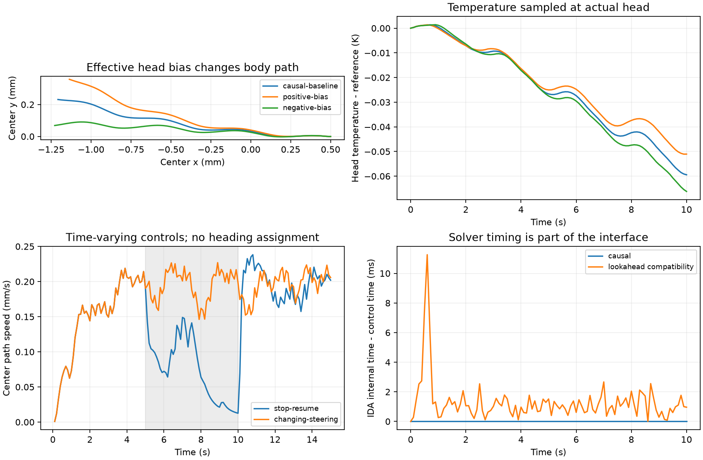

# 快速身体的逐步控制、重置与实际头部测温

日期：2026-10-27。接续[快速身体来源验证](neuromechanics-fastbody-2026-10-27.md)和[研究计划](../neuromechanical-research-plan-2026-10-27.md)。

身体接口已实现并通过原生运行检查：可以连续保留身体、肌肉、神经和求解器状态；逐步施加驱动与头部偏置；完整重置；从运动后的头部位置采样温度。原平台和前一批来源运行记录均保留。

本次6条轨迹用于核查接口与执行响应，未连接现有8节点或扩展趋温回路，没有训练或趋温成功率结果。

## 实际进展

| 状态 | 内容 |
|---|---|
| 已实现 | 持续运行的原生工作进程，1 ms神经／肌肉时钟，按整数步推进 |
| 已实现 | 新进程重置，清除源程序函数内部的静态神经状态；实例彼此独立 |
| 已实现 | 由当前已接受身体几何重建伸展反馈；每个物理求解区间限制停止时间 |
| 已实现 | 实际头部测温，0.1 s感觉采样，可按0.2 s等整数采样周期保持控制 |
| 已实现 | 控制器观测只含局部温度、理想身体速度与局部曲率；可将后两项置零 |
| 部分实现 | 前进驱动与头部偏置能改变运动；尚无完整的反向、停顿、转向能力标定 |
| 待实现或待验证 | 8节点与扩展回路读出、感觉归一化和动态范围、闭环趋温、训练比较 |

## 这次检验了什么

**分段调用是否改变模拟。** 在相同固定控制下，将1000步一次推进，与按1、19、83、197、300、400步推进比较，身体、导数、神经输出、肌肉、伸展信号和侧边长度逐项完全相同。重置与另开独立身体进程均复现相同状态；另一个进程推进不会改变原进程的时钟。这里验证的是调用方式与状态管理，不是步长收敛。

**身体反馈是否来自当前身体。** 所有6条运行中，记录的侧边长度与Python独立几何重建的最大差小于3.1×10⁻¹⁹ m。默认模式中，保存帧的IDA内部时间没有超出控制时刻。原生程序每个1 ms更新前均从返回的身体姿态重新构建侧边长度。

**原求解器的超前是否被保留。** 另外保留显式兼容模式`causal=False`，只用于比较。它允许原IDA内部时间超过控制时刻；10秒基线中最大超前11.26 ms。与上一批已接受状态反馈轨迹在51个共同时间点比较，兼容模式最大坐标差为2.46×10⁻¹⁶ m、杆角度差为2.97×10⁻¹² rad；整数时钟和接口重写复现了上一批结果。

默认模式使用Sundials 2.3专有的`IDA_NORMAL_TSTOP`与逐步停止时间，同时限制最大内部步长1 ms。与兼容模式相比，平均中心速度变化+0.0354%，但轨迹坐标最大差达到7.29 μm，不能只用速度接近来声称轨迹相同。两种数值条件分开记录，后续默认使用限制超前的模式。

初版实现只调用`IDASetStopTime`并沿用`IDA_NORMAL`，被Python时钟检查拒绝：100步时输出为0.1 s，内部时间为0.100024 s。核查随源码附带的IDA实现后，改用显式`TSTOP`任务。初版留在实验目录`build/`，正式结果使用`build-v2/`；[修正记录](assets/neuromechanics-stepper-2026-10-27/implementation-correction.json)随归档保存。

**温度是否随实际头部运动更新。** 采用参考温度293.15 K、梯度(40,20) K/m的静态线性场，噪声设为0。在所有保存帧，根据实际头部坐标重新计算的温度与传感输出一致，数值差为0。正、负头部偏置改变路径，同时改变温度序列。噪声机制另通过固定种子重置复现检查；尚未做噪声下的行为评估。



图左上是身体几何中心轨迹，右上是实际头部测温。左下灰色区间为5–10秒：蓝线关闭前进驱动，橙线保持驱动并改变偏置。右下比较求解器内部时间。图展示运动与感觉接口响应，没有按温度选择动作。

## 运行结果

速度以0.1秒采样的几何中心路径计算，去掉前3秒；耗时包含进程启动、分段通信和记录，不含编译。单条确定性轨迹不构成独立重复统计。

| 条件 | 模拟时长 | 耗时 | 平均中心路径速度 |
|---|---:|---:|---:|
| 默认限制超前的基线 | 10 s | 3.76 s | 0.19763 mm/s |
| 允许超前的兼容基线 | 10 s | 1.23 s | 0.19756 mm/s |
| 恒定头部偏置+0.05 | 10 s | 3.34 s | 0.19305 mm/s |
| 恒定头部偏置−0.05 | 10 s | 3.39 s | 0.19861 mm/s |
| 5–10秒驱动置零，随后恢复 | 15 s | 4.54 s | 0.14460 mm/s |
| 0／+0.05／−0.05分段偏置 | 15 s | 6.05 s | 0.19581 mm/s |

10秒时头尾长轴的累计方向变化为：基线−7.59°，正偏置−19.87°，负偏置+7.98°。偏置的符号由源模型背腹约定决定，不直接解释成固定世界左右方向。仅在初始化时应用平移、旋转；控制过程中没有设置全局朝向。

驱动关闭并不立即停止身体。在该15秒例中，3–5秒平均速度为0.1960 mm/s，7–10秒降至0.0558 mm/s，恢复驱动后的12–15秒为0.1889 mm/s。因此当前`drive=0`只能称关闭有效前进驱动，尚不能当已标定的停止动作。

## 接口约定与限制

实现位于`src/thermotaxis/neuromechanics/boyle_body.py`与`thermal_body.py`；构建入口为`analysis/neuromechanics/build_boyle_worker.py`。每个身体持有一个常驻工作进程，分段调用不重启求解器；重置启动新进程。读取有超时，协议异常会关闭工作进程，无效控制在推进前被拒绝。

`BoyleBody.step(n, drive=..., head_bias=...)`推进n个1 ms更新。`advance(duration_s, ...)`要求时长为1 ms整数倍。驱动范围[0,1]，头部偏置范围[−0.1,0.1]是本接口声明的工程范围，尚未全范围标定。新控制在下一次身体推进后更新神经与肌肉，因此对身体力的影响至少延后一个物理更新区间。肌肉仍有源模型0.1 s响应时间。

身体快照包含49根杆的姿态和导数、48对背腹神经有效输出与肌肉状态、伸展输入、侧边长度。头部为杆0。速度是求解器返回时刻、沿头尾轴投影的几何中心平均平移速度；曲率取头部前5个内部曲率样本平均。这些是理想模拟反馈，尚未对应到具体生物感受器。

`ThermalObservation`仅包含`time_s`、`temperature_K`、`signed_speed_m_s`和`head_curvature_per_m`。位置、全局朝向、温度梯度及目标距离只留给环境和评价代码。关闭`body_feedback`后，速度和曲率槽位为0；共享运动模块内部的伸展反馈仍开启。将来关闭内部反馈应作为另一个干预条件，避免两者混淆。

身体仍是上一批固定的Boyle–Berri–Cohen简化模型：48段、12个背腹神经单元、96个有效背腹肌肉通道。头部偏置是前8个有效段的相反驱动，不是解剖突触。此次既没有把96通道变成95个命名肌肉，也没有安装完整302神经元网络。

限制超前使在线控制的时间关系更清楚，但仍沿用原模型神经／肌肉更新与IDA历史相结合的离散方案，没有在每次肌肉更新后重启求解器。更小控制步长与严格分裂误差收敛仍需另外检查。当前只验证有效琼脂阻力、无障碍条件；身体自接触、倒退与强转向不在已验证范围。

## 如何复现

从仓库根目录执行，`source`指向上一批固定提交检出；若没有该目录，先按[来源报告](neuromechanics-fastbody-2026-10-27.md)取得源码并构建随附Sundials。新输出目录必须不存在。上游来源与原始版权说明见[固定来源配置](../../configs/neuromechanics/boyle-source-lock.json)。

```bash
python3 analysis/neuromechanics/build_boyle_worker.py \
  --source results/neuromechanics-fastbody-2026-10-27/upstream/boyle2012 \
  --output results/neuromechanics-stepper-reproduction/build

BOYLE_WORKER="$PWD/results/neuromechanics-stepper-reproduction/build/worker" \
PYTHONPATH=src python3 -m pytest \
  tests/test_boyle_body.py tests/test_boyle_output.py \
  tests/test_neuromechanics_mapping.py tests/test_connectome.py -q

PYTHONPATH=src MPLCONFIGDIR=/tmp/worm-matplotlib \
results/neuromechanics-stage0-2026-10-27/env/bin/python \
  analysis/neuromechanics/audit_boyle_worker.py \
  --binary results/neuromechanics-stepper-reproduction/build/worker \
  --output results/neuromechanics-stepper-reproduction/audit \
  --previous results/neuromechanics-fastbody-2026-10-27/outputs/agar-accepted-feedback-10s
```

本次指定原生工作程序实际运行，**16项测试通过，4.73秒，无跳过**。没有设置`BOYLE_WORKER`时，5项原生集成测试会明确跳过，不能把这种运行当成本次验证复现。

材料：[机器可读汇总](assets/neuromechanics-stepper-2026-10-27/summary.json)、[测试记录](assets/neuromechanics-stepper-2026-10-27/pytest.log)、[源码补丁与6条原始轨迹](assets/neuromechanics-stepper-2026-10-27/reproduction.zip)、[SHA-256清单](assets/neuromechanics-stepper-2026-10-27/manifest.json)。压缩包保留上游使用说明；从完整固定提交重新构建依赖，不依赖本机编译出的二进制。

下一步先将现有8节点通过共享工程运动出口接入这个身体，检查温度扰动能否沿回路影响动作，并标定输入输出范围和转向能力。完成这些检查后，再固定扩展节点集与对照条件，开始网络比较。
