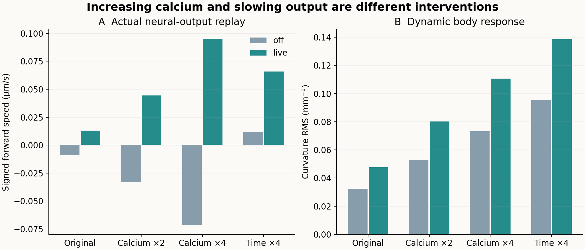
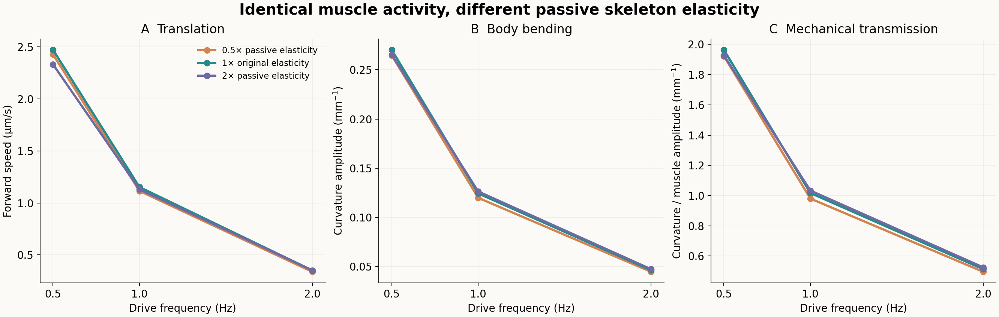
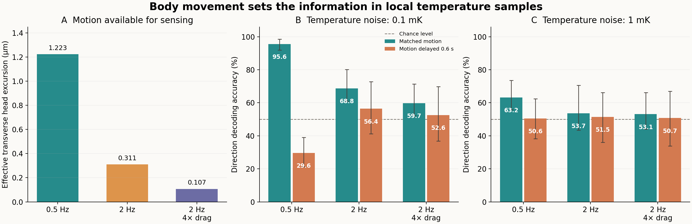

# 从钙活动到趋温信息：三个并行分支的综合结果

2026-11-13。按用户要求，具体实验由三个副进程执行，主流程负责方案审核、预算和输入权限控制、独立复算及综合解释。三个分支合计新增18条身体仿真，复用3条刚度基线与3条温度读出轨迹；没有新增完整302神经仿真或神经网络训练。

**当前结果把问题进一步分开了：增强钙响应能增强身体活动，但没有恢复有效推进；在所测范围内，调软／调硬的作用较小；身体运动幅度与温度—运动对应时序，则直接影响方向信息能否被读出。**

## A：重放完整网络输出，增强活动仍未解决推进

使用11月12日完整302／95肌肉模型最细步长off／live记录，在固定的10 ms钙保存网格上作线性插值，再接入同一身体。每种来源比较原样、钙乘2、钙乘4、时间拉长4倍，另有2条预定细步长检查。

| live来源重放 | 有符号速度 μm/s | 动态曲率RMS mm⁻¹ | 静态曲率RMS mm⁻¹ |
|---|---:|---:|---:|
| 原样 | 0.01286 | 0.04768 | 0.14620 |
| 钙乘4 | 0.09519 | 0.11059 | 0.32946 |
| 时间拉长4倍 | 0.06582 | 0.13863 | 0.16207 |

增强钙会增加形变，但增加的也包括静态弯曲。off来源原样约−0.00904 μm/s，钙乘4后约−0.07148 μm/s，活动增强却更向后。时间拉长使动态响应增加，off来源则转为约+0.01166 μm/s。两类干预作用不同，没有一种在本轮恢复有效持续推进。

时间拉长条件从8秒变为32秒。比较的是源时间4—8秒对应的物理窗口4—8秒或16—32秒，速度按物理时间归一化，输入平均矩单列；不把更长时长的总位移解释为等预算优势。

这里的off／live是历史来源标签。重放时均固定输入，没有实时神经反馈；10 ms重采样和去反馈也使重放不能当作原闭环复现。原源快照尚未通过完整系统数值收敛，因此本轮因果比较只在统一重放框架内部成立。



[A完整报告](network-output-replay-2026-11-13.md) · [指标](assets/network-output-replay-2026-11-13/summary.json)

## B：被动刚度在这个范围内不是主要敏感因素

只在被动纵向和对角弹性力项乘0.5／2，保留主动肌肉、阻尼、环境阻力及输入不变。原刚度3个频率条件经哈希核实后复用；新增6个主条件和2个细步长条件。

| 被动弹性倍率 | 0.5 Hz速度 | 1 Hz速度 | 2 Hz速度 |
|---|---:|---:|---:|
| 0.5 | 2.42750 | 1.11478 | 0.33760 |
| 1 | 2.47161 | 1.15215 | 0.35066 |
| 2 | 2.33194 | 1.13003 | 0.35158 |

速度单位μm/s。刚度变化的速度效应约−5.7%至+0.26%，而0.5→2 Hz的降速在三个刚度条件下均约85%。2 Hz、两倍刚度的微小正差约0.00091 μm/s，与步长差同量级，不作为改善证据。

这一结果不支持在该模型与范围中仅靠调软／调硬解决问题，也不能推广为弹性在其它范围或任务中没有作用。钙、命令与实际肌肉数组逐元素一致，使本轮小差异确实属于固定输入下的被动骨架弹性干预。



[B完整报告](passive-body-stiffness-2026-11-13.md) · [指标](assets/passive-body-stiffness-2026-11-13/summary.json)

## C：物理方程解释身体运动怎样影响温度方向信息

不训练新神经网络，使用固定线性温场及理想自运动输入。每个4秒窗口内，物理读出以相对头部位移估计空间梯度：

\[
T_i=b+g_x\Delta x_i+g_y\Delta y_i+\epsilon_i.
\tag{1}
\]

估计器只收到温度历史与当前身体坐标系中的相对位移，不收到真实梯度或绝对世界位置。真实梯度只用于生成观测、评价标签及检验误差预测。理想自运动是明确的额外信息假设，尚未定位到真实神经元如何实现。

| 身体轨迹 | 匹配运动、0.1 mK噪声 | 延迟0.6秒运动、0.1 mK噪声 | 匹配运动、1 mK噪声 |
|---|---:|---:|---:|
| 0.5 Hz | 95.59% | 29.60% | 63.24% |
| 2 Hz | 68.75% | 56.43% | 53.68% |
| 2 Hz、4倍阻力 | 59.74% | 52.57% | 53.13% |

这是侧向温度方向的平衡准确率，不是导航成功率。全部12个输入／估计条件、4个配对噪声种子均保留。图中误差线表示4个噪声种子的范围，不是生物重复或独立窗口的置信区间。



误差预测进一步解释了差异。消去纵向位移可以解释的部分后，横向有效激励为：

\[
S_y=\sum_i\left(\Delta y_i-\widehat{\Delta y_i\mid\Delta x_i}\right)^2,
\qquad \sigma_{g_y}=\frac{\sigma_T}{\sqrt{S_y}}.
\tag{2}
\]

位移先按窗口去均值，回归同时消去未知温度背景。3条轨迹的有效横向位移RMS约1.223／0.311／0.107 μm；0.1 mK噪声下，侧向梯度估计的预测标准差约12.77／50.23／145.61 K/m。2 Hz条件的几何条件数反而优于0.5 Hz，准确率仍较低，说明只看矩阵是否好求解不够，还要看运动的绝对幅度相对于噪声是否足够。

同样大小的运动，若与温度错开时序，也可能把温变归给错误方向。0.5 Hz的延迟组低于机会水平，属于该固定估计器的系统性失配，不只是噪声增大。1 mK结果显示信噪比降低后的明显性能损失；没有仅展示低噪声高分。

本轮是静态线性温场、float64传感器与理想自运动下的物理读出。它提供了物理方程在算法中如何使用的具体实例，没有验证真实神经回路实现、非线性温场迁移或闭环趋温。

[C完整报告](physical-thermal-readout-2026-11-13.md) · [指标](assets/physical-thermal-readout-2026-11-13/summary.json)

## 主流程独立核验

- 39个共享基线文件的SHA保持不变；新身体运行数量严格为A的10条与B的8条，C无新仿真。4条新半步长配对全部通过对应分支的原标准。
- 从原始速度、姿态独立计算有符号速度；用相邻切向量叉积／点积重建曲率，区别于分支的角度展开方法。
- B的曲率幅度以整数周期Fourier投影重算，区别于分支的最小二乘提取。
- C用显式2×2法方程独立求解，区别于分支的SVD最小二乘，重算全部12条件的准确率，并核对参考时间不晚于观测时间。
- 三个分支的数值检查与主流程独立重算全部通过。共享基线未被修改，失败与实现修订均保留。
- 三个分支各自从解压包独立复算通过；主流程另外核对三个最终ZIP的CRC与SHA256，均通过。三个分支均已结束，无后台仿真继续运行。

过程中三项实现问题有记录：A规范秒网格与整数网格的浮点表示差异，保留v1并以同一规范网格用独立np.interp复核，未放宽容差；B阻力参数预检发现原NBAR宏展开对应除以97，修正核验预期而未修改源模型；C仅修正JSON对NumPy标量的序列化，协议、估计器和输入不变。这些未增加科学条件或仿真预算。

[主流程独立核验JSON](assets/parallel-mechanisms-2026-11-13/independent-audit.json) · [最终归档复核](assets/parallel-mechanisms-2026-11-13/archive-review.json) · [执行状态](assets/parallel-mechanisms-2026-11-13/progress.json) · [分工与协议控制](../parallel-mechanism-stage-2026-11-13.md)

复算主流程审核（项目根目录）：

```bash
OPENBLAS_NUM_THREADS=1 python3 analysis/neuromechanics/parallel_mechanism_audit.py
```

本轮缩小了问题范围：单独增强活动或改变被动刚度没有解决推进，而身体运动的幅度、时间尺度和感觉参考对应关系已经能用受控实验与物理方程具体解释。完整302系统原有数值收敛与自主持续推进仍未通过，旧3/5验收不变。
