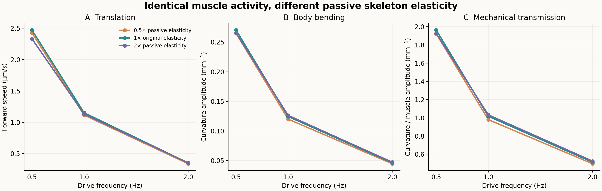

# 相同肌肉活动下，被动骨架弹性的作用

日期：2026-11-13。**6条新主条件、2条预定半步长条件全部完成，7项检查通过。所测被动骨架弹性变化只产生较小推进差异，频率由0.5升至2 Hz引起的显著下降在三种刚度下均保留。** 分支B，主流程内部审核后执行。协议SHA256：`bcdfe21f7598d09623e63eee443087bedd0132c274032cb248fdc963ec373326`。另复用3条已核验的原刚度轨迹；没有运行神经元或训练。

## 干预究竟改变什么

原Boyle程序中，主动肌肉刚度、被动阻尼和对角弹簧等参数在初始化时由`k_PE`派生。直接改全局`k_PE`会同时改变多项物理量。因此本实验保持所有全局参数原值，只对被动弹性力作局部缩放：

\[
F_{PE}\longmapsto\lambda F_{PE},\qquad
F_{D}=\lambda k_{DE}(L_{0D}-L_D)-D_{DE}\dot L_D.
\tag{1}
\]

背腹两侧各一条纵向被动弹力式、两条对角弹簧式，共4处受力项改变。主动肌肉弹力、全部阻尼、肌肉100 ms滤波、环境阻力、几何与初始条件保持原值。\(\lambda=0.5,1,2\)。它是模型被动骨架弹性力的缩放，同时可能影响纵向伸缩和弯曲，不等于只改变实测弯曲模量，更不是动物材料本构或柔软度的拟合。

输入沿用[上一阶段](calcium-body-transfer-2026-11-13.md)的95块具名肌肉规定钙波：峰值／工程半饱和值为1，0.5／1／2 Hz，沿身体1.5个波，背腹反相；经过同一平面投影与饱和映射进入48对有效肌肉。身体位置和曲率由力学求解。

## 源码审计与失败预检

每份生成源码均检查：反向撤去4处弹性力缩放及时间步宏后，逐字节恢复原身体源码。独立编译常数探针实际读取`k_PE/D_PE/k_AE/D_AE/k_DE/D_DE/T_muscle/CL_agar/CN_agar/L_seg`，确认它们在各变体中保持原值；只有局部被动弹性缩放系数及预定半步长改变。

首次构建预检失败，原因是手写的阻力核验期望值把分母写成98。原源码的`NBAR`宏为未加括号的`NSEG+1`，故`2.0*NBAR`实际展开成`2*48+1=97`。按编译探针修正的是本分支的核验期望，未修复原模型宏，未改变原阻力或方向比40。失败源码、探针和实际输出保存在`results/passive-body-stiffness-2026-11-13/preflight-failed-01/`；当时尚未启动身体仿真，最终协议和脚本在主运行前重新锁定。

## 判据

每条20秒，分析8—20秒。速度为沿实际身体轴的有符号速度时间平均；曲率在驱动频率处作正弦／余弦最小二乘，报告中央39个位置的幅度RMS。预先选择\(\lambda=0.5,f=2\)和\(\lambda=2,f=2\)两组从1 ms减半到0.5 ms，速度差要求≤max(0.2 μm/s，细步长速度绝对值的2%)，曲率相对差≤3%。不增加条件或改变标准寻找更好结果。

每一频率分别与复用的\(\lambda=1\)轨迹逐元素比较保存的钙、激活、命令、实际肌肉、时间和逐步输入矩；相等才允许把形变差异解释为被动弹性干预。所有轨迹保持有限与因果时钟。

## 结果



### 1. 频率作用在三种被动弹性下均保留

各格为一条确定性轨迹在8—20秒的有符号平均前进速度，单位μm/s；中间一行为上一阶段的哈希核实复用，不能作为3次独立生物重复。

| 被动弹性力缩放λ | 0.5 Hz | 1 Hz | 2 Hz |
|---|---:|---:|---:|
| 0.5 | 2.42750 | 1.11478 | 0.33760 |
| 1，原模型 | 2.47161 | 1.15215 | 0.35066 |
| 2 | 2.33194 | 1.13003 | 0.35158 |

相对原模型，被动弹性减半时速度降低约1.8%—3.7%；加倍时在0.5／1 Hz下降约5.7%／1.9%，2 Hz有约0.26%的微小正差。2 Hz的正差约0.00091 μm/s，与该条件半步长速度差约0.00093 μm/s处于相同量级，因此不把它作为刚度增加改善推进的证据。

与此相比，0.5→2 Hz的速度下降在λ=0.5／1／2下分别约86.1%／85.8%／84.9%。改变本组被动弹性系数没有消除节律与身体响应之间的差异，也没有出现“越软越好”。三档中原模型在0.5和1 Hz的速度略高；本实验没有精确搜索最优刚度，不能据此宣布原值最优。

### 2. 实际肌肉活动相同，身体响应差异来自弹性干预

6条新主条件各自与相同频率的原模型比较，2001个保存时刻的钙、激活、命令、实际肌肉、时间数组和输入一／二阶积分均逐元素一致。因此图中的运动差异不是由神经输入、钙幅值或肌肉滤波改变造成。

中央39个位置的曲率基频幅度RMS（mm⁻¹）：

| 被动弹性力缩放λ | 0.5 Hz | 1 Hz | 2 Hz |
|---|---:|---:|---:|
| 0.5 | 0.26468 | 0.11987 | 0.04466 |
| 1 | 0.27030 | 0.12436 | 0.04624 |
| 2 | 0.26531 | 0.12633 | 0.04731 |

身体中心线总长度也略有变化：整个0—20秒最小值在λ=0.5时约0.9939—0.9947 mm，原模型约0.9968—0.9972 mm，λ=2时约0.9984—0.9986 mm，初始均为1 mm。这与干预同时涉及纵向和对角骨架弹性一致，不能将其简化为只有弯曲模量改变。

### 3. 对物理约束与神经输出解释的意义

本轮缩小了一个解释空间：在这个钙幅度、原主动参数和原阻力工作区间中，前一阶段观察到的大幅频率效应，不能简单归结为“被动骨架弹性系数选错了”。肌肉滤波、实际身体机械响应和输出的空间协调仍需要分别考虑。

这也不是“被动弹性没有作用”：本轮确实产生可测的形变、伸缩和速度变化，只是幅度小于同一区间内的节律作用。更大范围的材料变化、其它输入幅度或主动／被动参数共同变化未测试。结果属于规定钙驱动下的模型机制，不是完整302神经网络运动、真实线虫柔软度、趋温学习或生物最优值的验证。

## 验证与复现

- 6主＋2细步长，共8条新身体运行，无失败运行，无追加条件；首次参数核验失败保留且发生在仿真前。
- 7项汇总检查通过：固定运行数、3条基线复用哈希、有限因果时钟、源码只变声明受力项、主动／阻尼／环境常数不变、输入与实际肌肉逐点相同、两组步长配对通过。
- 两组步长配对的速度差约0.000910与0.000934 μm/s，曲率相对差约0.151%与0.130%。检查仅覆盖这两组和所列统计量，不等于所有参数下的逐时轨迹收敛。
- 源码、编译探针、原始轨迹、协议／源码锁和失败预检均保存。可用独立解压目录复算，不启动新仿真。

在归档解压目录中复算：

```bash
PYTHONPATH=src OPENBLAS_NUM_THREADS=1 python3 analysis/neuromechanics/passive_body_stiffness/study.py summarize
```

身体二进制与Sundials静态库为macOS arm64构建；原生成C++与许可随材料保存。新机器若要重新求解需要重新编译，汇总复算仅依赖Python与NumPy。

[汇总与全部判据](assets/passive-body-stiffness-2026-11-13/summary.json) · [完整复现包](https://github.com/Zlllo/soft-worm-research-platform/releases/download/research-mechanisms-2026-11-13/passive-body-stiffness-2026-11-13.zip) · [归档核验记录](assets/passive-body-stiffness-2026-11-13/archive-validation.json)
