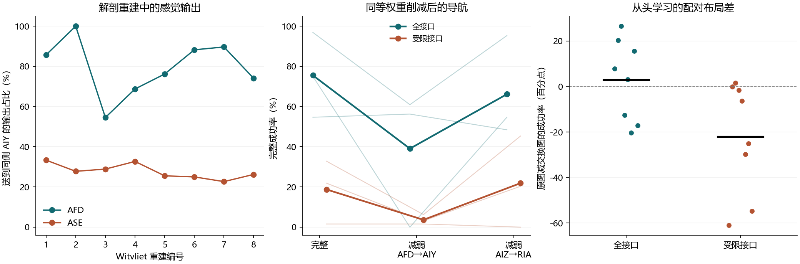

# 真实连接能解释趋温的哪一部分？

2026-11-19。在本项目的八细胞网络、公开电镜重建和原版 BAAIWorm 身体上，分别检验通路位置、模型依赖与身体可控性。所有培养温度数字来自已发表的动物结果。本次新增的行为均为计算机模拟。

## 为什么换问题

项目已把“能不能学会”“真实布局是否有优势”和“学会后依赖哪条边”做到了可以分别检验。动态等温追踪中，原图得 77.07%，10 张重排图里有 3 张更高。另一任务里，训练后的原图关闭 AFD→AIY 后，全接口成功率从 78.13% 降到 28.13%。这两件事可以同时成立。要从阴性结果往前走，先比较有同等解剖依据的通路，再比较两张图独立学习后的行为。[重排实验](expanded-graphs-2026-10-25.md) · [原通路实验](pathway-stage1-2026-11-03.md)

较完整的 302 神经元模型还受神经输出、钙到肌肉的变换及身体推进限制。既有快速身体实验也表明，即使温场固定，头部运动和参考时序变化就会影响温度方向解码。因此，本轮把导航回路放在已有的可控二维环境中比较，用三维身体另测转向能力。[全网络与身体结果](parallel-mechanisms-2026-11-13.md) · [物理采样实验](physical-thermal-readout-2026-11-13.md)

## 一、独立电镜重建里，AFD 的输出偏向谁？

逐份读取 Witvliet 等人的 8 份化学突触重建，按突触的发送者与每个接收者分别计数。在 12 类左右成对的 amphid 感觉神经元中，比较其送往**同侧 AIY**的化学输出占本类全部已命名神经元输出的比例。左右两侧先加总计数，再求比例。候选细胞、固定数据版本、文件哈希和逐侧计数均已保存。8 份重建覆盖不同发育阶段，只有编号 7、8 为成年个体。[Witvliet 等的原始研究](https://www.nature.com/articles/s41586-021-03778-8) · [作者数据版本](https://github.com/dwitvliet/nature2021/tree/0646af9d25896ae660f97d462eab2d67282f5625/data/synapses) · [逐侧计数](assets/pathway-specificity/amphid-outputs.csv)

| 重建编号 | 1 | 2 | 3 | 4 | 5 | 6 | 7（成年） | 8（成年） |
|---|---:|---:|---:|---:|---:|---:|---:|---:|
| AFD 输出到同侧 AIY | 85.7% | 100% | 54.5% | 68.8% | 76.2% | 88.2% | 89.7% | 74.1% |
| ASE 输出到同侧 AIY | 33.3% | 27.8% | 28.9% | 32.7% | 25.5% | 25.0% | 22.7% | 26.2% |

AFD 八次均排第一，ASE 八次均排第二。两个成年重建中 AFD 的分子／分母分别为 26/29 和 20/27。改成“每个释放位点一票，在该位点的所有接收者间均分”，AFD 仍八次排第一。若允许每类感觉细胞自行选择它最集中的任一接收者，AFD 并非每次最集中。较稳定的特征是**输出汇向 AIY 这个特定对象**。这些解剖结果本身不测传递符号、活动或温度选择。

把中间细胞放宽到项目的整个已命名神经元表，8 份重建都可通过 AIY 用两条化学边从 AFD 到 RIA，均未观察到 AFD→RIA 的直接化学边。有些重建也有经其他细胞的两步路径。令每个发送者按其突触计数比例分配一个单位输出，在所有到达 RIA 的两步路径中，经 AIY 的份额为 65.3%–100%。阈值若提高到每条边至少三个突触，最早一份重建不再有合格路径。这个计算只描述化学路径分布，不能解释成电流或信息流的实测份额。[全部通路与阈值敏感性](assets/pathway-specificity/two-hop-routes.csv)

## 二、训练好的模型依赖 AFD→AIY 到什么程度？

恢复原阶段的全部 6 个 All 检查点。完整网络和 AFD→AIY 双侧关闭在旧 32 例上的 384 个逐例成败判定与归档一致。另取 64 个新病例，线性／径向场和冷／热起点四种组合各 16 例。每个病例在所有条件下使用相同噪声种子。240 秒内，温场扰动前后都完成规定的稳定追踪才记为成功。这里的全接口允许广泛输入输出；受限接口把温度给 AFD、头摆相位给 AIY，从 RIA 读动作。功能权重沿用训练值，电连接保持原样。

比较 Cook 八细胞子图中全部 5 组左右同侧、跨类、两边都存在的化学连接。AFD→AIY 在左／右两侧的电镜权重为 25／29，AIZ→RIA 为 29／25，匹配边数和两侧权重集合。Cook 的单位是电镜连续切片数，与上一节的突触计数不同。[Cook 数据定义](../../data/connectome/README.md)

| 干预 | 全接口完整成功 | 受限接口完整成功 |
|---|---:|---:|
| 完整 | 80.73% | 18.23% |
| 关闭 AFD→AIY | 23.44% | 0.52% |
| 关闭反向 AIY→AFD | 56.77% | 17.19% |
| 关闭 AIY→AIZ | 67.19% | 11.46% |
| 关闭 AIY→RIA | 31.25% | 18.75% |
| 关闭 AIZ→RIA | 48.44% | 24.48% |
| AFD→AIY 功能权重减半 | 51.04% | 3.12% |
| AIZ→RIA 功能权重减半 | 71.35% | 23.96% |

关闭 AFD→AIY 的损失在两种接口的平均值中都最大；全接口关闭 AIY→RIA 的损失也很大。受限模型本来就可能失败，完整网络三个种子的成功例数为 25、10、0（各 64 例），最后一个种子关闭 AFD→AIY 后反而成功 1 例。只看平均值会掩盖地板效应。

**进一步控制训练后的权重大小。** 在每个模型、每一侧取两条候选边中较小的权重绝对值，把两条边分别向零削减同样的量，保留原符号。用另一组 64 例评价，未参与选择干预幅度。全接口成功率为完整 75.52%、削弱 AFD→AIY 39.06%、削弱 AIZ→RIA 66.15%；受限接口依次为 18.75%、3.65%、21.88%。每种接口都是 2/3 种子符合 AFD→AIY 削弱损失较大的方向。不能把两条边同量缩小解释为下游状态也改变同样多。该结果支持当前已学策略对通路位置有依赖，证据强度仍受 3 个训练种子约束。[逐模型数据与摘要](assets/pathway-specificity/)

## 三、原图与严格配对的替代图能否分别学会？

固定电连接、同类连接和所有未成对的化学边；对剩下五组同侧双边连接，穷举新的跨类目的地，同时保持每个具名细胞的化学入度和出度。恰有一个不同布局：把 AFD→AIY、AIZ→RIA 交换为 AFD→RIA、AIZ→AIY。其他边不变。训练参数跟各发送侧的边槽走。交换图让受限接口的温度输入 AFD 与动作读出 RIA 直接相连，提供一个可能有利于这个工程任务的捷径。枚举结论只适用于上述约束。

32 次拟合覆盖两图、两种接口和 8 个配对随机种子。每对从相同随机数初始化，使用同一份归档教师示范、同一小批次顺序，执行 2,048 次监督更新，每批 64；没有强化学习续训。冻结后用第三组独立的 64 例评价。此阶段从头训练，不能把它的绝对分数与上一节多阶段训练后的检查点直接比较。

| 接口 | 原图成功率 | 交换图成功率 | 原图减交换图 | 原图／交换图稳定追踪时间占比 |
|---|---:|---:|---:|---:|
| 受限 | 1.76% | 23.83% | −22.07 个百分点 | 3.30%／17.59% |
| 全接口 | 22.07% | 19.14% | +2.93 个百分点 | 21.01%／20.71% |

受限接口中，8 对种子里交换图 6 胜、1 平、1 负。冷／热起点及线性／径向四个分层的平均差都偏向交换图；平均绝对温差也从原图的 0.608 K 降至交换图的 0.315 K。全接口两图各有胜负。保持处理配对，同时重采样训练种子与分层病例，10,000 次百分位重采样给出的成功率差 95% 描述区间，受限为 [−39.84, −6.64]、全接口为 [−9.18, +15.23] 个百分点。小样本、单一替代图、单一教师和预算限制了外推；全接口区间包含可能有意义的正负差异，不能据此宣布等效。这里也没有测完整学习曲线或达到某个成功率所需的交互数。



左图 ASE 为各重建的第二名。中图每种颜色的细线为 3 个冻结模型，粗线为均值。右图每点为 1 对独立初始化，黑线为 8 对均值。按上述设计得到的结论是：**原图中的已学策略依赖 AFD→AIY，但当目标只是把温度尽快读成转向，保留自然通路位置没有带来稳定优势。** 受限接口的结果甚至偏向交换图。该结果值得保留为论文的阴性对照。

## 四、哪一种动物现象能真正区分机制？

Hawk 等在相同保持温度下给予升温刺激。保持温度高于培养温度时，27/75 个动物表现出该 AIY 响应；低于培养温度时为 44/65，相差 31.7 个百分点。AFD 在各组都普遍响应。这里记录的是不同动物中出现响应的比例。[Hawk 等，图 2](https://pmc.ncbi.nlm.nih.gov/articles/PMC5806692/#F2)

本项目现有 raw 接口只保留约 4 秒的近期窗口，计算动作时从零初始化内部状态。把两段不同的温度前史接到相同的近期升温和相位序列，41 个相同观测后，两组实际输入逐元素一致，6 个冻结模型的动作 logit 差全部为零。这是对输入接口的检验；短前缀没有模拟动物数小时的培养，也没有把模型节点值解释成钙信号。[数值记录](assets/pathway-specificity/cultivation-memory.json)

**建议把下一轮的主要指标改为“相同升温、不同培养经历下的 AIY 响应差”，再检验它能否预报行为方向。** 用相同的感觉适应模型、相同数量的慢状态变量，分别允许慢状态作用在 AFD→AIY 传递、AIY 自身兴奋性或动作读出。先匹配基础 AIY 响应，再用留出的刺激幅度和培养温度切换后的恢复时程比较三种机制。把随机重排和同参数量模型作为对照。两组响应比例单独不足以辨认调节究竟发生在哪条边。行为端可再分别报告接近／远离培养温度时的前行持续时间和重定向，避免一个到达率掩盖不同策略。[Luo 等的双向趋温实验](https://pmc.ncbi.nlm.nih.gov/articles/PMC3932917/) · [AFD 与 AIY 的时相关系](https://pmc.ncbi.nlm.nih.gov/articles/PMC7322292/)

## 五、三维身体能承担哪部分验证？

直接读取上游 b99ca5a 的 video_offline 序列化回路，实际含 136 个细胞。八细胞核心中有 AIYL/R 和 AIZL/R；AFDL/R、RIAL/R 都没有实例化。上游的 15 个感觉输入也没有 AFD。三维游动示例因此可作为共同身体；若要检验 AFD→AIY，须明确接入哪个温感回路及其运动输出。通用名称表包含某个细胞，不能代替实际加载检查。[回路核查](assets/pathway-specificity/demo-circuit.json) · [上游程序及示例](https://github.com/Jessie940611/BAAIWorm/tree/b99ca5a)

上一轮的原始头轨迹经过镜像温场重算。只用最初 2 秒估计经过初始头位的摆动平面，法线距世界 +Y 约 9.3°；后 3 秒相同轨迹在两镜像场上的温差 RMS 为 27.46 mK。用 1 秒或 3 秒标定分别得到 23.28、27.69 mK。将轨迹投影回标定平面后，两个场逐帧一致。上述差值描述可供感觉端接收的输入，不代表动物能识别目标侧，也没有建立生物测温噪声下限。[头部轨迹及温度曲线](assets/pathway-specificity/baaiworm-head-temperature.png) · [原始轨迹](assets/pathway-specificity/baaiworm-head.csv) · [几何核查](assets/pathway-specificity/swim-mirror.json)

在相同示例上新运行 6 次，每次 5 秒。两次不施加干预，另四次分别在第 2–4 秒将左、右、背、腹各自的两组肌肉命令乘 0.8（每组 24 个位置），之后恢复。同一批原始神经输出的 150 帧肌肉命令哈希在六次间逐字节一致。每 0.1 秒记录头位和 984 个网格顶点的几何中心。几何中心按顶点等权平均。两次无干预中心轨迹逐点相同，四种干预在施加前亦重合。法向正号统一选朝世界 +Y 的一侧。

| 减弱的肌群 | 恢复后第 4–5 秒中心相对无干预的平均法向偏移（体长） | 同期头部偏移（体长） |
|---|---:|---:|
| 左 | +0.0717 | +0.2537 |
| 右 | −0.0520 | −0.1225 |
| 背 | +0.0259 | +0.0853 |
| 腹 | +0.0233 | +0.0105 |

**左右肌群有方向相反的相对控制效果，背腹两组在该法线上的平均效应同号。** 但以各自第 2 秒的位置为原点，到第 5 秒，四种干预的中心绝对法向位移仍全为负。说明这组命令足以改变漂移量；尚未证明能从同一姿态分别游向目标平面的两侧。头部偏移明显大于中心，后续趋温指标应以中心靠近目标及停留时间为主。此结果限于一个起始姿态、一个干预相位和幅度，重复基线是数值复核。六次均在完整写出数据后退出图形程序时报告内存释放错误，未把退出过程计入采样。[逐帧身体数据](assets/pathway-specificity/body/) · [中心位移核查](assets/pathway-specificity/body-summary.json)

## 复现入口

从仓库根目录，把 src 加入 PYTHONPATH。电镜分析使用固定版本的作者原始 JSON，缓存于 results/witvliet。三个病例组独立选择，起始搜索种子分别为 1911001、2911001、3911001。旧归档病例单列。通路干预与配对布局训练使用 CPU、PyTorch 2.5.1 和 NumPy 2.2.6。逐例数据与训练损失已入库。

```powershell
$env:PYTHONPATH='src'
python analysis/witvliet_pathways.py
python analysis/pathway_specificity.py
python analysis/pathway_specificity.py --matched
python analysis/bilateral_routing.py
python analysis/cultivation_memory_check.py
python analysis/baaiworm_mirror_replay.py
python analysis/summarize_pathway_specificity.py
python analysis/summarize_baaiworm_muscles.py
python analysis/plot_pathway_specificity.py
```

原生身体实验沿用已配置的 baaiworm-focal 容器和原示例启动器 /work/run.sh。把 analysis/baaiworm_muscle_probe.py 放入容器的 /work/temperature，执行 analysis/run_baaiworm_muscle_probe.sh 可在新目录重跑。它使用单独的虚拟显示器，运行结束恢复原被动记录器。逐条件 trajectory.csv 和 completed.json 对应仓库 body 目录中同名条件的 CSV 与 JSON。此阶段没有训练 14 神经元网络。