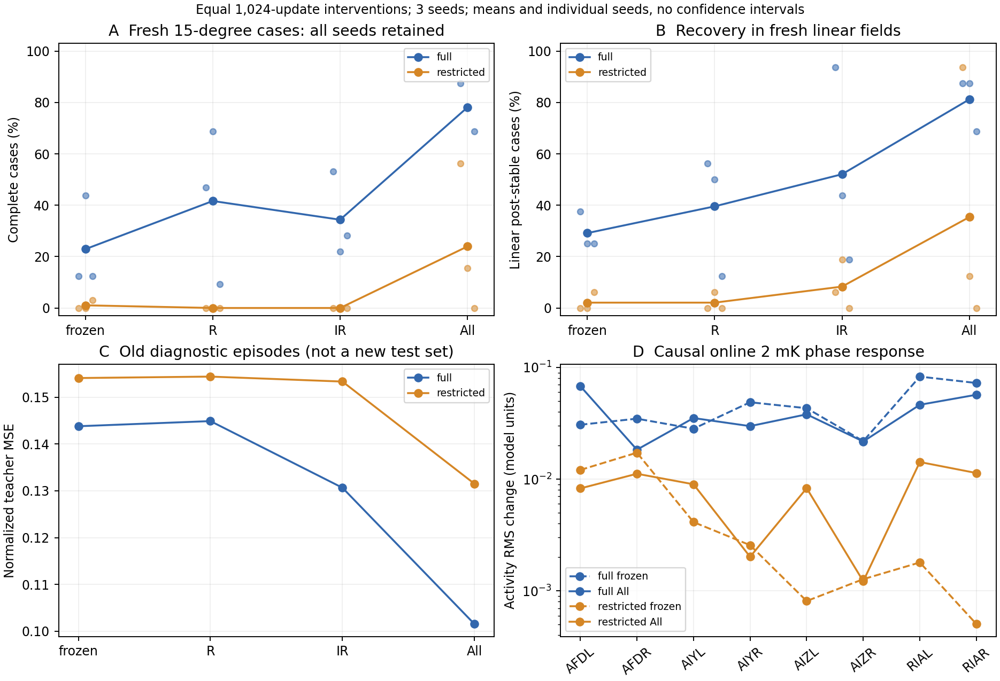
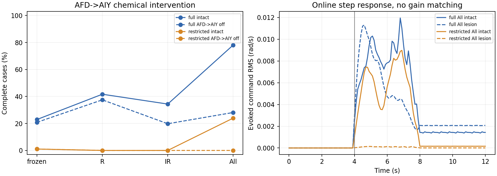

# 阶段一：感觉—动作瓶颈与AFD→AIY通路干预

日期：2026-11-03。状态：**已完成**。[原短期计划](../short-term-neural-physical-experiments-2026-11-03.md)中的第一个实验；身体负载与主动测温实验另行开展。

## 结果回答了什么

在保持节点数量和解剖连边掩码不变时，允许内部有效权重参与续训，比只修改输入／输出更有效。full接口三个种子在新病例上均改善，restricted只有两个种子改善，仍存在明显不稳定性。已有8节点模型并非完全不能表达任务，但原有功能参数没有充分实现这种能力。

改善后的策略对已有AFD→AIY化学通路表现出依赖。关闭这组连接后，full的平均完整成功率从78.13%降至28.13%，restricted从23.96%降至0。这个结论针对当前训练得到的模型，并未比较所有同规模边干预，也没有证明真实布局优于重排图。

## 固定条件与预算

所有条件独立从旧BC检查点开始。full、restricted各保留种子7、17、27。冻结基线、仅读出R、输入投影与读出IR、全部actor功能参数All四个条件，共24个状态，其中18次新增监督续训，6个冻结基线；新增PPO交互为0。

续训统一1024次更新、批量256、Adam学习率0.003，按训练种子生成相同的教师样本序列。R只能改变actor权重／偏置，IR额外允许输入投影，All额外允许内部化学效能、gap参数和偏置；critic、探索方差与图索引缓冲区全部冻结。逐状态检查确认未改变权限之外的参数。

原教师的24条episode用于续训，另8条为旧数据诊断，后者在原BC时也用过，不是独立测试。新评价病例按几何条件选定，线性／径向场×冷热侧各8个，共32个，所有模型共享。病例清单在拟合前固定，没有按任何策略表现筛选。局部参考控制器在这32例均成功，条件保持15°。

共完成：768条新病例评价、768条旧病例回归、768条新病例通路关闭评价，合计2304条；它们不构成2304次独立训练。另有192个在线刺激协议及234个冻结模型／幅值探针。18次续训及基线记录的累计耗时约68.74秒，不含评价和探针，也不是跨机器性能保证。

## 新病例的全部条件

完整成功要求扰动前后均达到原稳定追踪约定。每行是三个训练种子的均值，病例和种子均未删除。

| 接口 | 条件 | 完整成功 | 线性场扰动后稳定 | 旧8条诊断episode MSE |
|---|---|---:|---:|---:|
| full | 冻结 | 22.92% | 29.17% | 0.14381 |
| full | R | 41.67% | 39.58% | 0.14490 |
| full | IR | 34.38% | 52.08% | 0.13066 |
| full | All | **78.13%** | **81.25%** | **0.10152** |
| restricted | 冻结 | 1.04% | 2.08% | 0.15411 |
| restricted | R | 0.00% | 2.08% | 0.15442 |
| restricted | IR | 0.00% | 8.33% | 0.15336 |
| restricted | All | **23.96%** | **35.42%** | **0.13151** |

All完整成功逐种子：full为87.50%、78.13%、68.75%；restricted为56.25%、15.63%、0。仅用restricted均值会掩盖第三个种子未学成的事实。



图中的小点为独立训练种子，连线是均值，不是置信区间。D面板中的节点为标签顺序，不表示唯一串联通路。

结果支持原full模型不只是读出层不足，继续调整内部功能参数还能明显改善。restricted仅调输入／输出仍几乎无完整成功；允许内部改变才在两个种子形成有效行为。它仍未达到可靠的受限回路实现，不能把问题全部归为一个标量增益。

诊断误差和闭环成绩也不等价：full的IR比R拟合误差低，但完整成功反而更低。旧教师分布上的误差不是独立的新病例行为指标。

## 通路干预与幅度匹配

每个模型复制后，只关闭数据中已有的AFD→AIY化学连接；保持其它连接、输入／输出、gap及模型初态约定不变。干预不改变节点数，也不新增解剖连边。

| All接口 | 原完整成功 | 通路关闭后 | 种子7／17／27：前→后 |
|---|---:|---:|---|
| full | 78.13% | 28.13% | 87.50→65.63；78.13→6.25；68.75→12.50 |
| restricted | 23.96% | 0.00% | 56.25→0；15.63→0；0→0 |



通路作用不仅表现为所有节点活动都变大。2 mK在线相位刺激中，full的RIA平均响应从冻结模型的0.0777降到All的0.0517模型单位，动作响应却从0.0100升到0.0285 rad/s；restricted的RIA响应则从0.00115升到0.01279。活动幅度与行为改善不是一一对应关系。

另外在独立的80组背景／相位窗口上，为通路关闭模型计算非负RMS增益；只在新的在线刺激中将其用于诱发响应差值比较，不部署为策略，也不宣称行为已被增益恢复。2 mK、0.5 Hz在线刺激中，幅度匹配后的归一化波形误差，full三个种子为1.080、0.317、0.716，restricted为1.638、0.714、0.933。一个校准增益不能在这些新背景／在线时程中普遍恢复原响应。

这包括波形、状态依赖和时间关系的变化，不能只凭该结果归给某个细胞的特定生理时间常数。在线刺激的神经记录来自每一因果观测窗口的最终状态；没有把窗口内部的计算展开位置误当成实际神经活动时间。

## 冻结布局对照和证据范围

真实图、全部10张原重排图、隔离节点与GRU的78个原raw检查点均保留，完成234个冻结幅值探针。它们用于记录已有表征差异。本阶段只续训真实图的6个BC起点，因此没有用All的改善与未等预算续训的重排图作布局优劣结论。

Hawk等的研究区分了AFD感觉响应和AFD→AIY传递的调节，这为本次分层干预提供了生物问题。[Hawk et al., 2018](https://pmc.ncbi.nlm.nih.gov/articles/PMC5806692/)

本阶段显示：**保留解剖连接存在性，并不保证功能已实现；在当前模型中调整内部传递后，可以形成行为并产生通路依赖。** 化学符号与效能仍可训练，缺少细胞功能数据约束，故不称已复现真实AFD／AIY生理机制。

All同时释放多个内部参数，尚未将改善唯一归因于化学效能、gap或细胞偏置中的某一项。仅有3个训练种子，也没有估计普遍的生物或布局优势。下一阶段转向身体反馈与负载，不据此继续搜索最高分配置。

## 实现、验证与复现

执行入口：`analysis/run_pathway_stage1.py`；汇总与归档：`analysis/summarize_pathway_stage1.py`。设计、源码与输入哈希在拟合前固定，支持新根目录。所有分支保存模型、参数权限、训练曲线、逐病例结果和原始探针数组。

新干预测试与原诊断测试共18项通过。以项目`tests/`为范围运行回归，**204项通过、14条既有Matplotlib/Pyparsing警告**；指定了已构建的原生Boyle工作程序，身体接口测试没有因未设置程序路径而跳过。

最初从工作区根目录递归收集测试时，误收集了`results/`下的上游示例、历史检出副本及旧程序，产生58个收集错误，日志保留为`regression-broad-collection.log`。随后明确使用`pytest tests`，不把上游未配置的依赖例子算成本项目回归已通过。

R条件与PR #3旧病例复核：6个模型的最大参数差不超过8.95×10⁻⁸，完整成功判定全部一致。在192条旧病例、6项逐病例字段中有4处细小差异：3处追踪比例变化各为1/1200，1处稳定时刻变化0.2秒；没有称逐字段完全复现。原始比较记录在汇总中保留。

```bash
# 在仓库根目录，原模型与教师缓存须已按旧归档恢复。
PYTHONPATH=src python3 analysis/run_pathway_stage1.py prepare --root results/pathway-stage1-reproduction
PYTHONPATH=src python3 analysis/run_pathway_stage1.py train --root results/pathway-stage1-reproduction
PYTHONPATH=src python3 analysis/run_pathway_stage1.py evaluate --root results/pathway-stage1-reproduction
PYTHONPATH=src python3 analysis/run_pathway_stage1.py probe --root results/pathway-stage1-reproduction
PYTHONPATH=src MPLCONFIGDIR=/tmp/worm-stage1-matplotlib python3 analysis/summarize_pathway_stage1.py \
  --root results/pathway-stage1-reproduction --output results/pathway-stage1-reproduction-report

BOYLE_WORKER="$PWD/results/neuromechanics-stepper-2026-10-27/build-v2/worker" \
PYTHONPATH=src python3 -m pytest tests -q
```

[汇总JSON](assets/pathway-stage1-2026-11-03/summary.json)、[全部状态与轨迹记录](assets/pathway-stage1-2026-11-03/reproduction.zip)、[SHA256清单](assets/pathway-stage1-2026-11-03/manifest.json)。归档保留失败／未改善分支；原教师数据和78个BC起点按旧归档恢复，不在本批重复打包。
