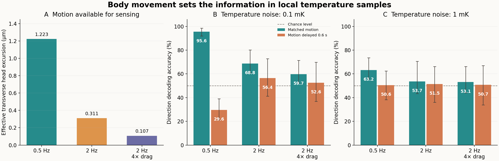
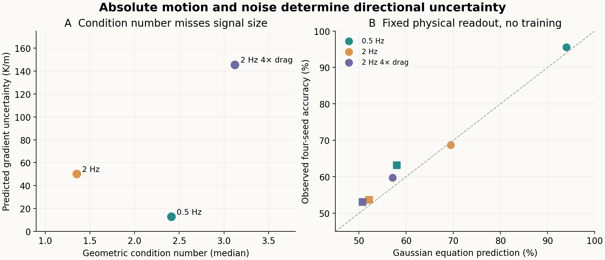

# 物理采样方程：身体运动怎样影响温度方向信息

2026-11-13。分支C完成。**在同样的静态温度梯度与传感噪声下，身体运动较弱时，侧向温度方向更难估计；运动参考延迟还可能使方向判断系统性反转。** 本阶段使用固定物理回归，无新身体／神经仿真，无神经网络训练。



图A是排除纵向混同后的有效侧向头部运动，图B／C展示全部12个预定条件。误差线只表示4个传感噪声种子的最小—最大范围，不是置信区间，也不表示生物重复。温度方向准确率不是趋温导航成功率。

## 一个无需训练的物理读出

在固定线性温场中，同一4秒窗口内的头部温度满足：

\[
T_i=b+g_\parallel x_i+g_\perp y_i+\epsilon_i.
\tag{1}
\]

这里\((x_i,y_i)\)是头部相对位移，表达在**该窗口结束时的身体前后轴与法向轴**中；\(b\)是未知常温背景。对温度和位移分别去均值后，直接用无正则最小二乘估计两个梯度分量，不调整超参数。目标是当前身体法向梯度\(g_\perp\)的符号。

估计器的输入只有41点局部温度与41×2相对位移矩阵。真实梯度与实际世界坐标只在温度观测、监督标签及方程预测验证中使用，不传入估计器。当前身体方向用于建立相对自运动坐标和标签，并非额外给出环境梯度方向。

这一模型假设有**理想自运动估计**：能够知道过去头部位移在当前身体坐标系中的表示，且没有运动测量噪声。它比已实现的具体生物感受通路更理想，不称为真实AFD／AIY计算。温场静态、线性，传感器采用float64；不能直接等同于旧GRU解码任务或真实线虫传感精度。

## 固定设计和信息权限

- 复用已有3条完整20秒身体轨迹：标准0.5 Hz、标准2 Hz、2 Hz且两个方向环境阻力均乘4。模型钙峰值／Kc均为1，肌肉时间常数100 ms。
- 2种运动参考：匹配，以及完整历史连续延迟0.6秒；2档独立高斯温度噪声：0.1与1 mK，合计12条件。4个固定噪声种子，条件间共享标准噪声实现，仅按噪声水平缩放。
- 8个固定方向的40 K/m线性梯度，方向为\(\pi/8+k\pi/4\)。每种场有未知常温偏移，范围±0.04 K。
- 10 Hz观测，4秒窗口，终点从12到20秒、间隔0.5秒，共17个相互重叠窗口。延迟参考取窗口所有时刻之前0.6秒的实际头部位移，并相对其自己的延迟终点平移；再转入**当前**窗口结束时的身体坐标系。温度始终来自当前时刻，未循环拼接、未用未来运动。
- 没有训练／验证调参。3条轨迹、全部温场和噪声条件均在读正式指标前固定。6528次窗口评价不是6528个独立身体／动物样本。

协议SHA256：`a41d4c77c594f6c47a8b72a30ace09e9bcfe128d8e0c858b20d95b369f46dc29`。

## 全部结果

每个格子汇总4个固定噪声种子、8个场方向与17个窗口；正负标签平衡。所有条件的数值可用率均为100%，没有弱目标或秩不足窗口被剔除。

| 身体条件 | 0.1 mK，匹配 | 0.1 mK，延迟0.6秒 | 1 mK，匹配 | 1 mK，延迟0.6秒 |
|---|---:|---:|---:|---:|
| 标准0.5 Hz | 95.59% | 29.60% | 63.24% | 50.55% |
| 标准2 Hz | 68.75% | 56.43% | 53.68% | 51.47% |
| 2 Hz，4倍阻力 | 59.74% | 52.57% | 53.13% | 50.74% |

0.1 mK条件中，较慢、弯曲较明显的身体轨迹支持较可靠的侧向判断；快节律或高阻力轨迹的判断更弱。提高传感噪声到1 mK后，全部结果明显接近机会水平，不能只展示低噪声结果。

0.5 Hz条件延迟0.6秒，相当于约0.3个周期的运动参考错位。低噪声准确率低于50%，说明错误参考并非只增加随机误差，还会把温度—运动关系解释成相反方向。这是该固定时延与节律下的现象，不推广为所有延迟都使解码反向。

## 为什么条件数不足以解释信息质量

将侧向运动中可由纵向运动线性解释的部分扣除，定义：

\[
S_y=\left\|y_c-x_c\frac{x_c^\mathsf T y_c}{x_c^\mathsf T x_c}\right\|^2,
\qquad
\sigma_{\hat g_\perp}=\frac{\sigma_T}{\sqrt{S_y}}.
\tag{2}
\]

\(S_y\)表示对侧向梯度真正有区分力的绝对运动激励。它同时考虑运动大小和纵横方向的可区分性。表中几何量为17个窗口的中位数，预测不确定性使用0.1 mK噪声：

| 身体条件 | 有效侧向位移RMS μm | 几何条件数 | 预测侧向梯度标准差 K/m |
|---|---:|---:|---:|
| 标准0.5 Hz | 1.22284 | 2.409 | 12.77 |
| 标准2 Hz | 0.31090 | 1.352 | 50.23 |
| 2 Hz，4倍阻力 | 0.10725 | 3.121 | 145.61 |

2 Hz的几何条件数反而比0.5 Hz更好，但运动尺度小得多，预测方向不确定性更大。因此“矩阵不病态”和“温度方向容易分辨”是不同的问题。



右图圆点表示0.1 mK、方块表示1 mK；虚线是预测与观测相等的参考线，没有拟合斜率。

对匹配输入，已知高斯温度噪声还能预测符号正确率：

\[
P(\text{方向正确})=\Phi\!\left(\frac{|g_\perp|}{\sigma_{\hat g_\perp}}\right).
\tag{3}
\]

低噪声三条件的方程预测分别为93.96%、69.44%、57.10%，实际四噪声种子汇总为95.59%、68.75%、59.74%。预测展示运动几何与传感噪声怎样解释结果，不是对实测准确率拟合出来的曲线。四个噪声种子的有限波动仍然存在；1 mK标准0.5 Hz的预测57.97%、实际63.24%，不将它称为精确吻合。式(3)不用于延迟输入，因为延迟已经违反匹配线性观测关系。

## 可用率、控制与保存

秩判定相对容差1e-12，最小奇异值必须大于1e-12 m，条件侧向激励\(S_y\)大于1e-24 m²；没有满足时报告“未解”，不默认赋予一个有利方向。侧向真值小于梯度幅度10%时单列弱目标。主数据中这两类情况均未出现。

6个数值控制通过：已知无噪声平面恢复、未知背景／平移不变性、世界刚体旋转不变性、秩1不可用、微小运动不可用、条件激励与逆协方差一致。另逐窗口核验零延迟一致、运动参考不来自未来、输入与源码哈希。

第一次汇总在保存控制检查JSON时因NumPy布尔标量类型失败；只修正了JSON标量转换。原v1源码、原锁、部分输出与错误说明保存在 `results/physical-thermal-readout-2026-11-13/implementation-corrections/`。协议、输入、估计器、判据均未改；重算不是新条件、训练或独立重复。

每个窗口的估计器实际输入\(X/T\)、当前与参考时间轴、OLS输出以及真实法向标签已保存，便于独立核对是否有信息越界。真实标签保存在结果包供评价使用，估计器函数不接收它。

源码审计确认估计器只读取固定数值协议中的3个键：秩相对容差、最小奇异值和最小侧向激励；不读取场方向／梯度幅度。v1与修正后的估计器函数源码一致，逐窗口CSV逐字节一致，保存的全部估计输入／输出数组也一致。复现包实际解压后，CRC／逐文件SHA通过，仅用解压文件独立重算的主汇总、CSV、几何量与控制记录逐字节一致，所有估计器数组一致。

## 对主研究的意义

上一阶段显示身体力学会改变肌肉活动到实际弯曲的传递；本阶段进一步显示，这种弯曲差别会改变局部温度采样所包含的方向信息。物理方程因此不仅限制“能走多快”，也能解释“相同梯度和噪声下，哪些运动能提供可辨识的感觉信息”。

这里得到的是静态线性场、理想自运动条件下的物理算法参照，没有训练真实神经回路，也没有完成自主趋温。它给真实网络失败提供可检查的区分：是输入的物理信息本来弱，还是回路没有正确使用已有运动参照。

## 复算入口

项目／解压目录根部：

```bash
OPENBLAS_NUM_THREADS=1 python3 analysis/physical_thermal_readout/assay.py analyze --output recomputed-physical-thermal
```

只读取归档内冻结的3条轨迹与配对传感噪声，不求解身体或神经元。绘图入口为 `analysis/physical_thermal_readout/plot_results.py`。

[全部汇总](assets/physical-thermal-readout-2026-11-13/summary.json) · [逐窗口记录](assets/physical-thermal-readout-2026-11-13/window-results.csv) · [实际估计器X/T输入](assets/physical-thermal-readout-2026-11-13/estimator-inputs.npz) · [数值控制](assets/physical-thermal-readout-2026-11-13/controls.json) · [输入边界及实现修正核验](assets/physical-thermal-readout-2026-11-13/information-boundary-audit.json) · [完整复现包](https://github.com/Zlllo/soft-worm-research-platform/releases/download/research-mechanisms-2026-11-13/physical-thermal-readout-2026-11-13.zip) · [归档核验](assets/physical-thermal-readout-2026-11-13/archive-validation.json)
