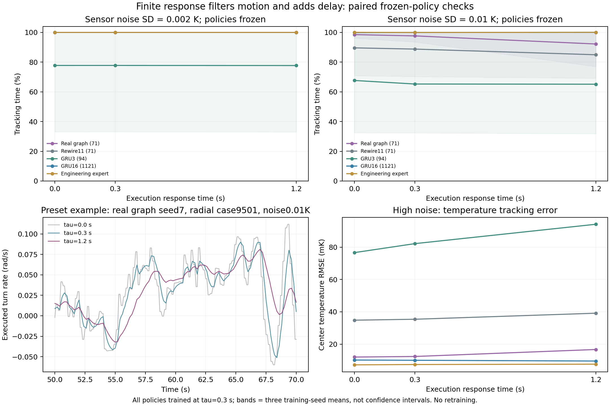

# 有限执行响应：平滑收益与迟滞代价

日期：2026-10-24。本批冻结已有控制器，只改变执行响应和测温噪声，不追加训练。

## 当前结果

有限响应使实际转向更平滑，但没有普遍提高追踪。高噪声时，真实图随着响应变慢，从98.45%下降到92.15%；GRU16在这组条件中仍接近100%。当前证据支持平滑与迟滞之间的权衡，不能推出约束越强越好，也不能推出训练样本收益或能耗降低。

## 配对设计

冻结全节点真实图、重排图11、GRU3和GRU16，每模型3个训练种子；均使用32条轨迹、2048次更新、执行响应0.3秒的已有检查点。改变执行响应为0／0.3／1.2秒，测温噪声标准差0.002／0.01 K。每条件使用种子9501／9502、直线和圆形场共4条120秒病例。

神经模型共288条轨迹，工程教师与盲对照48条，共336条。各条件共享初态、噪声随机流、传感和控制时钟；模型在各自实际轨迹上接收局部头部读数。这里包括执行器变化产生的访问分布变化，不能将所有差异只归因于直接滤波。只使用一张重排图作为机制参照，不代表随机图总体。

## 平均追踪时间比例

| 模型 | 噪声0.002 K：响应0／0.3／1.2秒 | 噪声0.01 K：响应0／0.3／1.2秒 |
| --- | --- | --- |
| 真实图71参数 | 100%／100%／100% | 98.45%／97.59%／92.15% |
| 重排图11，71参数 | 100%／100%／100% | 89.54%／88.72%／84.91% |
| GRU3，94参数 | 77.71%／77.72%／77.66% | 67.62%／65.23%／65.10% |
| GRU16，1,121参数 | 100%／100%／100% | 99.85%／99.94%／100% |
| 工程教师 | 100%／100%／100% | 100%／99.88%／100% |

盲对照各条件均37.79%。噪声条件相同的差异是病例和训练种子上的配对结果；接近100%的微小差异不作为统计优势。图中范围是三个训练种子的均值范围，多个病例不替代独立训练。

## 数值检查与指标边界

额外12条冻结轨迹比较物理步长0.01与0.005秒，保持传感0.1秒、控制0.2秒。所选两模型、三个响应条件的追踪比例均未变化。0.2秒共同观察尺度的角速度变化RMS比值接近1。

即时执行器的角速度包含阶跃，在更细物理网格上计算加速度RMS会约增加到原来的1.414倍；该量随网格变化，不能用它证明物理收益。有限响应的相同RMS比值接近1。原始诊断量仍保留，正式图表没有以该网格相关数值推断机械能或代谢。

模型目前没有肌肉力、力矩、弹性或绝对阻力标定。图中的平滑转向是该执行器模型的性质，追踪分数反映它与冻结策略配合后的结果；这些量不能代替真实软体能耗。

## 对实际训练的意义

本批直接检验控制稳定性和抗噪表现。监督学习中，如果输入窗口和教师标签不变，改变执行器不会改变离线损失。物理约束对训练的作用需要通过示范分布、学习器访问轨迹、策略训练目标或环境交互体现，并分别控制优化充分程度。现有结果提示迟滞代价值得保留为对照，不支持预先假设约束一定帮助训练。

## 材料

[完整结果](assets/tracking-response-2026-10-24/results.json)、[设计](assets/tracking-response-2026-10-24/design.json)、[步长检查](assets/tracking-response-2026-10-24/dt-check.json)、[摘要](assets/tracking-response-2026-10-24/summary.json)、[源码、检查点和预定示例轨迹](assets/tracking-response-2026-10-24/models-and-sources.zip)及[校验](assets/tracking-response-2026-10-24/manifest.json)均已保存。脚本为`analysis/tracking_response_probe.py`和`analysis/check_tracking_response_dt.py`，采用原目录布局并拒绝覆盖已有实验。
