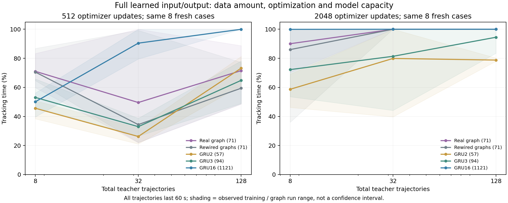

# 数据量、优化次数与模型容量

日期：2026-10-24。承接[连接布局与接口比较](tracking-topology-2026-10-24.md)。本批为固定接口下的监督示范学习，不是强化学习交互效率。

## 当前结果

增加优化后，真实图相对重排图的早期差距明显缩小。32条轨迹、2048次更新时，真实图与全部三张重排图都在本批新病例上达到100%追踪；8条轨迹时，GRU16约99.9%，真实图约90%。本任务尚未显示真实连接比充分训练的普通网络更省示范数据。

小容量GRU表现较弱，说明参数数量本身不能完整描述表达能力与优化难度。71参数的速率回路与57／94参数的GRU只有参数规模接近，内部状态数、门控运算和计算量仍然不同。真实与重排速率网络之间才是严格的连接布局对照。

## 设计与执行

固定全节点可训练输入输出、去均值且保留均值的编码、4秒历史、感觉权限、动作边界、Adam学习率0.003与batch64。真实／重排回路71参数，GRU2为57、GRU3为94、GRU16为1,121参数。

每场4／16／64条60秒轨迹，共8／32／128条，使用与父实验完全相同的嵌套整轨迹子集。每个模型在512、2048次更新取检查点，训练种子7／17／27，重排图种子11／22／33交叉。验证轨迹另有16条，训练预算未包含验证及教师开发成本。

共63个训练配置、126个评估端点，其中54次为新增拟合、9次完整复用已有2048更新结果；36次新增拟合的前512点验证指标与父实验逐项相同。已有端点不作为额外独立训练重复计数。两个单线程CPU进程分别处理速率网络和GRU，全部拟合完成后才统一查看种子9301—9304、两个场共8条120秒新病例。

## 新病例的追踪时间比例

每个真实图／GRU为3个训练种子均值；重排均值为3图×3训练种子。图中阴影为实际范围，不是置信区间，九次重排训练不能代替九张独立随机图。

| 模型 | 512更新，8／32／128条 | 2048更新，8／32／128条 |
| --- | --- | --- |
| 真实图71参数 | 71.03%／49.58%／71.53% | 90.04%／100%／100% |
| 重排图71参数 | 70.51%／34.38%／59.42% | 85.99%／100%／100% |
| GRU2，57参数 | 45.63%／26.20%／73.21% | 58.68%／79.90%／78.79% |
| GRU3，94参数 | 53.08%／32.97%／64.83% | 72.24%／81.38%／94.48% |
| GRU16，1,121参数 | 50.11%／90.42%／99.97% | 99.93%／100%／100% |

8条轨迹、2048更新下，三张重排图分别为90.49%、88.82%、78.65%，真实图90.04%，没有一致领先。32与128条轨迹时，各图的全部三个训练种子均达到本批指标上限。

追踪指标仍为温差≤0.05 K、与静态等温线切向夹角≤25°的时间比例；起点接近目标等温线，100%不代表任意初态或任意环境成功。

## 解释范围

512更新时，8条轨迹上的真实图平均分曾高于GRU16；增加到2048更新后排序改变。因此，固定一次较短优化预算就宣布样本效率优势会产生误导。这里能报告给定数据和计算预算的经验表现，不能估计一般样本复杂度，也不能认为2048次更新对所有模型都已充分。

只使用一组固定嵌套数据子集，尚未检验数据抽取种子的波动。八个新病例属于小规模探索，现已查看。所有比较采用工程化全节点接口，结论不覆盖真实感觉投影、神经元生物动态、培养温度记忆或真实身体。

后续已继续检查[冻结控制器的物理响应](tracking-response-2026-10-24.md)，并对动态温度场重新定义评价指标。机制设计依据另见[神经证据记录](../neuron-mechanism-evidence.md)。

## 复现材料

[摘要](assets/tracking-surface-2026-10-24/summary.json)、[联合设计](assets/tracking-surface-2026-10-24/joint-design.json)、[全部检查点、源码与执行记录](assets/tracking-surface-2026-10-24/models-and-sources.zip)、[校验清单](assets/tracking-surface-2026-10-24/manifest.json)均已保存。两个模型分组的拟合结果与新病例结果也单独保存于同目录。

`analysis/tracking_learning_surface.py`分为`--stage fit`与`--stage evaluate`，固定模型列表和源码哈希后可用`--resume`恢复中断。首次拟合依赖父实验及教师缓存，先按布局比较报告建立父实验，或恢复归档中的原目录布局。所有126个端点已打包，冻结评估可直接读取相应检查点；复用端点的来源与新增拟合标记保留在JSON中。
