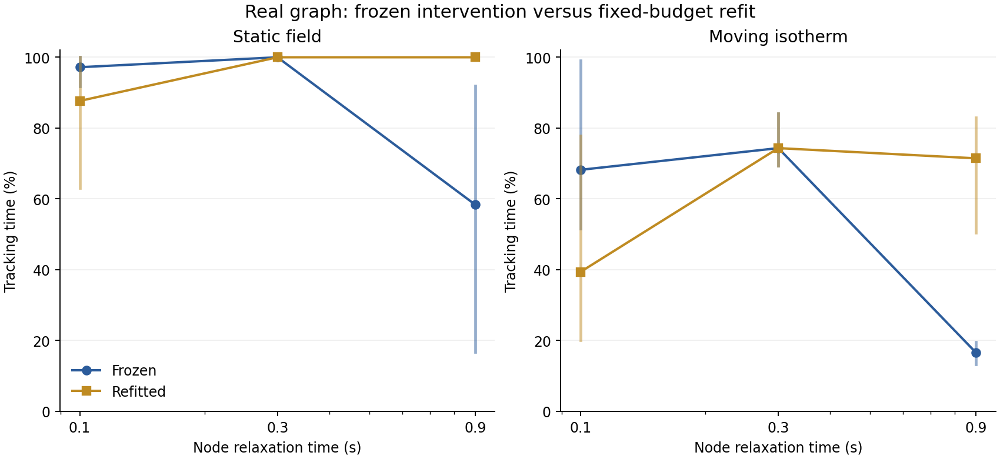
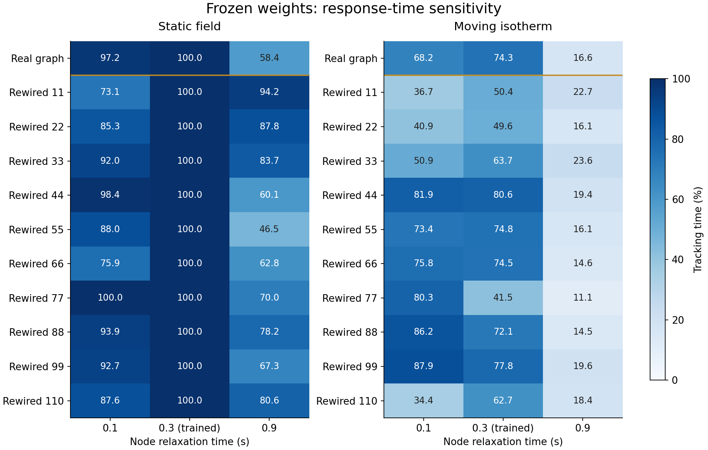

# 回路时间常数：冻结干预与重新训练

日期：2026-10-25。

## 研究问题

此前10张重排图扩展未显示真实图稳定占优。本轮转向机制问题：追踪是否依赖已训练回路的特定响应速度？改变响应速度后表现下降，是已训练参数不再适配，还是模型在该条件下学不会？

这里的时间常数是简化速率回路的节点响应参数，不是已经标定的生物神经时间常数。所有节点统一改变，化学递归、gap耦合与输入驱动通过同一个积分系数更新。

## 检验什么、为什么这样检验

**冻结干预。** 保持权重、连接、输入、动作和四秒历史窗口不变，把原0.3秒时间常数改为0.1／0.3／0.9秒。覆盖真实图、全部10张互不相同的重排图、3个训练种子；另有不改变的GRU16、工程教师和盲对照。共104个模型／种子／条件、1248条轨迹。

新病例10501／10502，线性和径向两种场；动态波幅0.05 K、周期60秒，初相0与π/2。每个条件4条静态轨迹、8条动态轨迹，均120秒。径向物理平均半径固定5 mm，按初相调整起点。条件在观察结果前保存，不按成绩选图；静态、动态及20—120秒区间分别报告。

**重新训练诊断。** 另对真实图在0.1和0.9秒下各训练3个种子，共6次新拟合。使用原32条静态教师示范、2048次更新，Adam参数、初始权重生成规则和批次抽样规则相同。六次拟合全部完成后才检查行为。0.3秒复用原模型；该小批次仅检验真实图的可学习性，没有重新比较各拓扑的学习优势。

## 真实图结果

追踪百分比表示满足任务温差与运动方向条件的时间比例。先对病例、场与初相平均，再对三个训练种子平均；静态和动态任务的几何评价不同，主要比较同一任务内的配对变化。

| 时间常数（秒） | 处理 | 静态追踪 | 动态追踪 | 动态20秒后 |
| --- | --- | --- | --- | --- |
| 0.1 | 原0.3秒权重，冻结后改变时间常数 | 97.19% | 68.22% | 67.82% |
| 0.1 | 在该时间常数下重新训练 | 87.67% | 39.40% | 32.21% |
| 0.3 | 原0.3秒权重，冻结后改变时间常数 | 100.00% | 74.35% | 72.90% |
| 0.3 | 在该时间常数下重新训练（复用原模型） | 100.00% | 74.35% | 72.90% |
| 0.9 | 原0.3秒权重，冻结后改变时间常数 | 58.38% | 16.57% | 5.99% |
| 0.9 | 在该时间常数下重新训练 | 100.00% | 71.46% | 68.91% |

将已训练模型直接改慢至0.9秒造成明显下降，但在0.9秒下重新训练后，静态追踪恢复100%，动态表现恢复到约71.5%。这说明冻结后的下降不能直接解释成较慢回路无法完成任务。

0.1秒也没有显示普遍收益。冻结真实图时，种子7的动态表现从约69.5%提高到99.0%，另两个种子下降；重新训练后的动态均值约39.4%，其中三个种子约20.0%、77.8%、20.4%。这些差异提示，在当前静态示范与固定优化预算下，时间常数改变会影响拟合、闭环行为和动态迁移之间的关系；本轮尚未定位到具体连接或神经元机制。



图中点和线为三个训练种子均值，竖线是三个种子的最小值至最大值，**不是置信区间**。0.3秒两条曲线复用同一组原模型。

## 全部图的冻结干预

| 模型 | 0.1秒动态追踪 | 原0.3秒动态追踪 | 0.9秒动态追踪 |
| --- | --- | --- | --- |
| real8 | 68.22% | 74.35% | 16.57% |
| rewired8-11 | 36.74% | 50.45% | 22.71% |
| rewired8-22 | 40.86% | 49.62% | 16.13% |
| rewired8-33 | 50.91% | 63.66% | 23.63% |
| rewired8-44 | 81.90% | 80.56% | 19.37% |
| rewired8-55 | 73.37% | 74.77% | 16.15% |
| rewired8-66 | 75.84% | 74.49% | 14.56% |
| rewired8-77 | 80.32% | 41.48% | 11.11% |
| rewired8-88 | 86.23% | 72.07% | 14.51% |
| rewired8-99 | 87.89% | 77.77% | 19.63% |
| rewired8-110 | 34.41% | 62.74% | 18.45% |



同一批原权重直接改快至0.1秒后，10张重排图中5张动态均值提高、5张下降；真实图下降约6.13个百分点。重排图77由41.48%升至80.32%，三个训练种子均提高，分别约21.71、46.66、48.18个百分点。这说明固定响应速度下的连接布局排名依赖响应动态；尚不能据此认定具体连接机制或最优时间常数。

热图每格为三个训练种子均值；逐种子数值、配对变化及分场结果保存在[摘要](assets/tracking-timescale-2026-10-25/summary.json)。没有用轨迹数代替独立图或训练种子数量，也没有根据本批结果挑选所谓最优时间常数。

## 结果意味着什么与局限

- **已验证：** 在当前简化回路里，节点响应速度是行为的重要条件；训练后的参数与响应时间需要配合。冻结干预与重新训练回答不同问题，不能互相替代。
- **尚未验证：** 哪个时间常数最优、真实图是否比重排图更容易适配，以及时间常数与身体执行延迟是否存在有益匹配。真实图重新训练只覆盖两个新时间常数，不能推广为全图比较。
- 四秒输入历史的均值特征仍提供历史信息，且回路每次查询从零状态重算。因此不能把改变节点时间常数描述成只改变总记忆长度。
- 训练数据来自静态教师，动态场只用于冻结迁移评估。仅3个训练种子、每场2个病例和2个初相，全部为探索诊断；没有进行总体显著性推断。重新训练诊断使用相同评估病例，不作为独立确认性测试。
- 没有新增生物时间尺度标定、强化学习交互效率或弹性身体结论。

## 验证与复现

干预测试检查所有学习张量保持一致、原模型不被修改、单次更新满足响应方程、padding无影响、0.3秒恒等干预精确复现原输出，并拒绝非法时间常数。完整测试200项通过，14条既有依赖弃用警告。实验源码及检查点哈希检查通过。另对原0.3秒设置重跑初始及128次更新，验证结果与原批次完全一致；这只是流程复现检查，不计为独立拟合。

主实验支持中断续跑：

```bash
PYTHONPATH=src python3 analysis/probe_tracking_timescale.py
# 已存在中断批次时：
PYTHONPATH=src python3 analysis/probe_tracking_timescale.py --resume
PYTHONPATH=src python3 analysis/refit_tracking_timescale.py
MPLCONFIGDIR=/tmp/worm-matplotlib PYTHONPATH=src python3 analysis/summarize_tracking_timescale.py
MPLCONFIGDIR=/tmp/worm-matplotlib PYTHONPATH=src python3 analysis/report_tracking_timescale.py
```

首次运行依赖前一批训练记录和固定教师数据缓存。已公开的归档可独立复查权重、设计与结果：

- [设计](assets/tracking-timescale-2026-10-25/design.json)、[冻结结果](assets/tracking-timescale-2026-10-25/results.json)、[摘要](assets/tracking-timescale-2026-10-25/summary.json)
- [冻结源码及原权重](assets/tracking-timescale-2026-10-25/models-and-sources.zip)
- [重新训练设计](assets/tracking-timescale-2026-10-25/refit-design.json)、[完整记录](assets/tracking-timescale-2026-10-25/refit-results.json)、[摘要](assets/tracking-timescale-2026-10-25/refit-summary.json)、[源码及新权重](assets/tracking-timescale-2026-10-25/refit-models-and-sources.zip)
- [SHA256校验](assets/tracking-timescale-2026-10-25/manifest.json)

下一项先检查0.1秒条件下的优化与静态闭环失败，使用预先固定的更长更新预算及配对初态诊断，区分未充分拟合与迁移问题；随后将重新训练扩展到全部重排图，再安排节点响应与执行响应的交叉比较。不同时间常数下都应分别报告静态胜任程度和动态表现，不能只比较迁移排名。
