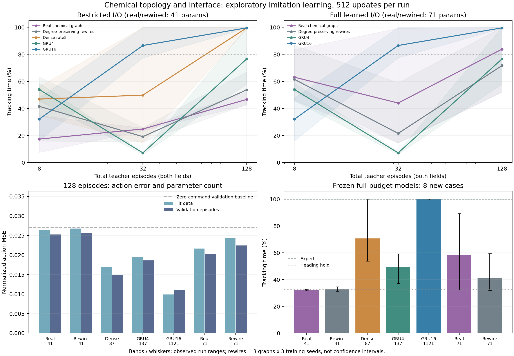
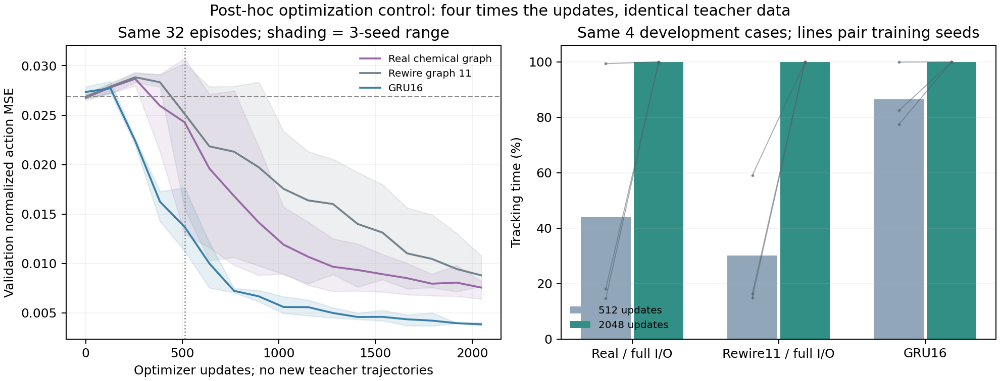

# 二维追踪：连接布局、感觉接口与优化预算

日期：2026-10-24。性质：探索性监督模仿学习，不是强化学习样本效率或生物功能复现。

## 当前判断

当前不能声称真实回路更节省训练样本。真实图在全节点输入输出、512次更新的部分条件中优于三张重排图，但该差异依赖接口、训练种子和优化预算。限制输入输出的真实与重排模型在新病例上均接近盲对照。普通 GRU16 提供了有效且表现更好的基准。

同样32条示范轨迹，将优化从512次增加到2048次，真实图、重排图11和 GRU16 的九个冻结模型在八个新病例上均达到100%追踪时间比例。这证明这组数据足够让这些模型学会任务，512次更新下的失败不能直接解释为数据不足。也不能由此推断所有重排图在更多更新后都同样成功。

## 对照对象与共同条件

沿用[普通神经网络基准](neural-tracking-2026-10-24.md)的规定运动学场景、因果41样本窗口、保留均值的去均值编码、局部头部温度和运动相位。所有神经模型均不读取真实位置、朝向、温度梯度或未来信息。

| 模型／接口 | 可训练参数 | 改变与限制 |
| --- | ---: | --- |
| 真实经典8节点，限制接口 | 41 | 温度进入 AFD，sin/cos相位进入 AIY，RIA 输出 |
| 化学度保持重排，限制接口 | 41 | 只改变化学连接布局 |
| 全连接8节点，限制接口 | 87 | 相同速率神经元与接口，连接数更多 |
| 真实／重排8节点，全节点接口 | 71 | 所有节点学习感觉投影，所有节点参与输出 |
| 普通 GRU4 | 137 | 相同观测和历史，容量不匹配 |
| 普通 GRU16 | 1,121 | 相同观测和历史，容量不匹配 |

化学连接来自固定版本 Cook2019 数据，只使用连接是否存在，不把 EM 截面数当成突触效能。化学符号和强度均可学习，gap 为对称非负扩散；真实与重排共享 gap、节点标记、每节点化学入出度、自连接、感觉入口、输出、神经动态、参数数量和初始参数向量。重排种子11、22、33产生不同布局，分别接受125、108、107次交换；有限交换不代表均匀随机图采样。

速率神经元时间常数固定0.3秒、传感间隔0.1秒，这是工程选择。每次决策从零状态重放有效历史，padding不推进神经状态。小随机偏置和非零输出初始化解除之前的严格对称问题，不保证所有结构都容易优化。AFD/AIY/RIA 接口本身也属于工程假设，不能因节点名称真实就称生物复现。全节点接口同时增加30个参数，不能把接口间的全部改善单独归因于输入或输出位置。

## 数据、执行和评估

教师数据与上一次普通网络实验逐字节摘要一致。训练轨迹固定为每场64条、每条60秒；所有模型共享同一组完整轨迹，并取每场前4、16、64条作为嵌套子集。相应总轨迹数为8、32、128，标签数为2,408、9,632、38,528。窗口高度相关，不能当作独立轨迹。固定离线验证另有16条轨迹、4,816个标签；表中训练预算不含验证和教师开发成本。

主要比较共99组：限制接口的7个模型条件×3数据预算×3训练种子，以及全节点接口的4个图条件×3预算×3训练种子。训练种子7、17、27与随机图种子分别交叉。每组512次 Adam 更新，学习率0.003、batch64；无追加访问轨迹、无最高分检查点选择。每种预算均有32,768次带放回窗口抽取，因此少数据组有更多重复暴露，不能将结果当成一般样本复杂度。

另保留8次可训练性预检和9次后验延长优化对照。8次预检中7次与主矩阵是确定性重复，不增加独立样本数。两个主矩阵分别在单CPU线程进程中并行执行，不据墙钟时间判断计算效率。

开发行为评估使用种子8101、8102，在直线／圆形场各2条120秒轨迹。预检已使用这些病例，因此仅作开发集。冻结主矩阵检查点后，在种子9101—9104的八条新病例上检查最大数据预算的33个模型。检查计划在主矩阵完成前保存；病例现已查看，后续不能重复称未经使用的最终测试。

追踪比例是中心温差≤0.05 K、方向与等温线切向夹角≤25°同时成立的时间比例，起点在目标等温线附近。100%不表示零温差、任意初态寻温、真实软体力学或机械能耗结论。

## 固定512次更新的结果

表中为开发病例上的追踪时间比例均值。真实图和普通网络各3个训练种子；重排为3张图×3个训练种子。九次重排训练不能当成九张独立随机图。

| 模型／接口 | 8条轨迹 | 32条轨迹 | 128条轨迹 |
| --- | ---: | ---: | ---: |
| 真实图，限制接口 | 17.38% | 24.83% | 46.70% |
| 重排图，限制接口 | 41.63% | 19.17% | 53.79% |
| 全连接8节点，限制接口 | 46.95% | 49.87% | 99.58% |
| GRU4 | 54.09% | 7.18% | 76.62% |
| GRU16 | 32.07% | 86.56% | 99.59% |
| 真实图，全节点接口 | 63.13% | 44.03% | 83.85% |
| 重排图，全节点接口 | 61.56% | 21.59% | 71.70% |



全节点接口下真实图的平均分高于当前三张重排图，属于值得保留的条件性观察；限制接口下不成立，也没有整体超过 GRU16。部分曲线不随轨迹数单调上升，仅凭固定更新数不能判断是数据覆盖、拟合充分程度还是访问分布造成差异。

在128条轨迹、512次更新的冻结模型上，八个新病例结果如下：

| 模型／接口 | 新病例平均追踪 | 不同训练／图运行的范围 |
| --- | ---: | ---: |
| 真实图，限制接口 | 32.10% | 31.59%—32.69% |
| 重排图，限制接口 | 32.69% | 31.34%—34.56% |
| 全连接8节点，限制接口 | 70.73% | 53.85%—100.00% |
| GRU4 | 49.36% | 36.99%—59.15% |
| GRU16 | 100.00% | 100.00%—100.00% |
| 真实图，全节点接口 | 58.21% | 32.35%—89.13% |
| 重排图，全节点接口 | 41.02% | 32.03%—59.31% |

同组工程教师100%，保持朝向对照32.44%。全节点真实图仍显示相对这三张重排图的条件性改善，但训练种子波动很大。限制接口模型的训练与验证动作误差也接近零转向基准，不能将低分只归于泛化问题。图中阴影和误差线是观察到的范围，不是置信区间。

## 数据固定、增加优化次数

发现32条轨迹时部分模型表现较差后，固定这组数据、初始化、采样序列和学习率，仅增加到2048次更新。选择全节点真实图、重排图11和 GRU16，各3个训练种子。前512次的验证指标与原实验逐项相同，排除了换数据或换随机初始化造成的比较差异。



| 模型 | 开发病例：512→2048更新 | 同八个新病例：512→2048更新 |
| --- | ---: | ---: |
| 真实图，全节点接口 | 44.03%→99.83% | 55.22%→100.00% |
| 重排图11，全节点接口 | 30.10%→100.00% | 49.67%→100.00% |
| GRU16 | 86.56%→99.96% | 99.97%→100.00% |

八个新病例的这一比较为后验配对检查，九个模型均在查看病例结果前已训练完成，没有据此追加拟合。数据不变即可改善，说明原优化预算不足是重要因素；这不抹去早期学习速度可能存在的差异，也不证明全部重排图最终能力相同。延长优化只覆盖图11，并且固定的一个嵌套数据子集仍限制结论范围。

## 下一项研究

1. 在固定接口下交叉比较数据量与更新次数，保留全部三张重排图及独立训练种子，区分数据需求和优化需求。开发病例及当前新病例都不再作为未经查看的确认性测试。
2. 增加参数数量接近的普通 GRU：当前相同输入下 GRU2为57、GRU3为94个参数，作为71参数回路的容量参照；GRU16继续作充分可学习基准。不要因参数小就直接归因于生物先验。
3. 输入输出位置与参数数量分别控制，才讨论哪种感觉—运动配合产生作用。真实神经元的动态、连接符号与时间常数需另有证据并独立消融。
4. 在控制器已能充分学会任务后，再交叉比较有限执行响应、动作限制与身体因素；当前没有检验物理约束对训练的收益。

## 材料与复现

公开材料包包含全部116次执行的设计、结果、检查点与源码快照，以及新病例、训练误差和优化配对检查；原始重叠窗口数组未重复打包，可按固定种子再生成。详见[归档索引](assets/tracking-topology-2026-10-24/archive-index.json)、[完整归档](assets/tracking-topology-2026-10-24/models-and-sources.zip)、[结果摘要](assets/tracking-topology-2026-10-24/summary.json)及[文件校验](assets/tracking-topology-2026-10-24/manifest.json)。首次检查设计保存时遇到源码绝对路径复制错误，未执行训练或评估；失败记录保留，成功检查使用更正后的独立设计。

```bash
PYTHONPATH=src python3 analysis/compare_tracking_topology.py --mode budgets --output results/topology-repeat --seeds 7 17 27 --budgets 4 16 64
PYTHONPATH=src python3 analysis/compare_tracking_topology.py --mode budgets --output results/topology-full-repeat --models real8 rewired8-11 rewired8-22 rewired8-33 --interface full --seeds 7 17 27 --budgets 4 16 64
PYTHONPATH=src python3 analysis/compare_tracking_topology.py --mode budgets --output results/topology-optimization-repeat --models real8 rewired8-11 gru16 --interface full --seeds 7 17 27 --budgets 16 --updates 2048
```

训练程序拒绝覆盖已有输出，并核对缓存指纹。新病例检查先运行 `analysis/diagnose_tracking_topology.py --plan-only` 保存设计，再用同一组 `--roots`、`--output`执行；原优化配对脚本保留原目录布局。绘图脚本支持指定各结果目录，需同时提供已完成的矩阵、检查与优化结果。

新增六项检查覆盖有效历史、初始梯度、图／参数匹配、感觉投影与整轨迹预算选择；完整测试182项通过，14条既有 Matplotlib／pyparsing 弃用警告。旧普通网络与场景源码未修改，其原始实验哈希保持有效。
